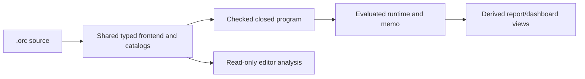
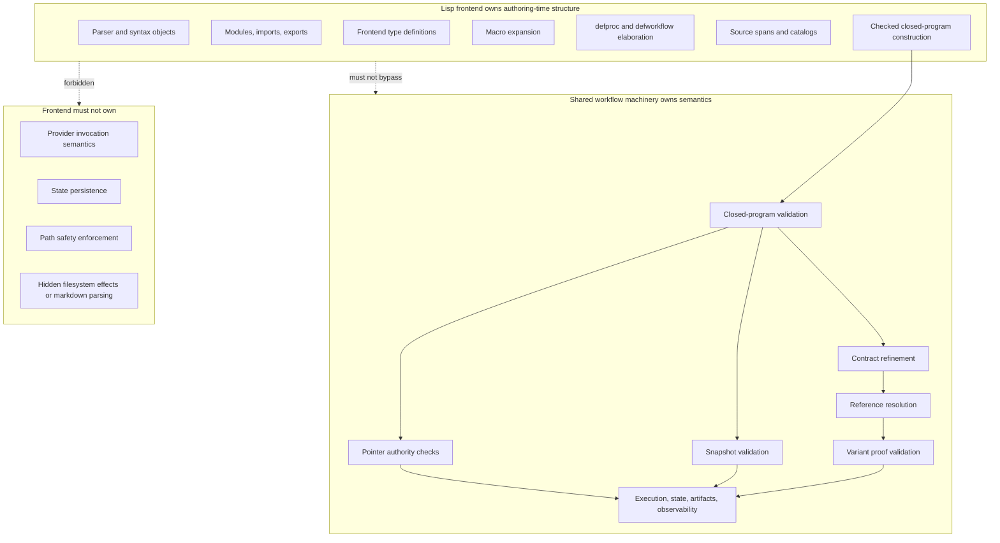
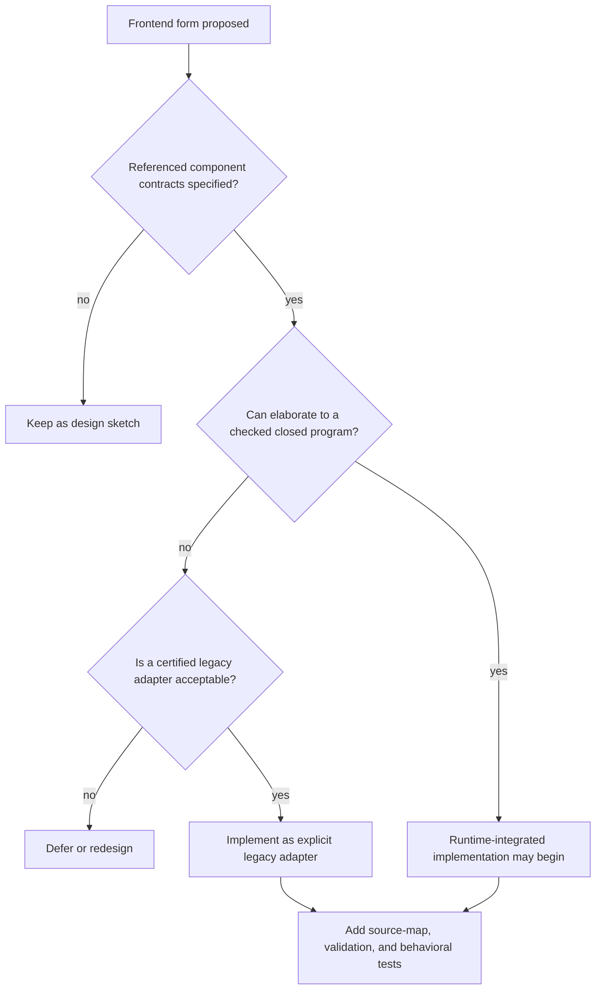
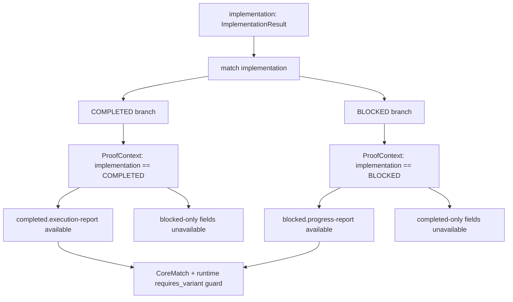
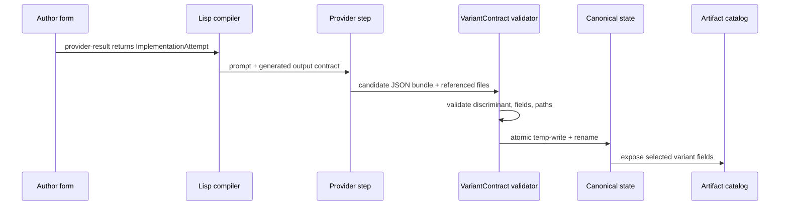
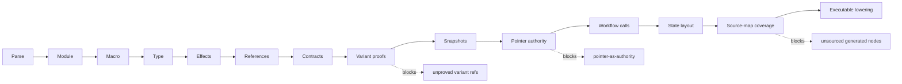

# Workflow Lisp Frontend Specification and Design

Status: accepted baseline / umbrella frontend contract
Target substrate: checked closed-program execution at 2.35/2.36 and bounded
2.37/2.38 extensions, target-2.39 procedure authoring/phased delivery and
target-2.40 serial typed host input; source/import/tooling
admission starts at 2.35; the flat emitter is retired
Primary purpose: composable, typed, procedural authoring of deterministic workflows  
Non-purpose: replacing the runtime, weakening validation, or generating brittle YAML-shaped code

Execution scope: [executor retirement](workflow_lisp_executor_retirement.md)
and [CLI](../../specs/cli.md) govern executable admission. Historical lowering,
IR/source-map emissions and effect descriptions below remain design/type
history, not available flat builds. Source spans, catalogs and read traces
remain part of typed diagnostics and LSP for admitted source at 2.35 or newer.
Every imported module must meet that floor. Pre-2.35 analysis compatibility is
retired under the [source-floor contract](workflow_lisp_executor_retirement.md#source-floor-235),
not selected by an old imported header.

Lifecycle note: this document is the parent language contract for Workflow
Lisp. Focused companion contracts refine current ProcRef, compiler
middle-end, runtime migration, and composition/stdlib behavior:
[Workflow Lisp ProcRef And Partial Application Delta](workflow_lisp_proc_refs_partial_application.md),
[Workflow Lisp Core Calculus And Compiler Middle-End](workflow_lisp_core_calculus_middle_end.md),
[Workflow Lisp Runtime Migration Foundation](workflow_lisp_runtime_migration_foundation.md),
[Workflow Lisp Post-Foundation Composition And Stdlib Migration](workflow_lisp_post_foundation_composition_stdlib_migration.md),
[Workflow Lisp Procedure-First Reuse Contract](workflow_lisp_procedure_first_reuse_contract.md),
and
[Workflow Lisp Native Transportable Returns And Typed Result Guidance](workflow_lisp_native_transportable_returns.md),
and
[Workflow Lisp Pure List Traversal](workflow_lisp_pure_list_traversal.md),
and
[Workflow Lisp Provider Live Binding](workflow_lisp_provider_live_binding.md),
and
[Workflow Lisp Provider Peer Messaging](workflow_lisp_provider_peer_messaging.md).

The bounded target-2.38 [Agent Sessions extension](workflow_lisp_agent_sessions.md#authoring-and-composition)
admits run-local allocation and sequential typed native turns. It does not
admit the historical context-capture surface below or immutable native snapshots.

Accepted target-2.39 contract: [effect-ledger simplification](workflow_lisp_effect_ledger_simplification.md)
owns optional identity-aware effect restrictions and their migration.
Inference-default restrictions, caller-owned inline composition, finite private-form
admission and inferred inspection use the existing frontend and evaluated runtime.
The [simplification plan](../plans/2026-10-15-orc-simplification-roadmap-extension.md#target-239-selected-implementation)
owns bounded consumer acceptance and remaining verification gates. Current
target-2.30 resolved-inline [pure-call composition](workflow_lisp_pure_call_composition.md)
is summarized in §8.6 below; it does not change authored effect declarations.

Historical target-2.31 syntax/type contract (context capture is excluded from
current evaluated execution): the portable ordinary-call slice of
[provider context values](workflow_lisp_provider_context_values.md):
`provider-result :context <Context expression>` starts a fresh call with quoted
history; `:capture-context :portable` returns `Contextual[T]` while `:returns T`
continues to describe only the model's result. `Context` and `Contextual[T]`
are ordinary closed structural values, not handles or a second memory service.
Supported private/generic, collection, loop and pure-transformation positions
use the existing value pipeline. Ambiguous flattened private field paths still
reject. Capture is opt-in and limited to the reviewed Codex exposed-event codec;
native and cross-provider continuation are not admitted. Normative transport
and atomic publication contracts are in [Providers](../../specs/providers.md)
and [Step IO](../../specs/io.md).

Historical target-2.32 syntax/type contract (that `request-input` execution and
answer/cancel mutation are retired; current 2.40 behavior is separate): one host-mediated expression,
`(request-input question)`. Its question is exact `String`; its fixed ordinary
result is `HumanReply = ANSWERED(text String) | CANCELLED`; and it infers the
subject-free `host-input` effect. It lowers to the existing validated pipeline
as one `request_input` leaf, not a provider/command call or a general
continuation primitive. The root durably suspends for one request; answer or
cancel only settles the request, and ordinary resume validates and consumes the
same scoped leaf result. The normative durable-state and CLI contracts are in
[State](../../specs/state.md) and [CLI](../../specs/cli.md).

Current target-2.40 [durable host input](workflow_lisp_durable_host_input.md)
uses `(request-input question [:returns A] [:timeout-sec duration] [:show (path ...)])`
and the ordinary imported generic `std/host::HostReply[A]`: `ANSWERED(value A, by
String)`, `CANCELLED(by String)`, `EXPIRED`. Brackets here mark optional operands,
not literal source syntax. Answer `A` is `String`, an enum or a fully transportable
closed union. The question is a string expression or directly applied typed
`defprompt`. An explicitly declared prompt answer contract supplies omitted
`:returns`; raw questions and prompts with only an implicit return require it.
An explicit answer contract must agree with the prompt. Imported prompt types
retain their canonical declaring owner through specialization and typed export;
caller-local names cannot rebind them. Show operands are typed relpaths,
not strings; timeout is an exact positive integer expression. The checker
retains full instantiated answer/reply constraints through closed compilation,
transport validation, replay and branch refinement.

The inferred effect remains subject-free `(host-input)`. Definition origins
2.39 and newer infer omitted restrictions; explicit restrictions still constrain
transitive effects. Target 2.40 retains 2.39 composition, finite source and phased
provider admission. Requests are serial within the same memo and refuse in pure
contexts, transitive parallel workers and child `run-ref` programs. Earlier
targets do not acquire evaluated host input by importing `HostReply`.
Normative rules are in [DSL](../../specs/dsl.md#evaluated-durable-host-input-target-240),
[state](../../specs/state.md#evaluated-durable-host-input-target-240) and
[CLI](../../specs/cli.md#evaluated-host-input-target-240).
The [bounded Python frontend](python_workflow_frontend.md) emits these same
ordinary forms; it adds no runtime type/effect authority.

Target 2.33 adds first-order generic unions (§8.5) and the `std/improve`
library module (§87.1).

Target 2.34 adds the implemented [numeric surface](workflow_lisp_numeric_surface.md).
The pipeline described here was the runnable route through 2.34; those
entries are now retired.
Targets 2.35 and 2.36 select [evaluated execution](workflow_lisp_evaluated_execution.md)
through public `compile`, `run`, `resume` and `invalidate`. The admitted
first-release classes at 2.35 are delivered. The target-2.36 W3 additions are
implemented at 2.36; the [Phase 4c closeout](../reports/2026-10-07-evaluated-execution-phase-4c-w3-closeout.md) owns bounded public consumer and qualification evidence.
Target 2.37 bounded parallel map is qualified through the public command line
with stand-in providers and commands, not yet with a real provider; use the
[recipe and its limits](../lisp_workflow_drafting_guide.md#173-parallel-map-target-237)
and the [open items](../reports/2026-10-07-evaluated-execution-phase-5-closeout.md#addendum-2026-11-12-public-qualification).
Target 2.38 separately implements bounded [Agent Sessions](workflow_lisp_agent_sessions.md):
run-local allocation and typed native turns. [PQ-1a](../reports/2026-10-14-agent-sessions-pq1a-qualification.md)
records deterministic proofs and bounded adapter smokes; the real-provider consumer
comparison (PQ-1c) priced the agent variant at 1.4 to 1.7 times the plain handoff on one
four-turn pattern and made no quality claim ([result](../../experiments/pq1c/README.md#result)).

Design principles: this specification follows the language-wide principles in
[Workflow Language Design Principles](workflow_language_design_principles.md).
The compact operating rule is:

- design for typed transitions, not brittle gates;
- structured bundles are authority and reports are views;
- artifact values are authority and pointer files are representations;
- freshness requires snapshot/hash evidence, not mtime;
- validate before committing canonical state;
- contracts may only narrow;
- type specificity is opt-in: structural or general transportable contracts
  may narrow later, and nominal taxonomies are not an admission requirement;
- variant-specific references require proof;
- frontends elaborate typed semantics into checked closed programs; views never become compiler authority;
- macros cannot hide effects;
- procedures compose workflow behavior;
- state paths are derived from contexts, not hand-managed;
- legacy parsing and pointer conventions are quarantined;
- every generated semantic node is source-mapped.

The Lisp frontend is a typed procedural authoring language. Current executable
entries use the shared typed frontend and checked closed-program route:

```text
Lisp source
  -> frontend AST
  -> macro/import expansion and ProcRef specialization
  -> typecheck and effect/proof analysis
  -> WCC/typed elaboration and normalization
  -> checked closed program
  -> evaluated runtime and memo
  -> derived report/dashboard views
```

Admitted library-only imports and editor analysis stop at the typed/catalog
boundary where appropriate. Pre-2.35 source imports and analysis refuse.
Neither path emits a flat executable bundle. WCC/schema-2 and schema-1
remain historical compiler-owner identities for retained typed decisions;
old lowerers, flat emitters and historical-run replay are retired.



The design is grounded in the v2.14 handoff's guardrails: the frontend must
generate proven core semantics rather than hide unresolved semantics; the core
substrate includes `materialize_artifacts`, `pre_snapshot`, `variant_output`,
`select_variant_output`, `requires_variant`, `SnapshotRef`, and variant-aware
artifact references; and pointer files are representations, not semantic
authority.

Diagram index:

- Pipeline and authority boundary: introduction.
- Ownership boundaries and implementation gate: Section 0.
- Variant proof flow: Section 11.
- Structured provider result flow: Section 22.
- Standard-library lowering map: Part VI.
- Compiler intermediate and source-map flow: Part VIII and Section 74.
- Validation pass sequence: Section 59.

## How To Read This Document

This is the accepted language baseline. It records current semantic rules and
versioned source/type contracts; a source version does not imply current
executable admission. Explicitly proposed library sketches require their focused
design and implementation gates. Historical rollout, flat projections and example
programs are preserved outside the baseline through the stable anchors below.

For current implementation status, start with the
[capability matrix](../capability_status_matrix.md), its linked component
contracts and tests, and the
[route-readiness registry](../workflow_lisp_route_readiness_registry.json).
The [documentation hub](../index.md) routes current work selection; an older
drain state or MVP report is not a current selector. For the historical
bounded first tranche, read
[Workflow Lisp Frontend MVP Specification](workflow_lisp_frontend_mvp_specification.md)
and [Workflow Lisp MVP Comparison](../workflow_lisp_mvp_comparison.md).

### Reader Paths

| If you want to... | Read first |
| --- | --- |
| Decide whether the frontend is allowed to exist at all | Core thesis and design goals: Sections 1-3. |
| Understand implementation prerequisites and ownership boundaries | Section 0, then internal component docs linked from that section. |
| Learn the author-facing language | Parts I-II: modules, types, definitions, expressions, calls, and `match`. |
| Understand semantic authority rules | Parts III-IV: effects, artifact authority, reports, contexts, and derived state. |
| Understand provider/command output handling | Part V plus lowering rules for `provider-result`, `command-result`, and `produce-one-of`. |
| Understand the standard library target | Parts VI and XIV. |
| Understand macro safety | Part VII plus effect validation and source-map requirements. |
| Understand compiler/runtime internals | Parts VIII-IX, then Parts X-XII. |
| See the intended end-user shape | Part XV examples and the MVP comparison. |
| Plan implementation work | Current focused design and linked plan; Part XVII supplies verification requirements. Historical staging does not select work. |

### Grouped Contents

| Area | Sections |
| --- | --- |
| Prerequisites and boundaries | Section 0. |
| Thesis, goals, non-goals | Sections 1-3. |
| Language surface | Part I, Sections 4-8. |
| Expressions and control flow | Part II, Sections 9-15. |
| Effects, authority, state, and contexts | Parts III-IV, Sections 16-21. |
| Provider, command, and structured output semantics | Part V, Sections 22-25. |
| Standard procedural library | Part VI, Sections 26-31. |
| Macro system | Part VII, Sections 32-37. |
| Compiler intermediates and lowering | Parts VIII-IX, Sections 38-58. |
| Validation, errors, source maps, observability, CLI | Parts X-XIII, Sections 59-80. |
| Standard library sketch and examples | Parts XIV-XV, Sections 81-91. |
| Lints, testing, staging, and resolved/open decisions | Parts XVI-XX, Sections 92-110. |

## 0. Prerequisites, Boundaries, And Missing Internal Specs

The shared typed frontend, catalogs, proof/effect analysis and provenance feed
checked closed-program construction. These component boundaries must remain
validated; adding a language form requires proving that its typed representation
and admitted evaluated behavior agree. Flat Core/Semantic/Executable IR contracts
are historical or retained analysis/read contracts, not runtime-integration
prerequisites for restoring a deleted executor.

### Hard Prerequisites

The historical v2.14 substrate established the following typed authority
concepts. Their retained schemas constrain imports/readers; snapshot,
selection and materialization effects are not current evaluated prerequisites
or admitted merely because their type names remain available:

- `materialize_artifacts`
- `pre_snapshot`
- `variant_output`
- `select_variant_output`
- `requires_variant`
- `SnapshotRef`
- variant-aware artifact references
- pointer authority rules
- validation-before-commit semantics

It also depends on the shared compiler/runtime contracts listed below. These
contracts are intentionally internal design docs for now; they are not public
DSL feature specifications.

### Boundary With Existing Components

The Lisp frontend owns:

- parsing `.orc` source
- frontend AST and syntax objects
- module/import/export resolution
- frontend type definitions
- pure helper checking
- macro expansion, when macros are implemented
- `defproc` and `defworkflow` elaboration
- source spans, catalogs and diagnostic provenance
- typed elaboration and checked closed-program construction

Existing shared workflow machinery owns:

- checked closed-program validation
- contract refinement checks
- reference resolution
- variant proof validation
- snapshot validation
- pointer authority checks
- provider prompt-contract injection
- command/provider execution
- state writes and resume
- artifact publication
- observability

The frontend must not own:

- runtime execution
- provider invocation semantics
- state persistence
- artifact lineage storage
- path safety enforcement
- hidden markdown parsing
- hidden filesystem effects



<a id="internal-component-contracts-required-before-runtime-implementation"></a>

### Shared Component Ownership And Historical Contracts

The following preserve typed/shared component contracts and historical flat
architecture. They do not define a missing executor to restore; current
execution follows the evaluated design and retirement cutoff:

The code of items 1 to 4 and 9 (`orchestrator/workflow/{core_ast,semantic_ir,executable_ir,state_layout}.py`,
with `surface_ast.py`, `loaded_bundle.py`, `runtime_plan.py` and the rest of the bundle-era IR stack)
was removed on 2026-11-12; the local git tag `archive/old-ir-stack-2026-11-12` holds it, and those four documents
are historical records.

1. [Core Workflow AST](workflow_lisp_core_workflow_ast.md)  
   Retained syntax-neutral dataclasses for typed analysis/imports and historical readers; executable flat projection is retired.

2. [Core Statement Taxonomy](workflow_lisp_core_stmt_taxonomy.md)  
   Concrete statement families such as provider step, command step, call,
   match, repeat, materialization, snapshot, variant output, and variant
   selection.

3. [Semantic Workflow IR](workflow_lisp_semantic_workflow_ir.md)  
   Validated type-rich IR that records contracts, refs, effects, proofs, state
   layout, and source maps.

4. [Executable IR](workflow_lisp_executable_ir.md)  
   Historical flat executable contract documenting validated
   `LoadedWorkflowBundle.ir` / `ExecutableWorkflow` as the runtime-facing
   authority and adjacent projections as derived views.

5. [Reference Catalog](workflow_lisp_reference_catalog.md)  
   Unified catalog for artifact refs, snapshot refs, outcome refs, exit-code
   refs, workflow inputs/outputs, and variant availability.

6. [Type Catalog](workflow_lisp_type_catalog.md)  
   Mapping from Lisp types to workflow contracts, output-bundle schemas, and
   variant-output schemas.

7. [Effect Graph](workflow_lisp_effect_graph.md)  
   Representation and checking of reads, writes, provider calls, command calls,
   workflow calls, state updates, ledger updates, resource moves, snapshots,
   and pointer materializations.

8. [Proof Graph](workflow_lisp_proof_graph.md)  
   How `match`, `requires_variant`, and compiler-generated proof contexts make
   variant-specific fields available.

9. [State Layout](workflow_lisp_state_layout.md)  
   Derivation of phase state paths, snapshot paths, bundle paths, temp paths,
   artifact roots, and pointer paths from typed contexts.

10. [Source Map](workflow_lisp_source_map.md)  
   Required mapping from frontend syntax through Core AST, Semantic IR,
   Executable IR, runtime logs, and diagnostics.

11. [Workflow Lisp Core Calculus And Compiler Middle-End](workflow_lisp_core_calculus_middle_end.md)
    Accepted compiler middle-end for current Workflow Lisp lowering. WCC
    schema 2 elaborates typed frontend programs into ANF-normalized calculus,
    performs scope/effect/proof analysis, and feeds the checked closed
    program; defunctionalization into the flat Core AST is retired (§44.1).
    New compiler-lane work must preserve this typed/checked route; schema 1/2
    flat identities remain metadata/type history only, without a backend or resume path.

12. [Frontend Standard Library Lowering](workflow_lisp_stdlib_lowering.md)
    Historical: lowering contracts of the standard forms, most of them removed
    on 2026-11-12; the `review-revise-loop` route is §27 here.

13. [Legacy Adapter](workflow_lisp_legacy_adapter.md)
    Rules for quarantined markdown parsing, old scripts, pointer conventions,
    and command adapters.

14. [Command Adapter Contract](workflow_command_adapter_contract.md)
    Certified command-adapter boundary for procedural behavior implemented by
    scripts or external commands, including inline-glue lint policy, adapter
    fixtures, source maps, and runtime-native promotion criteria.

15. [Debug YAML Renderer](workflow_lisp_debug_yaml_renderer.md)
    Retired renderer contract; no current emitter or optional runtime backend.

16. [Workflow Lisp Runtime Migration Foundation](workflow_lisp_runtime_migration_foundation.md)
    Runtime-migration contract for runtime-owned command/provider
    structured-output targets, private frontend-lowered typed value transport,
    historical promotion-gate rationale, prompt extern source semantics, and the
    `StateLayout` / `PathAllocator` boundary.

17. [Workflow Lisp Post-Foundation Composition And Stdlib Migration](workflow_lisp_post_foundation_composition_stdlib_migration.md)
    Composition and stdlib-migration contract for generic effectful
    composition hardening, imported/std `.orc` reuse, stdlib review/revise
    convergence, entrypoint bootstrap/defaults, canonical `resume-or-start`
    validation, and staged adapter-lint inventory.

18. [Workflow Lisp Procedure-First Reuse Contract](workflow_lisp_procedure_first_reuse_contract.md)
    Accepted boundary-role, lowering-identity, transitive-effect, and
    workflow-to-procedure migration contract. This specification owns the
    durable language rules; the companion records rationale, feasibility
    cases, migration tests, and non-candidate guidance.

### Implementation Gate

Runtime-integrated implementation may begin only after the component contracts
above answer:

- what data shape crosses the boundary;
- which existing validation pass owns the check;
- which frontend checks are new;
- which lowering choices are allowed;
- which runtime behavior already exists;
- which runtime behavior would be newly required;
- how errors and source maps are reported.

If a high-level frontend form cannot lower into these contracts, it is not
implementation-ready. It should remain a design sketch or be backed by a
clearly marked legacy adapter.

Current companion contracts:

- The runtime migration foundation retains structured-output conformance,
  typed value transport, provider result-target binding and allocation ownership.
  Its manifest-driven migration promotion gate is historical. Prompt
  extern source semantics and canonical `resume-or-start` proof alignment are
  part of that boundary when compatibility or promotion proof traverses those
  paths.
- The WCC middle-end is the current compiler-lane baseline for new Workflow
  Lisp lowering in the migrated route subset. It owns elaboration, ANF
  normalization and scope/effect/proof analysis; defunctionalization into the
  flat Core AST is retired (§44.1). New nested-control, loop, stdlib-composition and returned-variant work must
  reach the checked closed program with preserved typed analysis. Schema 1/2
  flat lowerer identities are historical, never compatibility executors.
- The composition/stdlib migration contract starts from the existing stdlib
  review/revise route, ProcRef specialization, loop exhaustion, structural
  constraints, and imported generic-loop evidence.
- The procedure-first reuse contract makes workflows durable public
  run/resume/invocation/publication boundaries and procedures the normal
  internal reuse unit. Procedure-first migrations lower inline; a private
  workflow requires a migration contract/evidence need for a private
  state/resume/debug namespace; `auto`
  is not a persisted identity promise.

Current review/revise stdlib status:

- the promoted `review-revise-loop` route is stdlib-owned, not a
  compiler-owned primitive;
- generic `.orc` expansion, compile-time specialization, structural constraints,
  authored loop exhaustion, parametric loop-state carriers, imported generic
  loop-state consumers, and bridge-retirement checks are implemented for the
  first review/revise tranche;
- the old review-loop bridge path is retained only as compatibility or
  historical migration context where explicitly marked;
- first-tranche schema and lowering requirements are normative in this
  specification; the companion review/revise integration design records the
  migration rationale, prerequisite sequencing, optional extensions, and
  historical design-gap trail.



## 1. Core Thesis

The Lisp frontend exists to solve problems that YAML cannot solve well:

- procedural composability
- typed reusable workflow functions
- module-level reuse
- structured state
- derived phase/resource contexts
- safe higher-order workflow calls
- typed outcome routing
- macro-based authoring compression
- source-mapped validation errors

It must not merely translate:

```yaml
steps:
  - name: X
```

into:

```lisp
(step X ...)
```

That would improve punctuation but not architecture.

The frontend should let authors write workflow logic like:

```lisp
(defworkflow run-selected-backlog-item
  ((ctx ItemCtx)
   (selection SelectionInput)
   (providers NeuripsProviders))
  -> SelectedItemResult

  (let* ((selected
           (resolve-selected-item ctx selection))

         (roadmap
           (call roadmap/sync
             :ctx (phase-ctx ctx 'roadmap-sync)
             :selected selected
             :providers providers.roadmap))

         (plan
           (ensure-approved-plan
             :ctx (phase-ctx ctx 'plan)
             :selected selected
             :roadmap roadmap.current
             :providers providers.plan))

         (implementation
           (call implementation/run
             :ctx (phase-ctx ctx 'implementation)
             :inputs (make-implementation-inputs ctx selected plan)
             :providers providers.implementation)))

    (finalize-selected-item ctx selected plan implementation)))
```

not:

```lisp
(phase-outcome implementation
  :state-path "${inputs.state_root}/implementation_state.json"
  :candidate step.MaterializeImplementationInputs.execution_report_target_path
  ...)
```

A high-level author should rarely spell:

- state JSON path
- snapshot name
- candidate output path
- variant bundle path
- pointer file path
- manual `requires_variant` pairing
- line-prefix report extraction

Those belong in lower-level elaboration, not normal authoring.

## 2. Design Goals

### 2.1 Procedural Composability

The language must support reusable procedural definitions:

```text
defworkflow  exported runtime-callable workflow
defproc      reusable effectful workflow procedure
defun        pure helper
defmacro     compile-time syntax transformer
```

A workflow should be composable like a program, not only like a YAML file.

### 2.2 Direct-To-IR Pipeline

The frontend uses shared typed elaboration, specialization and effect/proof
analysis, then constructs a validated checked closed program for the evaluated
runtime. Historical flat Core/Semantic/Executable IR is not an execution step.

It must not require YAML as an intermediate.

Historical generated YAML can remain an audit/migration fixture. Current
flat YAML emission is retired; retained rendered views are non-authoritative.

### 2.3 Typed Structured State

Human-readable reports are views. They are not semantic authority.

Semantic state must come from structured typed records, bundles, or unions.

Bad:

```lisp
:extract (:line-prefix "Blocker Class:" :strip ("`" "-" "#"))
```

Good:

```lisp
(defrecord Blocker
  (class BlockerClass)
  (reason String)
  (retryable Boolean)
  (owner Optional[String]))

(defunion ImplementationAttempt
  (COMPLETED
    (execution-report Path.execution-report))

  (BLOCKED
    (progress-report Path.progress-report)
    (blocker Blocker)))
```

### 2.4 Collapse Brittle Gates Into Typed Transitions

The frontend should not add more gate-shaped abstractions.

It should replace:

- file exists?
- status == APPROVED?
- recovery bundle missing?
- did this report contain a line?
- did this pointer file point somewhere?

with typed transitions:

- `resume_or_start`
- `resource_transition`
- `provider_result`
- `review_revise_loop`
- `backlog_drain`

### 2.5 Preserve v2.14 Semantic Guarantees

All lowered forms must preserve:

- contract inheritance/refinement
- snapshot evidence
- variant proof
- atomic bundle commit
- pointer authority
- same-version workflow call rules
- provider output-contract injection
- command output validation

The handoff explicitly treats mtime-only freshness, invalid bundle writes before
validation, pointer ambiguity, and unproved variant references as design
hazards. The frontend must not reintroduce them.

## 3. Non-Goals

The frontend does not provide:

- arbitrary Lisp evaluation
- runtime code loading
- general-purpose scripting
- untyped dynamic dispatch
- semantic parsing of markdown reports
- hidden filesystem effects
- hidden provider calls
- a second runtime
- a replacement for shared validation

It also should not expose NeurIPS-specific mechanics as core language
primitives. Domain-specific forms belong in modules or macro libraries.

## Part I. Language Surface

## Form Index

Every head the compiler knows at target 2.40, with the section that defines it. Forms removed from
the language follow in [Removed forms](#removed-forms).
`tests/test_workflow_lisp_reference_coverage.py` fails when a registered or removed head has no
entry here or in a heading.

| Head | Meaning | Defined in |
| --- | --- | --- |
| `workflow-lisp` | The file wrapper: header clauses, then the module's forms | [§4](#4-file-format-and-module-form) |
| `defmodule` | Names the module; the name follows the file's path | [§4](#4-file-format-and-module-form) |
| `import` | Makes another module's exports visible, whole, aliased or selected | [§4.2](#42-import-forms) |
| `export` | Names the definitions importing modules may see | [§4.3](#43-export-forms) |
| `defschema` | A reusable field schema | [§8.1](#81-defschema) |
| `defpath` | A path type: kind, root, existence | [§8.2](#82-defpath) |
| `defenum` | A scalar enum type | [§8.3](#83-defenum) |
| `defrecord` | A record (product) type | [§8.4](#84-defrecord) |
| `defunion` | A tagged union type, generic with `:forall` | [§8.5](#85-defunion) |
| `defun` | A pure helper function | [§8.6](#86-defun) |
| `defmacro` | A compile-time syntax transformation | [§8.7](#87-defmacro) |
| `defprompt` | A typed prompt fragment | [§8.7.1](#871-defprompt-target-220) |
| `defproc` | A reusable effectful procedure | [§8.8](#88-defproc) |
| `defworkflow` | A public, callable workflow boundary | [§8.9](#89-defworkflow) |
| `record` | Constructs a record value | [§7.4](#74-records) |
| `variant` | Constructs one variant of a union | [§8.5](#85-defunion) |
| `let*` | Sequential bindings | [§10](#10-sequential-binding-let) |
| `match` | Branches on a union's variant; each arm's binder sees that variant's fields | [§11](#11-pattern-matching) |
| `if` | Two-way branch on an exact `Bool` | [§12](#12-conditionals) |
| `cond` | Ordered clauses on exact `Bool` conditions | [§12.1](#121-cond) |
| `loop/recur` | A bounded loop over typed state | [§13.1](#131-bounded-loop) |
| `fn` | The loop body function of `loop/recur` | [§13.1](#131-bounded-loop) |
| `continue` | Ends a loop iteration with the next state | [§13.1](#131-bounded-loop) |
| `done` | Ends a loop with its result | [§13.1](#131-bounded-loop) |
| `loop-state` | A typed record of loop state, built or copied with overrides | [§13.2](#132-loop-state) |
| `call` | Calls a workflow | [§14](#14-workflow-calls) |
| `workflow-ref` | A compile-time reference to a workflow | [§15](#15-higher-order-workflow-parameters) |
| `proc-ref` | A compile-time reference to a procedure | [§7.8](#78-procedure-references) |
| `bind-proc` | Binds some arguments of a procedure reference | [§7.8](#78-procedure-references) |
| `let-proc` | Local procedures with captures | [§7.8](#78-procedure-references) |
| `=` | Equality on `String`, `Int`, `Bool`, `Symbol`, same-type enums | [§10.2](#102-closed-pure-expression-surface) |
| `!=` | Inequality, same operands as `=` | [§10.2](#102-closed-pure-expression-surface) |
| `<` | Less than, `Int` or `Float` | [§10.2](#102-closed-pure-expression-surface) |
| `<=` | Less than or equal, `Int` or `Float` | [§10.2](#102-closed-pure-expression-surface) |
| `>` | Greater than, `Int` or `Float` | [§10.2](#102-closed-pure-expression-surface) |
| `>=` | Greater than or equal, `Int` or `Float` | [§10.2](#102-closed-pure-expression-surface) |
| `and` | Boolean and | [§10.2](#102-closed-pure-expression-surface) |
| `or` | Boolean or | [§10.2](#102-closed-pure-expression-surface) |
| `not` | Boolean negation | [§10.2](#102-closed-pure-expression-surface) |
| `+` | Sum, all `Int` or all `Float` | [§10.2](#102-closed-pure-expression-surface) |
| `-` | Difference of two, `Int` or `Float` | [§10.2](#102-closed-pure-expression-surface) |
| `*` | Product, all `Int` or all `Float` | [§10.2](#102-closed-pure-expression-surface) |
| `/` | Float division | [§10.2](#102-closed-pure-expression-surface) |
| `min` | Least operand, all `Int` or all `Float` | [§10.2](#102-closed-pure-expression-surface) |
| `max` | Greatest operand, all `Int` or all `Float` | [§10.2](#102-closed-pure-expression-surface) |
| `int/div` | Integer division | [§10.2](#102-closed-pure-expression-surface) |
| `int/mod` | Integer remainder | [§10.2](#102-closed-pure-expression-surface) |
| `float/abs` | Absolute value of a `Float` | [§10.2](#102-closed-pure-expression-surface) |
| `float/sqrt` | Square root of a `Float` | [§10.2](#102-closed-pure-expression-surface) |
| `float/log` | Natural logarithm of a `Float` | [§10.2](#102-closed-pure-expression-surface) |
| `int/to-float` | `Int` to `Float` | [§10.2](#102-closed-pure-expression-surface) |
| `float/floor` | `Float` to `Int`, rounding down | [§10.2](#102-closed-pure-expression-surface) |
| `float/round` | `Float` to `Int`, halves to even | [§10.2](#102-closed-pure-expression-surface) |
| `string/concat` | Joins strings | [§10.2](#102-closed-pure-expression-surface) |
| `string/empty?` | Whether a string is empty | [§10.2](#102-closed-pure-expression-surface) |
| `symbol/name` | A symbol's name as a `String` | [§10.2](#102-closed-pure-expression-surface) |
| `some?` | Whether an `Optional` holds a value | [§10.2](#102-closed-pure-expression-surface) |
| `or-else` | An `Optional`'s value, or a typed fallback | [§10.2](#102-closed-pure-expression-surface) |
| `record-update` | A copy of a record with some fields replaced | [§10.2](#102-closed-pure-expression-surface) |
| `list/empty?` | Whether a list is empty | [§10.2](#102-closed-pure-expression-surface) |
| `list/head` | A list's first element as an `Optional` | [§10.2](#102-closed-pure-expression-surface) |
| `list/rest` | A list without its first element | [§10.2](#102-closed-pure-expression-surface) |
| `list/append` | A list with one element added at the end | [§10.2](#102-closed-pure-expression-surface) |
| `list/length` | A list's length | [§10.2](#102-closed-pure-expression-surface) |
| `print` | Writes a value to stdout and returns it | [§10.2](#102-closed-pure-expression-surface) |
| `list` | Constructs a `List[T]` | [§10.3](#103-target-218-bounded-list-traversal) |
| `list/map` | Maps a pure body over a list | [§10.3](#103-target-218-bounded-list-traversal) |
| `list/map-effect` | Maps one effectful call over a list, at most `:max` elements | [§10.3](#103-target-218-bounded-list-traversal) |
| `path/join-under` | A path of a named rooted path type | [§10.3](#103-target-218-bounded-list-traversal) |
| `provider-result` | A provider step with a typed result | [§22](#22-provider-result) |
| `provider-bundle-path` | The path of a provider result's committed bundle | [§22](#22-provider-result) |
| `command-result` | A command step with a typed result | [§23](#23-command-result) |
| `request-input` | Durable input from the host; its `HostReply` type comes from `(import std/host :only (HostReply))` | [Durable host input](workflow_lisp_durable_host_input.md) |
| `run-ref` | A pinned child run | [Run references](workflow_lisp_run_ref_expression_environments.md) |
| `agent` | A run-local agent session | [Agent sessions](workflow_lisp_agent_sessions.md) |
| `with-live-providers` | Live provider supervision; the build refuses it (`closed_program_gap`) | [Providers](../../specs/providers.md) |
| `with-live-provider-peers` | Provider peer groups; the build refuses it (`closed_program_gap`) | [Providers](../../specs/providers.md) |
| `review-revise-loop` | The library review and revise loop (`std/phase`) | [§27](#27-review-revise-loop) |
| `with-phase` | The phase scope; only through `(import std/phase)` | [§21](#21-phase-context) |
| `phase-target` | A phase-owned output path; only inside `with-phase` | [§6](#target-239-source-admission) |
| `__with-phase__` | Private expansion form of `std/phase`; refused when written by hand | [§6](#target-239-source-admission) |
| `__generated-relpath-seed__` | Private expansion form of the library; refused when written by hand | [§6](#target-239-source-admission) |

### Removed forms

These heads refuse with `form_retired` at every target. The message names the git tag of the last
version that had the form.

| Head | What it was | Tag | What replaces it |
| --- | --- | --- | --- |
| `trial` | Blinded trials | `archive/dead-executors-2026-11-11` | Nothing in the language; a pinned child run is `run-ref` |
| `defresource` | Resource declarations | `archive/pre-one-target-2026-11-12` | Nothing |
| `deftransition` | Resource transition declarations | `archive/pre-one-target-2026-11-12` | Nothing |
| `resource-transition` | Resource transitions | `archive/pre-one-target-2026-11-12` | Nothing |
| `materialize-view` | Materialized value views | `archive/pre-one-target-2026-11-12` | Nothing; the typed value is the authority |
| `finalize-selected-item` | Selected-item fan-in | `archive/pre-one-target-2026-11-12` | Nothing |
| `backlog-drain` | The `std/drain` backlog drain | `archive/pre-one-target-2026-11-12` | The [verified-iteration drain](verified_iteration_drain.md) |
| `resume-or-start` | Reusable phase state | `archive/pre-one-target-2026-11-12` | Nothing; a run resumes with `orchestrator resume` |
| `run-provider-phase` | Provider phases | `archive/pre-one-target-2026-11-12` | `provider-result` |
| `produce-one-of` | Produced-outcome selection | `archive/pre-one-target-2026-11-12` | `provider-result` returning a union |
| `provider` | The producer section of `produce-one-of` | `archive/pre-one-target-2026-11-12` | `provider-result` |

The library modules `std/drain` and `std/resource` went with them: importing either refuses with
`module_not_found`.

## 4. File Format And Module Form

Recommended file extension:

```text
.orc
```

Every source file uses the workflow wrapper, and every module but an entry file declares its name:

```lisp
(workflow-lisp
  (:language "0.1")
  (:target-dsl "2.35")
  (defmodule example.module)
  (export run)
  (defworkflow run () -> Int
    1))
```

`workflow-lisp` is the one top-level form of a file: its `(:language ...)` and `(:target-dsl ...)`
header clauses are required, an unknown language version is refused, and a target whose
execution is retired is refused. Diagnostics: `frontend_parse_error`,
`language_version_unsupported`, `workflow_execution_target_retired`.

A module declared `(defmodule a/b)` (or `a.b`) is the file `a/b.orc` under one of its source
roots; otherwise compilation refuses. Only an entry file without `defmodule` is exempt, and such a
file may not `import` or `export`; an imported module always declares one. Diagnostics:
`module_path_mismatch`, `module_declaration_missing`.

### 4.1 Module Responsibilities

A module provides:

- namespace
- imports
- exports
- language version
- target DSL version
- type definitions
- procedural definitions
- macro definitions

### 4.2 Import Forms

```lisp
(import std/paths)
(import std/paths :as path)
(import neurips/implementation :only (run-implementation-phase ImplementationResult))
```

### 4.3 Export Forms

```lisp
(export
  run-implementation-phase
  ImplementationResult
  ImplementationInputs)
```

Only exported names are visible to importing modules.

## 5. Lexical Syntax

### 5.1 Atoms

```text
symbols           implementation/run
keywords          :ctx :inputs :providers
strings           "artifacts/work/report.md"
integers          86400
floats            0.25
booleans          true false
nil               nil
quoted symbols    'implementation
```

### 5.2 Comments

```lisp
; line comment
```

### 5.3 Lists

```lisp
(form arg1 arg2 :keyword value)
```

### 5.4 Vectors

Optional shorthand for literal homogeneous lists:

```lisp
[APPROVE REVISE]
```

May be omitted in v0.1 to keep parsing simple.

## 6. Name Resolution

Names resolve in this order:

1. lexical bindings
2. local definitions
3. import aliases
4. qualified module references
5. standard prelude

Examples:

```text
ctx
selected.plan-path
providers.implementation.execute
implementation/run
path.execution-report
```

The compiler must reject ambiguous unqualified names.

Imported bindings are the primary route for stdlib forms such as `with-phase` /
`phase-scope`, `finalize-selected-item`, and `backlog-drain`. Promoted
owner-lane evidence must compile through the imported stdlib definition. Any
retained bare-form compatibility lane is characterization-only and is not part
of the current authoring contract.

Compiler-known list heads are classified through the form registry before
elaboration. The registry distinguishes core special forms, core effect bridges,
stdlib extensions, and temporary compiler intrinsics. A stdlib extension such as
`review-revise-loop` must resolve through an imported stdlib binding or an
allowed stdlib macro expansion before ordinary typechecking and WCC
elaboration; promoted compilation must not silently elaborate it through a
literal-name compiler branch.

Imported stdlib macros may also emit helper-composed `let*` bindings whose
initializers call imported `defproc`s. Those helper calls remain ordinary
procedure calls for typechecking, effect visibility, WCC lowering, and source
maps; after hygiene rewriting, the introduced helper-result locals behave like
ordinary typed lexical bindings for downstream field access and constructor
arguments. The macro does not create variant proof on its own.

### Target-2.39 source admission

For source elaborated under target 2.39 or newer, `with-phase` and
`finalize-selected-item` must resolve through their imported stdlib bindings;
a residual bare compatibility head is refused instead of entering the old
literal-name elaborator. The registry/editor projection must not advertise
that compatibility fallback as a public form.

`__with-phase__` and `__generated-relpath-seed__` are private expansion forms.
After macro expansion, their head must carry an `introduced_by_expansion_id`
matching the actual template `ExpansionFrame` from the packaged builtin owner:
`std/phase.orc` for either form, or `std/drain.orc` for the seed. Validate the
resolved builtin definition file under the compiler's builtin stdlib root,
not merely a module name, macro name or nonempty expansion stack. User macros
that synthesize a private head and caller-supplied private syntax spliced into
a genuine stdlib macro are refused. A user macro that invokes a genuine
imported stdlib macro is permitted when that inner builtin template introduces
the private head. Existing syntax provenance supplies this finite check; no
new trust registry or public exemption is introduced.

Admitted 2.35–2.38 definitions retain their source regime. The packaged stdlib
migrates to 2.35 before the source floor; importing it into a 2.39 module keeps
genuine phase/drain expansions available.
`phase-target` remains an admitted compiler intrinsic with its existing typed
and checked-program consumers. Other retained intrinsics are unchanged;
private-form admission narrowing is not evidence that their implementation
owners are dead.

## 7. Types

The frontend has a static type system that maps to workflow contracts and
semantic IR entries.

### 7.1 Primitive Scalar Types

```text
String
Int
Float
Bool
Json
TimestampNs
RunId
Symbol
```

### 7.1.1 Transportable `Value` (Target 2.19)

`Value` is the compiler-owned exact opaque transport contract over strict JSON:
`null`, booleans, integers, finite floats, strings, recursively valid lists,
and recursively valid string-keyed objects. It is distinct from the
non-transportable internal `Json` type and from concrete records and unions,
whose declared fields and variants remain part of their contracts. `Value` is
a prelude type at every admitted source target, reserved against local or
imported shadowing. Diagnostics: `prelude_type_name_reserved`.

Source compatibility is exact. `Value` flows only to `Value`; no narrower
scalar, enum, path, record, union, optional, list, or map value is implicitly
widened to `Value`, and `Value` is never implicitly narrowed to one of those
types. It grants no field, variant, numeric, path, collection, or control-flow
operations. Authors may use exact `Value` in function, procedure, workflow,
provider-result, command-result, and workflow-call parameters or returns; in
record/union payload fields; as a provider prompt input; and under
`Optional[Value]`, `List[Value]`, or `Map[String, Value]` where the surrounding
transportable position is supported.

```text
Value -> Value  accepted
T -> Value      rejected for every narrower T
Value -> T      rejected for every narrower T
```

A narrower value where `Value` is declared, or a `Value` where a narrower type
is declared, is refused. There is no cast, decoder, field projection or dynamic
type test from `Value`: a field read, a `Bool` condition or an operator on a
`Value` is refused by that form's own check, and `Value` satisfies no structural
constraint such as `is-record`. Diagnostics: `type_mismatch`,
`return_type_mismatch`, `record_field_unknown`, `if_condition_not_bool`,
`pure_expr_operand_type_mismatch`, `parametric_constraint_unsatisfied`.

A direct `Value` result lowers to a sole compiler-owned `output_bundle` field:

```text
name: __result__
json_pointer: ""
type: value
```

The producer writes the JSON value at the document root. There is no authored
or hidden `{"value": ...}` envelope; state and debug projections may show the
`__result__` name, while source sees only `Value`. A public workflow boundary
uses `kind: value` with `type: value`; the classification remains opaque and
never changes with an observed payload shape.

The shared validator returns the recursively validated value without coercion:
booleans stay booleans, integers stay integers, and lists and objects keep
their order and keys. Malformed JSON fails with `invalid_json_document`; a
non-finite number anywhere in the value, written as a non-standard constant or
too large for a double, fails with `float_not_finite` and its value path; in-memory non-finite numbers,
non-string object keys, cycles, or other non-JSON leaves fail as
`invalid_transportable_value`, reporting the first invalid RFC 6901 value
path. JSON `null` is a present valid value, not a missing bundle or pointer.

Typed/WCC preparation and checked-program construction preserve the literal
`Value` identity and its direct-root/public-boundary contracts. Current
artifacts, state/report projections, memo identity and resume reconstruction
retain `Value` without specializing it from runtime
shape. Resume validates the same declared contract as the original boundary;
it neither reparses the payload into a narrower type nor re-executes an already
committed compatible provider boundary.

The provider contract describes a `Value` result as one JSON value at the
document root and names no fields. `(result Value ...)` may carry
`:description` and `:format-hint` for provider contract guidance. `:example`
is rejected with
`value_guidance_example_unsupported` because target 2.19 has no checked source
constructor that erases a narrower literal to exact `Value`. Guidance does not
narrow validation or change state, checkpoint, or resume behavior.

### 7.2 Enum Types

```lisp
(defenum DrainStatus
  CONTINUE
  BLOCKED
  EMPTY)

(defenum BlockerClass
  missing_resource
  unavailable_hardware
  roadmap_conflict
  external_dependency_outside_authority
  user_decision_required
  unrecoverable_after_fix_attempt)
```

For the first-tranche parametric review/revise route, `ReviewDecision` is not a
global two-token enum. It is a stdlib-owned union with `APPROVE`, `REVISE`, and
`BLOCKED` variants as defined by
`workflow_lisp_review_revise_stdlib_parametric_integration.md`.

Enums map to:

- scalar contract with allowed values
- JSON schema enum
- variant discriminants when used in unions

### 7.3 Path Types

Path types are refined contracts.

```lisp
(defpath Path.state-file
  :kind relpath
  :under "state"
  :must-exist false)

(defpath Path.state-existing
  :kind relpath
  :under "state"
  :must-exist true)

(defpath Path.execution-report
  :kind relpath
  :under "artifacts/work"
  :must-exist true)

(defpath Path.execution-report-target
  :kind relpath
  :under "artifacts/work"
  :must-exist-target false)

(defpath Path.review-report
  :kind relpath
  :under "artifacts/review"
  :must-exist true)
```

Path refinements must not weaken inherited contracts.

A value of type:

```text
Path.execution-report
```

is a path value, not a pointer file path.

Pointer files are optional materialized representations.

### 7.4 Records

```lisp
(defrecord ImplementationInputs
  (design Path.design)
  (plan Path.plan)
  (check-commands Path.check-commands)
  (execution-report-target Path.execution-report-target)
  (checks-report-target Path.checks-report-target)
  (review-report-target Path.review-report-target))
```

Records map to:

- typed product values
- structured output bundles
- workflow input groups
- semantic IR product types

`(record Type :field value ...)` constructs a record value: every declared field is given once,
with a value of the field's type. Diagnostics: `record_field_unknown`, `record_field_missing`,
`record_field_duplicate`, `type_mismatch`.

### 7.5 Unions

```lisp
(defunion ImplementationAttempt
  (COMPLETED
    (execution-report Path.execution-report)

  (BLOCKED
    (progress-report Path.progress-report)
    (blocker Blocker)))
```

Unions map to tagged variant contracts.

Every union has:

- discriminant name
- variant names
- variant-specific fields
- optional shared fields
- static availability metadata

Variant-specific fields are only accessible inside proof contexts created by
`match`, explicit `requires`, or a frontend construct that lowers to one of
those.

### 7.6 Optional And List Types

```text
Optional[String]
List[Path.execution-report]
Map[String, Json]
```

Initial implementation may restrict these to structured bundles and pure values,
not artifact refs, unless existing contracts support them.

### 7.7 Workflow References

```text
WorkflowRef[SelectedItemInput -> SelectedItemResult]
WorkflowRef[(DrainCtx SelectionState) -> SelectionResult]
```

Workflow references are compile-time/module-link values, not runtime-loaded
code or structured runtime inputs. They target named `defworkflow` boundaries,
resolve before WCC and Core AST projection, and are erased before executable IR
and runtime state.

They are passed to a `defproc` formal of a `WorkflowRef[...]` type, which calls
the workflow (§15). The compiler checks signatures before lowering, and a
`WorkflowRef` return type must be a record or union.

Use `WorkflowRef` only when whole-workflow identity is part of static
orchestration. Use `ProcRef` for normal internal reusable behavior. A
`WorkflowRef` formal of a `defproc` and a `ProcRef` formal are compile-time
parameters, erased before runtime; neither reference type may become a
runtime-bound public workflow input contract or cross outputs, records, unions,
artifacts, provider or command results, ledgers, or loop-carried runtime state.
A `defworkflow` with a `WorkflowRef` formal is refused with `compiler_defect`
when it is the entry or is called, so a workflow reference is passed only to a
`defproc`.

### 7.8 Procedure References

```text
ProcRef[PhaseInput -> PhaseResult]
ProcRef[(SelectedItem Design Plan) -> ImplementationResult]
```

Procedure references are compile-time references to named `defproc`
definitions. They provide higher-order procedural composition without adding
runtime procedure values, closures, provider-selected procedures, or dynamic
dispatch in executable IR.

The accepted model is:

- `ProcRef[...]` types reference named `defproc` signatures;
- `(proc-ref name)` creates an explicit compile-time procedure reference;
- `bind-proc` partially binds named arguments and produces a specialized
  compile-time `ProcRef`;
- specialization happens before WCC elaboration, Core Workflow AST projection,
  and Semantic IR projection;
- executable IR and runtime state contain no unresolved procedure values.

Detailed contract:
[Workflow Lisp ProcRef And Partial Application Delta](workflow_lisp_proc_refs_partial_application.md).

Through target 2.35, bounded V1 `let-proc` adds one local typed procedure with explicit identifier
captures and `(proc-ref local-name)` references. It specializes a private
generated procedure through ordinary `defproc` lowering; nested or recursive
local procedures and escaping procedure references remain rejected. See the
[implemented local-binding contract](workflow_lisp_let_proc_local_proc_refs.md).
At 2.36, the [W3 contract](workflow_lisp_write_once.md#63-language-changes-to-let-proc)
adds several local bindings, inferred lexical captures and expected signatures
from exactly one authored direct consumer call site when incomplete; complete
signatures retain reuse. It uses existing generated procedures and the evaluated
route. Declared externs stay available without becoming captures. W3 is
implemented at 2.36.

### 7.9 Type Parameters And Structural Constraints

Generic `.orc` procedures may declare compile-time type parameters. The
first-tranche surface is intentionally monomorphized before WCC elaboration and
Core AST projection: each call site resolves every type parameter to one
concrete type, checks any declared constraints, emits or reuses a deterministic
specialization, and then typechecks/lowers the concrete helper through the
ordinary WCC path.

The implemented contract is instantiate-then-typecheck:
definition-time generic-body checking is provisional for capabilities granted by
declared structural constraints, while the authoritative body typecheck and
effect summary are recomputed on the instantiated helper before lowering.

Type parameters and compile-time references must not appear in:

- Core Workflow AST;
- Semantic IR;
- Executable IR;
- runtime state;
- artifact contracts;
- output bundles;
- provider or command payloads.

The implemented structural constraint family is the review/revise first
tranche:

```text
T is-record
T is-union
T has-field name Type
T has-union-variant VARIANT
T has-union-variant VARIANT (field Type ...)
T has-shared-union-field name Type
P ProcRef[(A B ...) -> R]
```

Constraint checking is compile-time. Unsatisfied constraints fail before
lowering. Variant-specific fields remain governed by proof metadata (the
compiler-internal representation of refined match binders) after
specialization: generic code still needs a proof-bearing `match` before
accessing variant-specific fields.

Specialization identity includes at least:

- source module and definition name;
- source definition digest;
- concrete type argument identities;
- compile-time ProcRef identities;
- target DSL version;
- language/compiler version;
- generated-name schema version;
- call-site identity when needed for source maps or generated path identity.

## 8. Definition Forms

### 8.1 `defschema`

Defines reusable field schemas independent of concrete records.

```lisp
(defschema ReportTargets
  (execution-report-target Path.execution-report-target)
  (checks-report-target Path.checks-report-target)
  (review-report-target Path.review-report-target))
```

Use when several records share field structure.

### 8.2 `defpath`

Defines path contract refinements.

```lisp
(defpath Path.backlog-active
  :kind relpath
  :under "docs/backlog/active"
  :must-exist true)
```

Lowering:

```text
Contract(kind=relpath, under=..., must_exist=...)
```

### 8.3 `defenum`

Defines scalar enum contract.

```lisp
(defenum SelectionMode
  ACTIVE_SELECTION
  RECOVERED_IN_PROGRESS)
```

### 8.4 `defrecord`

Defines product type.

```lisp
(defrecord SelectedItemInputs
  (selection-mode SelectionMode)
  (selected-item-active-path Path.backlog-active)
  (selected-item-in-progress-path Path.backlog-in-progress)
  (selected-item-context-path Path.state-existing)
  (check-commands-path Path.state-existing))
```

### 8.5 `defunion`

Defines tagged outcome type.

```lisp
(defunion SelectedItemResult
  (CONTINUE
    (item-summary Path.work-report)
    (run-state Path.state-existing))

  (BLOCKED
    (item-summary Path.work-report)
    (reason String)
    (stage FailedStage)))
```

Current authored construction for a declared union variant is explicit:

```lisp
(variant SelectedItemResult CONTINUE
  :item-summary report-path
  :run-state state-path)
```

The authored `variant` form lowers directly to the existing
`UnionVariantExpr`. It requires an explicit union type name, an explicit
variant name, and keyword/value field pairs. The resulting expression has the
declared union type. Constructing a union value does not create proof for
variant-specific field access; later reads still require `match`,
`requires_variant`, or another proof-bearing path.

At target 2.33, `defunion :forall (T ...)` declares a first-order generic
union whose type parameters may occur in variant field types:

```lisp
(defunion Outcome :forall (T E)
  (OK (value T))
  (ERROR (error E)))

(variant Outcome[Int String] OK :value 1)
```

An application such as `Outcome[Int String]` is a type in parameter, return,
record-field, `ProcRef`, and `provider-result :returns` positions, and names
the union in a `variant` constructor. Applications are compile-time only: the
existing specialization pipeline instantiates each one to an ordinary concrete
union before typecheck and lowering. The
[parametric type-system design](workflow_lisp_parametric_type_system.md#proposed-cf-1-first-order-generic-unions)
owns application, argument binding, identity, and diagnostics;
[versioning](../../specs/versioning.md) owns target admission.

### 8.6 `defun`

Defines pure helper function.

```lisp
(defun phase-name->state-key ((phase Symbol)) -> String
  (string/concat (symbol/name phase) "_state"))
```

Pure functions may:

- construct records
- construct paths symbolically
- select fields
- combine strings
- compute constants
- build type-level descriptors

Pure functions may not:

- read files
- write files
- call providers
- call workflows
- run commands
- inspect wall-clock time
- generate random values

A `defun` either evaluates at compile time or lowers to pure expression IR.

At target 2.30+, calls to resolved inline effect-free helpers can compose in
ordinary pure expressions, including aggregates, supported map bodies and other
functions. The compiler normalizes the selected implementation using its defining
module and settled generic/hook specialization; a call edge alone is not an
effect. Actual arguments retain caller scope, source order and eager exactly-once
evaluation through hygienic lexical bindings. Bindings inside short-circuit
operands remain inside those operands. Final strict checking also covers
uncalled functions and generic bases.

Admission is structural, after resolution and specialization: a helper's name,
module or authored `:effects ()` never admits a call. An effectful callee in a
function body is refused with `pure_function_has_effect`, whose notes name the
helper's call site and definition, and in a `list/map` body with
`list_map_body_effect_forbidden`, which names the position; neither names the
effect. An authored `:effects ()` that the inferred effects exceed is refused
with `procedure_effect_ceiling_exceeded`, which names them. A call whose
resolved body does not reduce to an effect-free inline pure expression, such as
a procedure of a 2.35 to 2.38 module with `:lowering private-workflow`, is refused as unrepresentable rather than as an
effect; from 2.39 an authored `:lowering` is itself refused. A recursive pure
helper is refused, also when the cycle passes through a procedure it calls.
Diagnostics: `pure_function_has_effect`, `list_map_body_effect_forbidden`,
`procedure_effect_ceiling_exceeded`, `pure_call_representation_unsupported`,
`proc_lowering_annotation_invalid`, `function_cycle`, `proc_lowering_cycle`.

Each actual argument is evaluated once, in source order and in the caller's
scope, before the callee's formals are bound, also when the formal is unused, so
an unused argument's failure still fails the call. Work inside an untaken `if`
branch, a skipped `and`/`or` operand or an empty `list/map` body is not
evaluated; a `list/map` evaluates its body once per element in input order. A
selected hook is expanded under its own specialization and defining module; a
caller's procedure of the same name never captures it. The call's work belongs
to the enclosing workflow; no helper result is stored.

The shared pure-expression schema 3 represents ordered lexical `let` bindings:
each initializer sees the earlier bindings, an inner scope may shadow an outer
name, a duplicate name in one binding list is refused, no binding escapes its
body, and payload schemas 1 and 2 refuse `let`. There is no runtime procedure
interpreter. Call/definition/specialization
provenance and deterministic compilation are retained. Effectful calls, private
execution frames, unresolved runtime-selected callables, and bodies outside the
supported pure-expression representation are not admitted by this rule. Existing
effect declarations remain unchanged. Targets below 2.30 retain their previous
pipeline and schema-1/2 behavior, including characterized placement limitations.
The [companion decision](workflow_lisp_pure_call_composition.md) details phase
ordering, representation and compatibility boundaries.

### 8.7 `defmacro`

Defines compile-time AST transformation.

A macro is a top-level template whose calls are replaced by copies of its body
before typechecking (Part VII):

```lisp
(defmacro my-let (binding &body body)
  (let* (binding) (splice body)))
```

The expansion is checked like authored source. A macro performs no I/O, reads
no clock, introduces no effect of its own, and at top level emits only
definition forms. Diagnostics: `macro_arity_error`, `macro_reserved_name`,
`macro_expansion_cycle`, `macro_emits_invalid_ast`, `macro_hidden_effect`
(§32 to §37).

### 8.7.1 `defprompt` (Target 2.20)

```lisp
(defprompt review-doc
  (:fills
    (target :doc DesignDocPath)
    (context :value List[DesignDocPath])
    (focus :text)
    (report :path :out ReviewReportTarget))
  -> ReviewDecision
  "Review the injected document for {focus}. Context: {context}. Write the review to {report}.")
```

- A declaration has a name, slots in declaration order, an optional `-> T` with
  the usual result guidance (exact `Value` when omitted, never inferred) and one
  template string (one line: a string literal does not span lines; write `\n`).
  Prompts form their own namespace and are exported and imported like other
  definitions.
- A prompt is not a value, procedure or `ProcRef`. Its one use is a direct, fully
  applied application as the `:prompt` of `provider-result` (agent turns
  included). A bare prompt name or `(proc-ref p)` there refuses; an application
  anywhere else is an unknown call; `proc-ref` of a prompt is an unknown
  reference. Diagnostics: `prompt_partial_application_unsupported`,
  `procedure_call_unknown`, `proc_ref_unknown`.
- Slot kinds are closed: `:doc`, `:text`, `:value`, `:path`. A kind says how the
  fill is delivered, not what type it has: `:value` is not the type `Value` and
  converts nothing. Each slot name is declared once. Diagnostics:
  `prompt_slot_kind_unknown`, `prompt_slot_duplicate`.
- Admissible fills: `:doc`, a workspace `relpath` path type that must exist;
  `:text`, exact `String`, rendered verbatim; `:value`, a type the canonical-JSON renderer takes
  (`String`, `Int`, `Float`, `Bool`, `Json`, `Value`, enums, paths, records,
  unions, and lists of these); `:path`, any path type, rendered as one POSIX
  path line. `Optional`, `Map` and other shapes have no renderer. Diagnostics:
  `prompt_slot_type_mismatch`, `prompt_fill_renderer_unsupported`.
- A refinement after the kind narrows the admissible fills, must itself be
  admissible for the kind, and creates no conversion; `:text` takes none.
  Diagnostics: `prompt_slot_refinement_invalid`.
- A placeholder is `{name}`, the name matching `[A-Za-z_][A-Za-z0-9_-]*`; `{{`
  and `}}` are literal braces, and any other brace, space inside braces or
  expression is invalid. A placeholder names a declared slot. Every `:text`,
  `:value` and `:path` slot appears at least once (repeats render the same
  bytes); a `:doc` slot never appears inline. Diagnostics:
  `prompt_placeholder_syntax_invalid`, `prompt_placeholder_undeclared`,
  `prompt_placeholder_missing`, `prompt_doc_placeholder_forbidden`.
- An application fills every slot exactly once, as `:slot expr`, in any order;
  compilation normalizes the fills to declaration order. Diagnostics:
  `prompt_fill_duplicate`, `prompt_fill_unknown`, `prompt_slot_undischarged`.
- A fill expression is a literal, a lexical name or a field path from a lexical
  name; bind anything else with `let*` first. Diagnostics:
  `prompt_fill_identity_unsupported`.
- The declaration owns the call's result type and everything the provider is
  shown: a fragment-backed `provider-result` may not also write `:returns`,
  `:inputs` or `:prompt-dependencies`. Diagnostics:
  `prompt_return_redeclaration_forbidden`, `prompt_inputs_redeclaration_forbidden`,
  `prompt_dependency_redeclaration_forbidden`.
- Refusals come in this order: the declaration (syntax, slots, kinds,
  refinements, placeholders), module resolution, fill names and completeness,
  fill types and renderers, then the result.

Delivery at run time is §22.6. The former text of §8.7.1 to §8.7.3 is
[preserved in the history file](../reports/documentation-history/workflow_lisp_frontend_specification-history.md#87-prompt-sections-former-text).


### 8.7.2 Implemented `:path :out` Slots (Target 2.21)

- `(slot :path :out [PathType])` makes a path slot an output position. `:out`
  occurs once, directly after `:path`, and on no other kind. Diagnostics:
  `prompt_output_position_syntax_invalid`, `prompt_output_position_kind_invalid`.
- The refinement, if any, and the fill's type are each a workspace `relpath`
  declared `:must-exist false`. Diagnostics: `prompt_output_position_refinement_invalid`,
  `prompt_output_position_fill_invalid`.
- The slot and its fill are the only authority for the output: the call requires
  one UTF-8 file, named after the slot, at the fill's path, which is the path the
  prompt renders. No caller form overrides its name, path, type or requiredness.
- After a successful attempt the output files are validated first, then the
  structured result; if either fails, the attempt fails and nothing is
  committed, but files the provider already wrote are not removed. An output
  name that is also an artifact name of the structured result fails the attempt,
  after the provider has run. Diagnostics: `provider_result_invalid`, whose
  violations name `missing_output_file`, `invalid_output_path` or
  `duplicate_artifact_name`.

### 8.7.3 Implemented Prompt-Attempt Identity (Target 2.22)

- A fragment-backed call has no prompt identity of its own in the checked
  program, and the evaluated runtime publishes no prompt snapshot and no
  prompt-attempt identity record. A provider effect's identity is its resolved
  input, which binds its assembled prompt, its prompt source and every file the
  prompt reads by digest
  ([evaluated execution §7.2](workflow_lisp_evaluated_execution.md#72-the-resolved-input)).

### 8.7.4 Implemented Phased Contract Delivery (Target 2.23)

Historical target-2.23 executable protocol; retained syntax/identity/read
schemas only. This profile and old-profile resume remain retired. Current
target-2.39 phased execution follows the [accepted evaluated contract](workflow_lisp_phased_contract_delivery.md#target-239-evaluated-migration);
ordinary admitted composed calls keep their own evaluated contract.

A direct fragment-backed `provider-result` may select `:delivery :composed` or
`:delivery :phased`. Omission remains byte-compatible composed delivery.
Phased delivery may additionally set one literal
`:materialization-attempts` in `1..3`; omission defaults to `2`. The attempts
keyword is illegal without explicit phased delivery.

The compiler-owned call-policy mapping orders present keys as `model`,
`effort`, `delivery`, then `materialization_attempts`. Only model and effort
are provider-bound; delivery and attempts are runtime-only. A phased call
requires the exact `interactive_terminal_turn_queue.v1` capability and exact
attempt identity v2. There is no capability-based fallback to composed
delivery.

The compiler renders canonical `C` once and retains exact slices
`T1 || T2 == C`: task once, then separator-inclusive materialization, with a
bounded retry reusing exact `T2`. Protocol frames remain outside `C`. The
complete runtime, identity/evidence, resume, and failure contract is
`workflow_lisp_phased_contract_delivery.md`.

### 8.8 `defproc`

Defines reusable effectful workflow procedure.

```lisp
(defproc ensure-approved-plan
  ((ctx PhaseCtx)
   (selected SelectedItemInputs)
   (roadmap RoadmapState)
   (providers PlanProviders))
  -> PlanGateResult

  :effects
    ((reads selected selected.selected-item-context-path)
     (uses-provider providers.generate providers.review)
     (writes Path.plan-target Path.review-report)
     (updates-state ctx))

  ...)
```

A `defproc` is the normal unit for reusable internal effectful behavior. It is
not a public callable workflow boundary merely because another unit calls it
or because it is exported from a library.

For admitted definition origins 2.35–2.38 it may lower by:

- inlining into caller core AST;
- lowering to a private generated workflow when its migration contract and
  evidence identify a private state, resume, or debug namespace; or
- lowering to a certified runtime effect.

Procedure-first workflow migrations select `:lowering inline` explicitly so
the retained public workflow owns state and checkpoint identity.
`:lowering private-workflow` creates a deterministic internal boundary, never a
public invocation or publication surface. The namespace need is review
evidence in the current slice, not a new source annotation. `:lowering auto` remains compatible
for identity-free helpers, but the compiler-selected route is not a stable
checkpoint, resume, state-path, or debug-identity promise. Every choice must
preserve source maps and effect transparency.

For definitions originating at target 2.39 or newer, the `:effects` clause is optional:
omission infers the transitive summary, explicit empty checks purity after
specialization, and named restrictions require the inferred effects to fit
resolved declared subjects. See the
[effect-ledger contract](workflow_lisp_effect_ledger_simplification.md).
Authored `:lowering` is rejected; reusable procedures use caller-owned inline
composition. The explicit workflow-boundary alternative and import rules are
specified in [§106](#106-procedure-lowering-policy-resolved).

Generic procedures may add a compile-time parameter header and structural
constraint header before their ordinary argument list. Illustrative shape:

```lisp
(defproc helper
  :forall (CompletedT InputsT ResultT)
  :where
    ((CompletedT is-record)
     (InputsT is-record)
     (ResultT has-union-variant APPROVED))
  ((completed CompletedT)
   (inputs InputsT))
  -> ResultT
  ...)
```

Generic `defproc` bodies are not runtime-generic. The compiler specializes them
to concrete monomorphic helpers before ordinary typechecking, WCC elaboration,
Core AST projection, Semantic IR, Executable IR, and runtime execution. Runtime
state must not carry type parameters, procedure values, provider refs, prompt
refs, or closure environments.

Versioned exception (target 2.38,
[Agent Sessions](workflow_lisp_agent_sessions.md#authoring-and-composition)):
runtime state may carry a runtime-owned `Agent` reference descriptor
`{run_id, identity, provider, policy, config_digest}` whose provider origins
are fixed by checked source (the closed `agent_turn` node's `origins`). It
admits no other provider ref, prompt ref, executable value or closure
environment; `Agent` is non-transportable at every workflow, run-ref, provider,
command, loop-state, parallel and closure-capture boundary.

For imported specializations, the helper body's free names resolve in the
defining module's environment, extended with the specializing call site's
concrete type, ProcRef, and value bindings.

#### 8.8.1 Why `defproc` Exists

A macro transforms syntax. A `defproc` represents reusable workflow behavior.

Examples:

- `resume-or-start`
- `resource-transition`
- `review-revise-loop`
- `run-provider-phase`
- `finalize-selected-item`

These are too semantic to be mere macros.

### 8.9 `defworkflow`

Defines exported runtime-callable workflow.

```lisp
(defworkflow run-implementation-phase
  ((ctx PhaseCtx)
   (inputs ImplementationInputs)
   (providers ImplementationProviders))
  -> ImplementationResult

  :effects
    ((reads inputs.design inputs.plan)
     (uses-provider providers.execute providers.review providers.fix)
     (writes Path.execution-report Path.checks-report Path.review-report)
     (updates-state ctx))

  ...)
```

A `defworkflow` maps to a callable workflow in core AST. Use it for a durable
public run, resume, externally invocable workflow-entry registration, an
independently addressable child-workflow identity, operator-visible lifecycle,
public input/output, or artifact-publication boundary. Ordinary module export
or an internal call does not establish that role. Internal reusable behavior
belongs in typed `defproc` definitions beneath the retained boundary.

Implemented parameter forms:

- `(name Type)`
- `(name Type :default <literal>)`

The bounded `:default` surface is part of the workflow boundary contract, not a
body-level expression feature. Authored
`defworkflow` defaults are supported only for boundary parameters that flatten
to exactly one public workflow input contract and whose type is one of:

- `String` from a string literal
- path / relpath boundary types from a string literal
- `Int` from an integer literal
- `Float` from a float literal
- `Bool` from a boolean literal
- enum boundary types from an enum-member symbol

Structured record/union defaults, collection defaults, `nil`, `WorkflowRef`,
`ProcRef`, and dynamic default expressions are not part of this slice. When a
caller omits a defaulted workflow input, the compiled input contract `default`
field is authoritative and caller-provided values still win over that default.

It has:

- typed input signature
- typed output signature
- declared effects
- body
- module-qualified name
- target DSL version

Calls to it lower to existing workflow call IR and obey same-version call rules.
Workflow calls preserve the callee's independent public identity. A call site
that needs reuse but not that identity is a workflow-to-procedure migration
candidate only after it passes the procedure-first migration test in Section
105.4.

## Part II. Expression And Control Forms

## 9. Pure Expressions

```lisp
(let ((x 1)
      (y 2))
  (+ x y))
```

Pure expressions are side-effect-free.

They may appear in:

- path construction
- record construction
- union construction with `variant`
- conditions over already-available values
- arguments to procs/workflows

## 10. Sequential Binding: `let*`

```lisp
(let* ((selected (resolve-selected-item ctx selection))
       (plan (ensure-approved-plan ctx selected providers.plan))
       (implementation
         (call implementation/run
           :ctx (phase-ctx ctx 'implementation)
           :inputs (make-implementation-inputs ctx selected plan)
           :providers providers.implementation)))
  (finalize-selected-item ctx selected plan implementation))
```

`let*` establishes sequential dependency order.

Lowering:

- each effectful binding lowers to one or more core statements
- later bindings may reference earlier bound values
- pure bindings lower to expression IR
- a `let*` binding is visible only in that `let*`'s body: written inside one
  record or variant field, operand or condition, it does not reach a sibling
  field or operand, whether or not a sibling field is a `match`

The runtime remains deterministic and sequential unless the core runtime
explicitly supports parallelism.

### 10.2 Closed Pure-Expression Surface

Workflow Lisp accepts a closed, effect-free pure-expression surface shared by
compile-time folding and run-time evaluation. The evaluator of
`orchestrator/workflow/pure_expr.py` owns the semantics; the frontend typechecks
into its payload rather than maintaining a separate evaluator. The closed
program carries checked pure value nodes, which the evaluated runtime evaluates
in lexical scope; a pure region writes no generated step or result bundle.
Literal-only trees fold away at compile time through the same evaluator.

A decimal literal (`1.5`, `-0.25`, `.5`, `2e-3`, `1.0E6`) is an expression
wherever an expression is admitted. There is no literal for infinity or for a
value that is not a number, and a literal that does not fit a finite double is
refused when the module is read. Diagnostics: `float_literal_not_finite`.

Each operator's name, operand types, result type and evaluation are defined
once, in the catalog of `orchestrator/workflow/pure_expr.py`, which the
typechecker, the compiler and the runtime read. A refusal names the operator
and prints its operands. An application whose operands are all literals is
evaluated when the program is compiled, so its refusal is a compile error that
points at the failing application, also when it is nested; a refusal at run time
carries no source location.

Supported operators are exact and closed:

| Group | Operators | Allowed operand/result shapes | Notes |
| --- | --- | --- | --- |
| Equality | `=`, `!=` | `String`, `Int`, `Bool`, `Symbol`, same-type enums | No float equality (`pure_expr_float_equality_forbidden`), deep union equality, or deep record equality. |
| Ordering | `<`, `<=`, `>`, `>=` | `Int x Int`, `Float x Float` -> `Bool` | Ordering is allowed for `Float`; equality is not. |
| Boolean | `and`, `or`, `not` | `Bool` -> `Bool` | Computed `Bool` values remain proof-neutral. |
| Arithmetic, targets through 2.33 | `+`, `-`, `*`, `min`, `max` | `Int` -> `Int` | `+`, `-`, and `*` fail closed on signed 64-bit overflow. |
| Arithmetic, target 2.34 | `+`, `*`, `min`, `max` (two or more operands); `-`, `/`, `int/div`, `int/mod` (two); `float/abs`, `float/sqrt`, `float/log` (one) | `+ - * min max`: all `Int` or all `Float` -> same type; `/` and the `float/` operators: `Float` -> `Float`; `int/div` and `int/mod`: `Int` -> `Int` only | Mixed `Int` and `Float` operands are refused at compile time; no operand is converted (`pure_expr_operand_type_mismatch`). `int/div` rounds toward negative infinity and `int/mod` has the sign of the divisor, so `(+ (* (int/div a b) b) (int/mod a b))` is `a`. `float/log` is the natural logarithm; unlike the other operators, which give the same double on every platform, it may differ in the last unit between mathematical libraries, and so may a digest that holds its result. Refusals: `pure_expr_division_by_zero` (a zero divisor of `/`, `int/div` or `int/mod`), `pure_expr_float_domain` (`float/sqrt` of a negative value, `float/log` of zero or a negative value), `pure_expr_float_not_finite` (an infinite or not-a-number result), `pure_expr_overflow` (an `Int` result outside 64 bits). |
| Conversion, target 2.34 | `int/to-float`, `float/floor`, `float/round` | `Int` -> `Float`; `Float` -> `Int` | Conversion is explicit; nothing converts silently. `int/to-float` gives the nearest double and never refuses; `float/floor` rounds down; `float/round` rounds halves to even. A result outside 64 bits is refused (`pure_expr_overflow`). |
| String | `string/concat`, `string/empty?`, `symbol/name` | `String`/`Symbol` | Path values are not strings for concatenation. |
| Option | `some?`, `or-else` | `Optional[T]` with typed fallback | Optional access still requires proof or an explicit option operator. |
| Record | `record-update` | base record plus typed field overrides | Unknown fields remain `record_field_unknown`. |
| List (target 2.18) | `list/empty?`, `list/head`, `list/rest`, `list/append`, `list/length` | eligible `List[T]`; `list/head` returns `Optional[T]` | All five operators are total; eligibility uses the shared whole-list transportability predicate. |
| Observation (target 2.35) | `print` | one operand of any type `T` -> the same `T` | Writes the operand's canonical compact JSON and a newline to the process's stdout, then returns the operand unchanged. Never folded at compile time. Not an effect: it has no identity and no memo record. Only the run's own evaluation writes, so `resume` prints again what it re-evaluates; readers that replay the program (views, `report`, the REPL) evaluate `print` as the identity. |

Deliberate exclusions stay enforced by typed diagnostics:

- no division or modulo before target 2.34; decimal literals in expressions from
  target 2.34 only (numeric surface rule N1);
- no path string concatenation;
- no collection operators beyond the exact target-2.18 list surface;
- no regex, time, randomness, workflow calls, provider calls, or command execution, and no IO beyond the stdout line `print` writes;
- no proof creation from computed equality/comparison alone.

### 10.3 Target-2.18 Bounded List Traversal

Target 2.18 implements one deliberately bounded, constraint-first collection
surface:

- `(list ...)` constructs an ordered eligible `List[T]`;
- `list/map` binds one element at a time in a pure body;
- `path/join-under` constructs a value of an explicitly selected rooted path
  family after pure lexical containment validation;
- eligible whole-list values may cross pure projections, callable contracts,
  and `loop/recur` state; and
- `list/map-effect` erases to the existing bounded loop and ordinary
  effect-call/checkpoint machinery, with exactly one supported effectful call
  expression per element after specialization.

The type boundary is structural and opt-in. The shared whole-list
transportability predicate decides list eligibility; target 2.18 does not add
a nominal list taxonomy. A named path family is required only because its
rooted containment and deferred existence policy are load-bearing. Record and
union list elements, higher-order or `ProcRef` mapping, general effectful map
bodies, indexing, and unbounded traversal remain outside this tranche.

Pure payload schema 2 carries the new list/map/path expression kinds while
pre-2.18 payloads remain schema 1. The effectful binder introduces no new Core,
Semantic IR, Executable IR, runtime-plan, scheduling, or checkpoint node kind.
The exact typing, erasure, diagnostic, resume, and compatibility contracts live
in
[Workflow Lisp Pure List Traversal](workflow_lisp_pure_list_traversal.md).

## 11. Pattern Matching

```lisp
(match implementation
  ((COMPLETED completed)
   (publish-completed ctx completed))

  ((BLOCKED blocked)
   (record-blocked ctx blocked)))
```

The author-facing model is **refined match binders**: inside each `match` arm,
the binder is the selected variant payload, so that variant's fields are in
scope directly on the binder. Compiler, lowering, validation, and runtime
surfaces represent the same refinement as **proof metadata**; proof tokens are
not authored values.

`match` over a union creates a proof context.

Inside:

```lisp
((COMPLETED completed) ...)
```

the compiler knows that:

- `implementation` is variant `COMPLETED`
- `completed.execution-report` is available
- blocked-only fields are unavailable

Lowering:

- core match over discriminant
- `ProofContext variant=COMPLETED`
- variant-aware artifact refs permitted inside branch
- runtime `requires_variant` guard retained

This maps directly to the v2.14 rule that variant-only references require proof
via `match` or explicit `requires_variant`.

The target-2.29 composition implementation extends this shared proof contract
to an exact scoped discriminant: `{ref, allowed}` guards carry finite declared
variant membership. Proof keys distinguish lexical producer identity and its
declared discriminant, so two unions from one producer (or same-named producers
in different scopes) cannot grant one another field access. Activity sets are
preserved through contract normalization; reads require a nonempty possible set
contained in the field's activity set. Match refines its exact selector. Runtime
checks use the same bound scoped address, including current iterations and
restore/replay. Legacy guards and <=2.28 bytes remain unchanged; at the new
target a legacy guard must identify one unambiguous root discriminant.
This contract is implemented, with public committed-boundary resume evidence;
pure-only default resume without a preceding semantic boundary remains outside
its scope. Follow
[Increment 2](workflow_lisp_value_and_continuation_composition.md#increment-2-carry-rich-values-through-a-complete-loop)
for ownership, compatibility and acceptance obligations.



## 12. Conditionals

At target DSL 2.26, an `if` condition may be any expression whose final
inferred type is exactly `Bool`; below 2.26 it is allowed only for pure or
already-proven values.

```lisp
(if selected.active?
  (resource-transition ...)
  selected)
```

Below 2.26, computed pure `Bool` conditions are allowed when the condition is
effect-free and typechecks as `Bool`; they may lower into a generated
`pure_projection` boundary when the condition is not already a literal or
direct reference.

At target 2.26, a typed discriminant comparison such as
`(= attempt.variant COMPLETED)` establishes sound branch-local variant proof
and therefore unlocks variant-specific fields in the proven branch. A computed
pure `Bool` condition that is not a typed discriminant comparison still routes
control flow but does not unlock variant-specific fields, optional payload
access, or union narrowing. Below 2.26, `match` remains the only construct that
establishes variant proof context.

For union values, `match` is preferred and remains a supported proof surface;
at target 2.26 typed `.variant` comparisons are an additional proof source.

The compiler should warn on:

```lisp
(if (= implementation.state COMPLETED)
  implementation.execution-report
  ...)
```

because this risks recreating unproved variant refs.

Preferred:

```lisp
(match implementation
  ((COMPLETED completed) completed.execution-report)
  ((BLOCKED blocked) ...))
```

### 12.1 `cond`

`(cond (condition result) ... (else result))` yields the result of the first clause whose
condition is true; each clause is a two-element list, each condition is exactly `Bool`, and a
single `else` clause comes last and is required unless the clauses are provably exhaustive. The
compiler erases `cond` into nested `if`. Diagnostics: `cond_clause_invalid`,
`cond_condition_not_bool`, `cond_else_invalid`, `cond_non_exhaustive`.

## 13. Loops

### 13.1 Bounded Loop

```lisp
(loop/recur
  :max max-iterations
  :state initial-state
  :on-exhausted exhausted-result

  (fn (state)
    ...))
```

Loop body returns:

- `(continue new-state)`
- `(done result)`

`:on-exhausted` is the loop's value when it reaches `:max` without `done`; the
loop binder (`state` here) is in scope and holds the last state. A loop without
it compiles with the `loop_missing_on_exhausted` warning, and reaching `:max`
fails the run with `loop_exhausted`.

Lowering options:

- `repeat_until` core construct
- generated workflow loop
- runtime loop IR

The compiler must preserve:

- boundedness
- typed loop state
- typed result
- no hidden variant proof across iterations unless explicitly supported

General cross-iteration proof is not assumed.

At target 2.18, a `List[T]` accepted by the shared whole-list transportability
predicate may be carried as one canonical collection-contract loop-state field
and restored with the same descriptor. This does not admit arbitrary
collection-valued loop state: top-level `Optional[T]` and `Map[K,V]` remain
outside the target-2.18 loop-state tranche, and unsupported list element shapes
fail before lowering.

At target 2.29+, already-transportable record/union elements are admitted in
root lists and lists within state records, using the defining type environment
and complete element descriptors. Initial state, `continue`, `done`, explicit
exhaustion and committed resume preserve the whole values. Exhaustion can use
the current state root/fields and recursively package records/variants with
renamed fields and scalar literals; normal `done` preserves its actual payload,
even when it chooses the exhaustion variant. This adds neither an exhaustion
evaluator nor top-level Optional/Map state. Default resume of a pure-only loop
without a prior semantic boundary retains its existing refusal.

`loop/recur` may declare authored loop state and an explicit exhaustion
projection. The first-tranche exhaustion surface lowers scalar loop-frame
markers to `repeat_until.on_exhausted.outputs` and then constructs the final
typed result from the last materialized loop-frame outputs.

Required behavior:

- exhausting `:max` after a completed iteration may produce a typed
  non-completion result when an explicit `:on-exhausted` projection is present;
- direct scalar field accesses rooted in the loop binding lower through
  `repeat_until.on_exhausted.outputs` as loop-frame refs on the WCC/schema-2
  route, so exhausted variants may preserve state-derived scalar fields without
  adding effectful work;
- arbitrary computed scalar `:on-exhausted` expressions still are not evaluated
  at exhaustion time; authors must carry those values through loop state before
  exhaustion if they need them in the terminal result;
- imported stdlib bounded-exhaustion routes now use the same pure exhaustion
  projection and perform any terminal `resource-transition` /
  `materialize-view` work only after the loop result is bound in ordinary
  post-loop workflow code;
- body failures, loop-output resolution failures, and predicate failures remain
  ordinary failures, not exhaustion results;
- direct non-scalar `on_exhausted` overrides are rejected below target 2.29;
  at 2.29+, the state-derived structured projection described above is admitted;
- imported generic `.orc` bodies may carry specialized loop-frame fields through
  ordinary `loop/recur :state` only after specialization has erased type
  parameters from the runtime-visible state contract; and
- a nested loop-body `match` arm may materialize sibling workflow-call outputs
  onto `continue` state and later loop frames on the ordinary WCC/schema-2
  route, but any later variant-specific access still requires fresh proof on
  the carried value rather than hidden cross-iteration proof.

### 13.2 `loop-state`

`(loop-state (name Type value) ...)` builds a typed loop-state record for `loop/recur :state`,
read as `state.name`; `(loop-state :like state :name value ...)` copies a loop-state record with
some fields replaced. Each field is declared once, its value has its declared type, `:like` takes
a loop-state record and names only its fields, and no field carries a type that cannot cross a
runtime boundary, such as `WorkflowRef`. Diagnostics: `loop_state_requires_typed_fields`,
`loop_state_duplicate_field`, `loop_state_field_type_mismatch`, `loop_state_like_not_loop_state`,
`loop_state_unknown_field`, `loop_state_runtime_transport_forbidden`.

```lisp
(loop/recur :max 3 :state (loop-state (i Int 0)) :on-exhausted state.i
  (fn (state)
    (if (= state.i 2) (done state.i) (continue (loop-state :like state :i (+ state.i 1))))))
```

## 14. Workflow Calls

```lisp
(call implementation/run
  :ctx implementation-ctx
  :inputs implementation-inputs
  :providers providers.implementation)
```

Checks:

- callee exists
- callee exported or local
- target DSL version compatible
- argument types match
- effects permitted
- return type matches binding

Lowering:

- `CoreCallStep`
- workflow reference
- typed input bindings
- expected typed outputs

## 15. Higher-Order Workflow Parameters

```lisp
(defproc invoke-runner
  ((runner WorkflowRef[WorkflowInput -> WorkflowOutput])
   (input WorkflowInput))
  -> WorkflowOutput
  (call runner :input input))

(defworkflow entry ((input WorkflowInput)) -> WorkflowOutput
  (invoke-runner (workflow-ref echo-helper) input))
```

Workflow refs are resolved at compile time or module-link time.

They are not runtime arbitrary code.

`(workflow-ref name)` is a compile-time reference to a `defworkflow` in scope,
passed where a `WorkflowRef[...]` parameter of a `defproc` is expected; the workflow's signature
must match the parameter's type, whose return type is a record or union. Diagnostics:
`workflow_ref_unknown`, `workflow_ref_signature_invalid`, `workflow_ref_type_invalid`.

## Part III. Effects And Authority

## 16. Effect System

Every effectful definition declares or infers effects.

Effect kinds:

- `reads(path-or-artifact)`
- `writes(path-or-contract)`
- `publishes(artifact-name)`
- `uses-provider(provider)`
- `uses-command(command)`
- `calls-workflow(workflow)`
- `updates-state(context)`
- `runs-ref(child-workflow)`
- `host-input` (no subject)

The compiler accepts exactly these kinds and refuses any other with
`unsupported procedure effect kind`.

Example:

```lisp
:effects
  ((reads inputs.design inputs.plan)
   (uses-provider providers.execute)
   (writes Path.execution-report Path.progress-report)
   (updates-state ctx))
```

### 16.1 Effect Checking

Procedure effects have two views:

- the **direct effect summary** contains effects introduced lexically by the
  procedure body, excluding called procedure, selected ProcRef, and called
  workflow bodies; and
- the **caller-visible transitive effect summary** joins those direct effects
  with every statically resolved procedure, ProcRef hook, and child workflow
  reachable from the body.

Generic declarations retain their direct body effects. After type parameters
and ProcRefs resolve, the compiler authoritatively typechecks each specialized
monomorphic helper and recomputes its caller-visible transitive summary before
lowering. `TypedProcedureDef.direct_effect_summary` carries the body-local
view and procedure-call edges; `transitive_effect_summary` carries the resolved
caller-visible closure. Inline and private-workflow lowering consume that
resolved transitive view. Inline structural visibility supports effect
evidence; it does not replace a truthful summary.

Stage 3 also owns each procedure's resolved lowering mode and generated
private-workflow name and passes the same resolved procedures to WCC
preparation. Source-selectable classic/schema-1 lowering and its
iteration-scope inline-to-private override are retired. Definition origins
2.35–2.38 retain their admitted lowering rules. These implemented substrates do not replace family-specific
effect, identity, runtime, parity, and review gates.

The compiler verifies:

- pure forms have no effects
- `defproc` effects are explicit or inferred
- `defworkflow` effects include all nested effects
- macros cannot hide effects
- resource transitions have resource capabilities
- provider calls have output contracts
- command calls have output validation
- provider, command, transition, bridge, publication, and child-workflow
  effects remain explicit on procedure-composed routes

### 16.2 Effect Transparency

Expansion must make all effects visible in the semantic IR.

No macro may emit hidden command/provider/state mutations without attaching them
to the source form and effect graph.

Imported `.orc` expansion follows the same rule. Effects introduced by imported
stdlib definitions and by selected compile-time ProcRef bodies are part of the
caller-visible effect summary. A stdlib helper that calls provider-result,
command-result, or a ProcRef whose body uses provider/command effects must
expose those effects to typechecking, Semantic IR, shared validation, runtime
planning, and explain/debug output.

Supported procedure composition includes typed provider and command results,
certified command adapters, declared reads/writes/state/snapshot/ledger/view
effects, runtime-native resource transitions, statically resolved child
workflow calls, and explicit bridge/compatibility effects when their ordinary
lowering contract is preserved. Public artifact names and publication policy
remain owned by the retained `defworkflow`; returning an artifact or value from
a procedure never publishes it implicitly.

## 17. Artifact Authority

An artifact value is authoritative.

Pointer files are optional representations.

A frontend value:

```text
Path.execution-report
```

means the artifact path value itself, not a file containing that path.

Pointer files may be generated only when:

- legacy command adapter requires them
- prompt needs a workspace-visible path
- debug output is requested
- runtime canonical pointer convention requires them

But pointer files are never semantic authority.

This follows the v2.14 pointer-authority model: artifact values are
authoritative, pointer files are optional materialized representations, and
published artifacts store values rather than pointer-file paths.

### 17.1 Private Frontend-Lowered Value Lane

The runtime migration foundation adds a private executable value-transport lane
for lowered Workflow Lisp values that are richer than the public authored-YAML
boundary. The frontend may lower scalar, relpath, list, map, record-like,
tagged, and nested relpath-containing values into validated executable
contracts without making those shapes ordinary public YAML artifacts.

When such values must cross materialization, publish, consume, prompt
rendering, or reusable-call boundaries:

- normalized typed values remain semantic authority;
- scalar/list/map materialized files are value views, not pointer authority;
- collection or record-like private artifacts use executable-private catalog
  identities plus additive state ledgers, not the public `artifact_versions`
  shape;
- prompt consume rendering is a deterministic view over resolved values;
- public authored YAML compatibility restrictions remain in force unless
  `specs/dsl.md` deliberately widens them.

For review/revise loops, review-provider output is decision evidence, not
carried-artifact identity authority. Consumed evidence such as checks reports,
progress reports, or prior execution reports must be carried by inputs or loop
state. A review decision may judge that evidence, but it must not replace the
authoritative path carried into the loop.

## 18. Reports Are Views, Not State

Markdown reports may be:

- created
- published
- reviewed
- shown to users
- linked in summaries

They must not be parsed to recover semantic fields.

Forbidden in normal workflow code:

```lisp
:extract (:line-prefix "Blocker Class:")
:parse-markdown-field "Review Decision:"
:grep "APPROVE"
```

Allowed only in:

```lisp
(deflegacy-adapter ...)
```

Example:

```lisp
(deflegacy-adapter parse-old-progress-report
  ((report Path.progress-report))
  -> Blocker

  :deprecated true
  :requires-fixtures true

  (legacy/line-prefix
    :field blocker-class
    :type BlockerClass
    :prefix "Blocker Class:"))
```

Legacy adapters are migration debt.

They must be:

- marked deprecated
- fixture-tested
- linted
- confined to legacy modules
- forbidden in new standard-library procedures

### 18.1 Materialized Value Views

Removed on 2026-11-12 (`materialize-view`; git tag `archive/pre-one-target-2026-11-12`): the head refuses with `form_retired` at every target. The text below is historical and selects no work.

`materialize-view` renders a typed value to a deterministic file
representation for a consumer that cannot consume the typed value directly.
The typed value remains semantic authority. The rendered file is a view,
prompt input, report, public artifact, or compatibility bridge only according
to its declared authority class.

```lisp
(materialize-view terminal-result
  :renderer canonical-json
  :role drain-summary)
```

Lowering:

- the frontend emits a generated `materialize_view` runtime step on the
  WCC/schema-2 route;
- the renderer id and renderer version are part of the executable contract;
- the rendered path is allocated through `StateLayout` with generated-path role
  `materialized_value_view`;
- Semantic IR records a `materialize_view` effect with source-map provenance;
- resume may reuse a valid deterministic view, but schema, renderer, or input
  mismatch fails closed; and
- shared validation rejects materialized views as typed semantic inputs unless a
  separate compatibility contract explicitly classifies the value as a bridge.

Materialized views replace deterministic report, pointer, and summary writer
scripts when those scripts merely render typed state. They do not replace
providers, commands, or resource transitions that perform external work or
durable mutation.

## Part IV. State, Contexts, And Derived Paths

## 19. Context Types

The language uses typed contexts, generic resources, and runtime-owned
allocation to avoid manual state management. The runtime's durable workflow
ontology is intentionally small:

```lisp
(defrecord RunCtx
  (run-id RunId)
  (state-root Path.state-root)
  (artifact-root Path.artifact-root)
  (temp-root Path.state-root))

(defrecord Resource[TState]
  (resource-id String)
  (resource-kind Symbol)
  (state-type Symbol)
  (version Int))

(defrecord AllocationScope
  (owner String)
  (semantic-role Symbol))
```

`RunCtx` is the only runtime-bootstrapped context. `Resource[TState]`
represents durable workflow-managed state by identity, type, version, and
provenance; the concrete backing store is a runtime detail. Domain contexts are
ordinary stdlib or workflow-family records over that generic core:

```lisp
(defrecord PhaseCtx
  (run RunCtx)
  (phase-name Symbol)
  (phase Resource[PhaseState])
  (allocation AllocationScope))

(defrecord ItemCtx
  (run RunCtx)
  (item Resource[WorkItemState])
  (allocation AllocationScope))

(defrecord DrainCtx
  (run RunCtx)
  (drain Resource[DrainState])
  (backlog Resource[BacklogState])
  (allocation AllocationScope))
```

### 19.1 Context Construction

```lisp
(phase-ctx run 'implementation)
(item-ctx drain-ctx selected-item)
(drain-ctx run steering target-design baseline-design)
```

Context constructors are ordinary stdlib or workflow-family helpers. They lower
to pure projection, resource-open/reference, and `StateLayout` allocation
effects. The compiler/runtime recognizes private executable context values by
their structural anchors, not by a closed table of domain names: a context is
private when its type transitively contains `RunCtx`, `Resource`, or a
runtime-derived allocation.

### 19.2 Boundary Authority Classes

Every path-like boundary value, generated binding, view, artifact target,
resource handle, and context binding has an authority class:

| Class | Meaning | Treatment |
| --- | --- | --- |
| `public_authored` | The caller genuinely chooses the value | Public workflow input or output |
| `compatibility_bridge` | Legacy or external surface retained for compatibility | Explicitly labeled bridge, not hidden semantic authority |
| `runtime_derived` | Derived from `RunCtx`, resource identity, or `StateLayout` | Hidden internal binding |
| `generated_internal` | Compiler/runtime-owned bundle, write root, temp path, sidecar, checkpoint, or helper binding | Private generated value |
| `materialized_view` | Deterministic rendering of a typed value | View; never semantic authority by itself |
| `public_artifact` | Intentionally published user-facing artifact | Public output with declared contract |

Promoted `.orc` entrypoints expose only `public_authored` values and explicitly
accepted compatibility bridges. `RunCtx`, `Resource` internals, generated
write roots, bundle targets, view targets, and private runtime paths stay off
the public authored boundary.

### 19.3 Derived State

The compiler/runtime derives:

- phase state bundle path
- snapshot names
- candidate target paths
- temporary bundle paths
- canonical artifact names
- optional pointer paths
- observability labels

High-level code should not manually write:

```text
"${inputs.state_root}/implementation_state.json"
```

unless inside low-level interop.

## 20. Canonical State Layout

State layout belongs to the compiler/runtime, not ordinary authors.

Example conceptual layout:

```text
state/
  phases/
    implementation/
      state.json
      snapshots/
      candidates/
  selected-item/
    state.json
  drain/
    state.json
```

The exact layout is not language syntax. It is produced by the lowering/runtime
state strategy.

Post-foundation implementations use the `StateLayout` / `PathAllocator`
boundary from the runtime migration foundation:

- `StateLayout` owns semantic allocation requests;
- `PathAllocator` owns concrete path names for those requests;
- source spans are provenance, not stable identity;
- stable identity comes from semantic ownership such as workflow/module,
  generated role, authored target, call-frame identity, loop/iteration scope,
  and lowering schema version;
- generated command/provider result bundles, variant projection bundles,
  materialized value views, reusable-call write roots, entrypoint managed write
  roots, source-map entries, and Semantic IR layout projections must share one
  allocation/provenance boundary;
- the authored `materialize-view` form lowers only to the generated
  `materialize_view` runtime family on WCC/schema 2; rendered files are
  representations only and shared validation must reject them as semantic
  authority when consumed as bridge-backed state or `resume-or-start` state;
- promotion-relevant private generated paths are run-isolated by default, while
  preserved non-isolated shapes are compatibility/public surfaces and not
  promotion evidence.

## 21. Phase Context

```lisp
(with-phase ctx implementation
  ...)
```

`with-phase` establishes:

- phase name
- phase state namespace
- phase artifact namespace
- standard output targets
- standard snapshot namespace
- observability span

It is a macro over context construction and scoped naming, not a runtime gate.

## Part V. Provider, Command, And Structured Output Semantics

## 22. Provider Result

```lisp
(provider-result providers.execute
  :ctx ctx
  :prompt prompts.implementation.execute
  :inputs (inputs.design inputs.plan)
  :returns ImplementationAttempt
  :artifacts
    ((COMPLETED
       (execution-report
         :target inputs.execution-report-target
         :format markdown))

     (BLOCKED
       (progress-report
         :target (phase-target ctx 'progress-report)
         :format markdown))))
```

Meaning:

- inject typed output contract into provider prompt
- resolve declared structured-output target through runtime path-safety logic
- expose the target through the runtime-owned structured-output binding
- provider must produce structured canonical bundle
- validate bundle
- validate referenced artifacts
- commit bundle atomically
- expose typed selected variant

Lowering:

- `ProviderStep`
- `VariantContract` from `ImplementationAttempt`
- `PromptContract` from return type
- `VariantOutput` validation
- `AtomicBundleWriter`
- `ArtifactEntry` registration



`(provider-bundle-path r :as PathType)` is the path of the committed result bundle of `r`, a
`provider-result` binding in scope, typed as `PathType`: a relpath type rooted under
`.orchestrate/runs`. Diagnostics: `provider_bundle_path_source_invalid`,
`provider_bundle_path_target_invalid`.

### 22.1 Provider Output Authority

The provider must produce structured state, not only prose.

Example canonical bundle:

```json
{
  "variant": "BLOCKED",
  "progress_report": "artifacts/work/implementation-progress.md",
  "blocker": {
    "class": "missing_resource",
    "reason": "Benchmark artifact unavailable.",
    "retryable": false,
    "owner": null
  }
}
```

The markdown report may say the same thing, but the JSON bundle is
authoritative.

### 22.2 Provider Structured-Output Target Binding

For provider steps with `output_bundle.path` or `variant_output.path`, prompt
text is not the only authority for the write location. The runtime resolves the
declared target before provider invocation, exposes that target through
`ORCHESTRATOR_OUTPUT_BUNDLE_PATH` or an accepted provider-equivalent reserved
binding, and validates only the declared target after provider execution.

Provider templates, provider sessions, managed-job wrappers, or authored
parameters must not redirect the structured-output target. A provider that
writes a valid-looking bundle to a sibling path fails with a missing/invalid
declared bundle; the runtime must not copy wrong-path bundles into place as
recovery.

### 22.3 Prompt Extern Source Semantics

Workflow Lisp prompt extern manifests distinguish workflow-source assets from
workspace prompt inputs:

- string prompt extern entries are backward-compatible shorthand for
  `asset_file`;
- explicit `{ "asset_file": "..." }` entries are workflow-source-relative and
  may not escape the workflow source tree;
- explicit `{ "input_file": "..." }` entries are workspace-relative and are
  used for workspace-owned or runtime-generated prompt material.

The frontend lowers these source kinds onto the existing provider prompt source
fields. It does not invent a new runtime prompt transport.

### 22.4 Call-Local Provider Policy

With a compiler-known provider extern as its first operand, `provider-result`
accepts exactly three optional call-policy keywords in its ordinary keyword section:

```text
(provider-result <compiler-known Provider extern>
  :prompt <compiler-known Prompt extern>
  :inputs (<expr> ...)
  [:model <String expr>]
  [:effort <String expr>]
  [:timeout-sec <positive Int literal>]
  :returns <return-spec>)
```

The complete allowed-key set remains explicit: `:prompt`, `:inputs`, `:returns`,
`:prompt-dependencies`, `:model`, `:effort`, and `:timeout-sec`. Each key occurs
at most once. Model and effort accept exact `String` values from the effect-free
inline-lowerable scalar and template subset; procedure edges alone do not count
as runtime effects. Timeout accepts only a positive exact-`Int` literal.
Diagnostics for type errors precede the inline-subset diagnostic.

At target 2.38, the first operand may instead be a run-local `Agent` under
[Agent Sessions](workflow_lisp_agent_sessions.md#authoring-and-composition).
That instance pins model/effort at its `agent` constructor; turns retain
prompt/input/result/timeout fields and refuse per-turn model/effort overrides.
The linked contract owns the bounded form and carriage/escape restrictions.

`:inputs` participates in typed dataflow on every supported route. Automatic
typed-value rendering into the provider prompt follows the existing implicit
renderer selection: supported scalars, records, relpaths, target-2.19 exact
`Value`, and recursively admitted lists do not need family-profile metadata.
Target 2.28 additionally admits closed unions and eligible lists of unions.
Flattened union boundaries retain branch-specific references; the shared
consumer resolver selects the discriminant before resolving only the active
payload, validates the reconstructed value, and uses canonical JSON. Ordinary
`:inputs` and prompt value fills share that route; path slots are unchanged.
Other shapes still require a separately implemented checked route. Phase
lowerings retain their atomic whole-input fallback or fail before launch when
no fallback exists. This does not change file-backed prompt dependencies, the
provider-output contract, or branch-proof rules for source field access.

Example:

```lisp
(provider-result providers.worker
  :prompt prompts.work
  :inputs (request)
  :model inputs.worker-model
  :effort inputs.worker-effort
  :timeout-sec 7200
  :returns WorkResult)
```

The compiler preserves presence and absence through traversal, macro hygiene,
procedure specialization, WCC, and direct/nested lowering. Present model and
effort lower to the closed internal mapping
`provider_call_policy = {model?, effort?}`; timeout lowers only to the existing
common `timeout_sec` field. Serializers omit absent policy entirely and emit
present entries as model then effort without changing unrelated mapping order.
No empty policy, default, fragment, provider parameter, or `null` is synthesized.

Provider capability is declarative. A resolved `ProviderTemplate` maps canonical
values through validated `CallPolicyBinding` data, performs the single merge
`defaults < provider_params < canonical overrides`, uses one existing
substitution pass, and then uses the existing command/session builder. General
placeholder extraction preserves dotted runtime/context names; only a binding's
`target_param` is restricted to one non-reserved bare identifier. Missing
capability fails before process/session creation with bounded
`provider_call_policy_unsupported` context. YAML/YML reserves both
`provider_call_policy` and `call_policy_bindings`.

Policy participates in compiled executable identity and normal public resume
guards. The runtime plan, semantic/runtime reports, dashboard/debug projections,
debug YAML, and source maps remain non-authoritative views; none supplies policy
or authorizes resume reuse.

### 22.5 Typed Provider Prompt Dependencies

`provider-result` may declare required and optional exact workspace files whose
contents enter the provider prompt:

```lisp
(provider-result providers.worker
  :prompt prompts.work
  :inputs (request)
  :prompt-dependencies
    (:required (work-order-path target-design-path ledger-path)
     :optional (prior-findings-path prior-check-log-path)
     :position prepend
     :instruction "Use these files as authoritative inputs:")
  :returns WorkResult)
```

At least one required or optional row is present. Every operand has a declared
workspace `relpath` type and refers to an existing inline-lowerable binding;
this form does not accept `String`, globs, dynamic instruction expressions, or
an author-facing path literal. Optional weakens existence only. Position
defaults to `prepend`, with `append` as the only alternative. Instruction is an
optional literal UTF-8 string; omission selects the established required or
optional dependency instruction.

The compiler preserves authored row order and roles through traversal,
specialization and WCC preparation into the checked provider operation and
its typed prompt-dependency contract. Compiler origin and exact-path meaning
remain typed metadata. Historical `depends_on`/provider-step side tables and
flat Core/Semantic/Executable projections describe their original formats;
they do not select a current compiler or execution route.

At runtime required and present optional paths are de-duplicated and rendered
in deterministic canonical workspace-relative path order. One provider attempt
owns one immutable resolve/read/normalize/render snapshot shared by ordinary or
adjudicated prompt composition and prompt finalization. A retry creates a fresh
snapshot.
The exact UTF-8 injection block is bounded at `262144` bytes and truncation is
deterministic and explicit. Completed-result reuse validates the compiled
checkpoint contract and returns the committed structured result without
reopening dependency files.

Only an ordinary typed Workflow Lisp attempt carrying the validated compiler
contract derives Workflow Lisp prompt-dependency records. Those records and
their offline content-addressed index contain metadata and digests, not file
bodies or prompt text, and are never execution or resume authority. YAML and
adjudicated paths without that ordinary typed carrier emit no Workflow Lisp
prompt-dependency evidence; their existing debug/state output is separate.
They still share the per-attempt snapshot/render owner and fresh-per-retry
behavior. YAML content injection remains a legacy authoring surface.

### 22.6 Workflow Lisp Prompt Fragments (Target 2.20)

A fragment-backed call applies one `defprompt` (§8.7.1):

```lisp
(provider-result providers.review
  :prompt (review-doc :target t :context ctx :focus focus :report report_target)
  :model review_model)
```

- `:text`, `:value` and `:path` fills are rendered into the template once per
  attempt. `:doc` fills become required prompt dependencies, delivered as one
  block prepended to the rendered template with the default instruction; a
  fragment has no instruction or position of its own. The output-position block
  and then the structured-result block are appended last.
- The rows that render the output positions are the rows that validate them
  (§8.7.2). The validated result, not the provider's prose, is the result.

The former text of §22.6 to §22.8 is
[preserved in the history file](../reports/documentation-history/workflow_lisp_frontend_specification-history.md#226-prompt-sections-former-text).


### 22.7 Implemented Prompt Output Positions (Target 2.21)

Output positions are §8.7.2; their delivery is §22.6.


### 22.8 Implemented Prompt-Attempt Identity And Diagnostics (Target 2.22)

Not produced by the evaluated runtime; see §8.7.3.


### 22.9 Implemented Phased Contract Delivery (Target 2.23)

Historical target-2.23 executable protocol; retained syntax/identity/read
schemas only. This profile and old-profile resume remain retired. Current
target-2.39 phased execution follows the [accepted evaluated contract](workflow_lisp_phased_contract_delivery.md#target-239-evaluated-migration);
ordinary admitted composed calls keep their own evaluated contract.

Target 2.23 opens the closed compiler-owned provider call policy with
`delivery` and `materialization_attempts`. The carrier flows unchanged through
classic and WCC compilation, Core, Semantic IR, Executable IR, persisted
provider configuration, checkpoint identity, and `RuntimeStep`. Omitted
delivery carries neither key; explicit composed carries only its delivery
selection; explicit phased carries the defaulted or authored attempts total.

Only explicit phased delivery selects the single-attempt coordinator. The
coordinator consumes one canonical render plus its exact `T1`/`T2` cut,
identity-v2 and functional-v3 policy, generated candidate paths, Q2 output and
result validators, and the exact structural interactive capability. It owns
the attempt-bound submit endpoint, phase ledger, bounded correction, natural
close, evidence publication, frozen-candidate restoration, and one guarded
state commit. None of those internal handles or evidence records is a Workflow
Lisp value.

Omitted and explicit composed calls retain Q3 identity v1/functional-v2 bytes
and the ordinary provider executor. A phased capability refusal launches no
provider and has no composed fallthrough. Interrupted nonterminal phased
visits are at-least-once: after every ordinary integrity guard validates the
exact visit, resume discards only its partial ledger/candidate authority,
emits exactly one `provider_attempt_interrupted_rerun`, and ordinary dispatch
reruns the whole phased visit from the task turn with a fresh attempt. No
interrupted provider session, attempt, or provisional candidate is reused.
Missing, malformed, conflicting, or ambiguous authoritative recovery state
fails closed before provider launch. Compatible completed reuse remains
invocation-free and validates the completed state/evidence boundary without
reading the phase ledger.

## 23. Command Result

At admitted targets 2.35–2.40, `:returns` is required. With neither `:argv` nor
`:adapter`, the named `ExternalToolBinding` supplies its **complete** literal
`stable_command`:

```lisp
(command-result inspect :returns Inspection)
(command-result inspect :inputs () :returns Inspection)
(command-result inspect :inputs ((target task.path)) :returns Inspection)
```

The first sends no input document; the second sends `{}`; the third sends the
checked fields. A stable prefix alone cannot establish the tool's required
argument count. Dynamic or additional arguments still need explicit `:argv`.
Missing bindings, implicit certified-adapter mode and explicitly empty
`:argv ()` refuse; the explicit adapter route remains supported.

The command typechecker materializes the literal operands before typed export,
WCC and closed construction, using the binding's defining environment. Nested
calls and effectful inputs retain structural order and exactly-once evaluation;
the generated literals add no effect site. Typed imports require concrete argv
and retain producer-owned argv, policy and closure, even with a homonymous
consumer binding. Malformed imports cannot request ambient inference.

The [command boundary contract](workflow_command_adapter_contract.md#static-command-argv)
owns binding rules and the optional shared-closure manifest. Both manifest
shapes become ordinary concrete bindings; runtime and persisted schemas are
unchanged.

```lisp
(command-result validate-plan
  :argv ("python" "scripts/validate_plan.py"
         "--plan" plan.path
         "--out" (phase-state-target ctx 'plan-validation))
  :returns PlanValidationResult)
```

Meaning:

- run command
- resolve declared bundle target through runtime path-safety logic
- set runtime-owned `ORCHESTRATOR_OUTPUT_BUNDLE_PATH` after authored env merge
- create or validate the bundle parent before launch
- validate structured output bundle
- expose typed result

For commands, no prompt contract is injected.

The runtime-owned command bundle target wins over any authored
`env.ORCHESTRATOR_OUTPUT_BUNDLE_PATH`. Exit `0` plus a missing or invalid
declared bundle is an output-contract failure, and stdout JSON does not satisfy
a declared `output_bundle.path`. Command-produced `variant_output.path` uses the
same target-binding rule only after the normative DSL/IO clarification required
by the runtime migration foundation.

## 24. Produced Outcome

Removed on 2026-11-12 (`produce-one-of` and its `provider` producer; git tag `archive/pre-one-target-2026-11-12`): the head refuses with `form_retired` at every target. Its former text is [preserved in the history file](../reports/documentation-history/workflow_lisp_frontend_specification-history.md#24-produced-outcome).

## 25. No Ordinary Text Extractors

The following is invalid outside legacy adapters:

```lisp
(blocker-class BlockerClass
  :from progress-report
  :line-prefix "Blocker Class:")
```

Error:

```text
semantic_field_extracted_from_report
```

Suggested fix:

Have the provider/command produce blocker-class in the structured output bundle.

## Part VI. Standard Procedural Library

Status scope: versioned library/type contracts. Module availability does not
admit every reachable effect. The review/revise schemas in §27 are current; §26
and §28–§31 name forms removed on 2026-11-12 (git tag
`archive/pre-one-target-2026-11-12`). Their former text and the old projection
diagram are [preserved in the history file](../reports/documentation-history/workflow_lisp_frontend_specification-history.md#part-vi-standard-procedural-library).

The standard library is the compression layer. Its forms are not privileged
syntax unless the compiler can lower them into explicit core statements,
effects, contracts, and source maps.

## 26. `run-provider-phase`

Removed on 2026-11-12 (`run-provider-phase`; git tag `archive/pre-one-target-2026-11-12`): the head refuses with `form_retired` at every target. Its former text is [preserved in the history file](../reports/documentation-history/workflow_lisp_frontend_specification-history.md#26-run-provider-phase).

## 27. `review-revise-loop`

`review-revise-loop` is a standard-library review/fix abstraction, not a
compiler-owned primitive. Its concrete review-result, findings, blocker, and
exhaustion schemas are owned by the stdlib definition; the language/compiler
must provide the generic structured dataflow, effect visibility, source maps,
and generated path handling needed to compile it like other `.orc` library code.

Review/fix provider and prompt selection belong inside the caller-supplied
procedures, not on the public `review-revise-loop` signature.

```lisp
(review-revise-loop implementation-review
  :ctx ctx
  :completed completed
  :inputs inputs
  :review (proc-ref review-implementation)
  :fix (proc-ref fix-implementation)
  :max 40)
```

First-tranche stdlib schema:

```lisp
(defpath ReviewFindingsJsonPath
  :kind relpath
  :under "artifacts/work"
  :must-exist true)

(defrecord ReviewFindings
  (schema_version String)
  (items_path ReviewFindingsJsonPath))

(defunion ReviewDecision
  (APPROVE
    (review_report ReviewReportPath)
    (findings ReviewFindings))

  (REVISE
    (review_report ReviewReportPath)
    (findings ReviewFindings))

  (BLOCKED
    (review_report ReviewReportPath)
    (blocker_class BlockerClass)
    (findings ReviewFindings)))

(defunion ReviewLoopResult
  (APPROVED
    (review_report ReviewReportPath)
    (findings ReviewFindings))

  (BLOCKED
    (review_report ReviewReportPath)
    (blocker_class BlockerClass)
    (findings ReviewFindings))

  (EXHAUSTED
    (last_review_report ReviewReportPath)
    (findings ReviewFindings)
    (reason String)))
```

`ReviewDecision` is the per-iteration review result. `ReviewLoopResult` is the
terminal loop result. `BLOCKED` is part of `ReviewDecision`, not a side channel
outside it, and blocked terminal state carries `blocker_class BlockerClass`.

There is no first-tranche generic `ReviewFinding` item record. The stdlib loop
standardizes the typed `ReviewFindings` carrier plus the minimum validated
artifact envelope at `items_path`: `schema_version` must equal
`"ReviewFindings.v1"`; `items_path` must point to JSON under `artifacts/work`;
that JSON must be a non-pointer object with a top-level `items` member.
Malformed findings fail as output-contract errors.

Semantic contract:

- `CompletedT` and `InputsT` are caller-owned records.
- `review` and `fix` are compile-time ProcRefs.
- `review` returns typed `ReviewDecision`.
- `fix` consumes findings from the immediately preceding `REVISE` decision:
  `ProcRef[(CompletedT InputsT ReviewFindings) -> CompletedT]`.
- the stdlib loop returns exact `ReviewLoopResult` variants.
- workflow-specific terminal unions are projected outside the loop by ordinary
  `match` with refined match binders.
- `APPROVE` and `BLOCKED` are terminal.
- `REVISE` invokes fix and continues; it is not completion.
- `EXHAUSTED` is typed terminal non-completion.
- findings validation runs before `ReviewFindings` is published to loop state
  and again before `fix` consumes findings after resume.
- carried evidence identity comes from inputs or loop state, not from
  `ReviewDecision` output.

Required generated shape:

- `repeat_until`
- call to review `ProcRef`
- optional command/provider work inside the review or fix procedures
- call to fix `ProcRef` on `REVISE`
- structured stdlib-owned `ReviewDecision`
- typed stdlib-owned `ReviewLoopResult`

No markdown parsing of review decision. No runtime `ProcRef`, provider ref,
prompt ref, type parameter, closure, or type object is carried in executable
state.

## 28. `resume-or-start`

Removed on 2026-11-12 (`resume-or-start`; git tag `archive/pre-one-target-2026-11-12`): the head refuses with `form_retired` at every target. Its former text is [preserved in the history file](../reports/documentation-history/workflow_lisp_frontend_specification-history.md#28-resume-or-start).

## 29. `resource-transition`

Removed on 2026-11-12 (`resource-transition`, `defresource` and `deftransition`; git tag `archive/pre-one-target-2026-11-12`): the head refuses with `form_retired` at every target. Its former text is [preserved in the history file](../reports/documentation-history/workflow_lisp_frontend_specification-history.md#29-resource-transition).

### 29.1 Lowering Options

Removed with `resource-transition`. Its former text is [preserved in the history file](../reports/documentation-history/workflow_lisp_frontend_specification-history.md#291-lowering-options).

## 30. `finalize-selected-item`

Removed on 2026-11-12 (`finalize-selected-item`; git tag `archive/pre-one-target-2026-11-12`): the head refuses with `form_retired` at every target. Its former text is [preserved in the history file](../reports/documentation-history/workflow_lisp_frontend_specification-history.md#30-finalize-selected-item).

## 31. `backlog-drain`

Removed on 2026-11-12 (`backlog-drain`, with `std/drain` and `std/resource`; git tag `archive/pre-one-target-2026-11-12`): the head refuses with `form_retired` at every target. Its former text is [preserved in the history file](../reports/documentation-history/workflow_lisp_frontend_specification-history.md#31-backlog-drain).

## Part VII. Macro System

## 32. Macro Phases

A macro is a template over syntax; the former phase model, syntax-object sketch
and error list are [preserved in the history file](../reports/documentation-history/workflow_lisp_frontend_specification-history.md#part-vii-macro-system-former-text).

- `defmacro` is a module top-level form; anywhere else it refuses. A module's
  macros are collected before its other forms expand, so a macro may be called
  above its definition. Diagnostics: `top_level_definition_in_expression_position`.
- A macro is not a value: its name outside the head of a call is unknown, and
  nothing of a macro reaches the checked program. Diagnostics: `name_unknown`.
- A macro is visible in another module when that module exports it and the
  importer names it unqualified through `:only`, through an alias (`alias.m`) or
  by module path (`mod/m`). A local macro wins over an `:only` import of the same
  name. Ambiguity is refused by import resolution before expansion.
  Diagnostics: `module_import_ambiguous`, `module_alias_duplicate`,
  `module_export_missing`.
- Expansion runs after import resolution and before elaboration and
  typechecking, and repeats until no macro call is left; an expansion that
  re-enters itself refuses. Diagnostics: `macro_expansion_cycle`.
- Macro output is elaborated, typechecked and checked like authored source.

## 33. Syntax Objects

- Parameters are positional names, optionally ending in one `&rest` or `&body`
  capture. A call with too few or too many arguments refuses. Diagnostics:
  `macro_arity_error`, `frontend_parse_error`.
- A template is syntax, not text. `(splice name)` inserts a `&rest` or `&body`
  capture into the enclosing list and is refused anywhere else. Diagnostics:
  `macro_emits_invalid_ast`.
- Every expanded node keeps its source span, form path and expansion stack: one
  frame per macro call, with the macro name, a deterministic expansion id
  (`m0001`, ...), the call site and the definition site.

## 34. Hygiene

- A name the template binds (with `let*`, for example) is renamed for its
  expansion. Caller code passed in as an argument cannot see it, and a caller's
  `y` passed into a template that binds its own `y` keeps the caller's value.
- A free name in the template, one the template uses but does not bind,
  resolves where the macro is called: to a binding in scope at the call site,
  or to a definition visible in the calling module, not in the module that
  defines the macro. Diagnostics: `name_unknown`, `procedure_call_unknown`.
- A name the caller passes in keeps its identity. There is no syntax for
  intentional capture.
- A binding the template introduces, such as a `let*` local bound to a call of
  an imported `defproc`, is an ordinary lexical binding afterwards, field access
  included. A macro creates no variant proof.

## 35. Macro Determinism

- Expansion evaluates nothing: no file, network, clock, environment, provider or
  command access at compile time. The same source expands to the same forms and
  expansion ids.

## 36. Macro Outputs

- At top level an expansion yields one of `defenum`, `defpath`, `defproc`,
  `defprompt`, `defrecord`, `defschema`, `defun`, `defunion`, `defworkflow`. An
  empty form, a head that is not a symbol, `defmacro` or any other head refuses;
  a removed head refuses as removed. Diagnostics: `macro_emits_invalid_ast`,
  `form_retired`.
- A provider or command effect written in the template is a hidden effect and
  refuses, before any command-boundary or provider check. The same effect
  written by the caller and passed through the macro is the caller's and is
  checked as usual, as is a call to an imported `defproc` that the template
  introduces. Diagnostics: `macro_hidden_effect`.
- A `defmacro` may not bind a reserved head (a registered form that is not
  marked bindable; library heads such as `review-revise-loop` are bindable), and
  a module may not define a macro twice. Diagnostics: `macro_reserved_name`.

## 37. Macro Error Model

- A failure in expanded code keeps the code of the check that found it and
  carries the expansion stack; rendered, each frame shows its call site and then
  its definition site, outermost first.
- The macro codes are `macro_arity_error`, `macro_reserved_name`,
  `macro_expansion_cycle`, `macro_emits_invalid_ast` and `macro_hidden_effect`.

## Part VIII. Compiler Intermediates

<a id="38-intermediate-overview"></a>
<a id="39-source-text"></a>
<a id="40-s-expression-parse-tree"></a>
<a id="41-syntax-ast"></a>
<a id="42-resolved-frontend-ast"></a>
<a id="43-expanded-frontend-ast"></a>
<a id="44-typed-frontend-ast"></a>
<a id="441-workflow-core-calculus"></a>

Compiler internals. The pipeline, provenance and private-context rules are owned by the [core calculus middle-end](workflow_lisp_core_calculus_middle_end.md#pipeline-provenance-and-private-contexts), WCC and its closure by [its §13.2](workflow_lisp_core_calculus_middle_end.md#132-retained-executable-wcc-closure), and checked-program construction by [evaluated execution](workflow_lisp_evaluated_execution.md#4-the-closed-program). The former text of §38 to §44.1 is [preserved](../reports/documentation-history/workflow_lisp_frontend_specification-history.md#38-intermediate-overview).

<a id="45-core-workflow-ast"></a>
<a id="46-validated-core-workflow-ast"></a>
<a id="47-semantic-ir"></a>
<a id="48-executable-ir"></a>
<a id="49-runtime-plan"></a>
<a id="part-ix-elaboration-and-wcc-projection-rules"></a>
<a id="50-defworkflow-elaboration"></a>
<a id="51-defproc-elaboration"></a>
<a id="52-call-elaboration"></a>
<a id="53-match-elaboration"></a>
<a id="54-provider-result-elaboration"></a>
<a id="541-with-live-providers-elaboration-target-216"></a>
<a id="542-with-live-provider-peers-elaboration-target-217"></a>
<a id="55-produce-one-of-elaboration"></a>
<a id="56-resource-transition-elaboration"></a>
<a id="57-review-revise-loop-elaboration-contract"></a>
<a id="58-backlog-drain-elaboration"></a>

Historical flat Core/Semantic/Executable IR and projection rules are retired executable architecture. Current checked-program construction is owned by [evaluated execution](workflow_lisp_evaluated_execution.md#4-the-closed-program); shared typed catalogs, proofs and source provenance remain required. See the [preserved record](../reports/documentation-history/workflow_lisp_frontend_specification-history.md#45-core-workflow-ast).

## Part X. Validation Passes

## 59. Validation Sequence

Recommended sequence:

1. parse validation
2. module validation
3. macro validation
4. type validation
5. effect validation
6. reference validation
7. contract validation
8. variant proof validation
9. snapshot validation
10. pointer authority validation
11. workflow call validation
12. state layout validation
13. source-map coverage validation
14. executable lowering validation

Stage 3 may expose more than one validation profile over this sequence:
frontend-only proof stops before shared bundle construction, shared-callable
proof runs the ordinary public-boundary/shared-validation lane, and dedicated
runtime-proof runs the shared bundle plus executable checks needed for
validated executable bundles while leaving parent-callable/public-boundary
promotion proof to the stricter shared-callable lane.



## 60. Type Validation

Checks:

- all names resolve
- record fields exist
- union variants exist
- structural generic constraints are satisfied before lowering
- every type parameter specializes to one concrete type at each call site
- no type parameter escapes into runtime-visible contracts
- function arguments match signatures
- ProcRef arguments resolve to compile-time named procedures with matching
  signatures
- WorkflowRef arguments resolve to compile-time/module-link named workflows
  with matching signatures
- neither ProcRef nor WorkflowRef escapes into a runtime-transported contract,
  executable value, or state carrier
- workflow call arguments match signatures
- pattern matches are exhaustive or explicitly partial
- return expressions match declared return type

On WCC/schema-2 routes, workflow-call type validation still gates first. After
one call binding typechecks against the callee parameter, the lowering pass may
materialize compiler-generated `pure_projection` producer steps for eligible
typed pure binding expressions (scalar literals, enum-member literals, pure-op
results, record-update results, and `let*` references to those values). The
generated producer remains internal lowering state rather than a new authored
workflow boundary surface, and effectful binding expressions remain invalid.

## 61. Effect Validation

Checks:

- pure functions have no effects
- macros do not hide effects
- procedures declare or infer effects
- workflow effect summaries include nested effects
- specialized procedures recompute caller-visible transitive effects after
  concrete type and ProcRef resolution
- resource transitions have capabilities
- providers are declared provider values
- commands are explicit command effects
- imported stdlib definitions expose provider/command effects introduced by
  their bodies
- selected compile-time ProcRef bodies contribute their provider/command effects
  to the caller-visible effect summary
- `with-live-providers` preserves both member provider effects and one
  source-owned `LiveSupervisionEffect(supervisor, worker)`; its settlement
  body contributes no effects
- `with-live-provider-peers` preserves every member provider effect and one
  source-owned `LivePeerMessagingEffect` with the exact authored-order member
  ids; its settlement body contributes no effects and it contributes no
  `LiveSupervisionEffect`
- child-workflow, bridge, and publication effects remain explicit and
  publication ownership remains on the public workflow boundary

## 62. Contract Validation

Checks:

- path refinements do not weaken source contracts
- literal paths have explicit contracts
- input/ref materialization inherits contracts
- record fields map to valid contracts
- union fields map to valid contracts
- provider supervision has exactly one transportable worker contract, the
  exact compiler-owned steering-directive contract, and one pure settlement
  result contract
- provider peer groups have two through eight transportable member contracts,
  the closed all-other-members policy, the queued-interactive capability
  requirement, `max_steers: 0`, and one pure settlement result contract
- stdlib review findings validate the `ReviewFindings.v1` carrier contract
- review-loop terminal projection cannot replace carried evidence identity with
  a review-provider-produced field

The handoff explicitly requires inherited contracts to be narrowed, not
weakened.

## 63. Variant Proof Validation

Checks:

- variant-specific field accessed only inside proof context
- `match` over discriminant creates proof
- explicit `requires` creates proof
- general `if`/`when` does not create proof unless supported
- runtime guard retained

## 64. Snapshot Validation

Checks:

- snapshot refs point to known steps
- snapshot names exist
- snapshot refs used only where allowed
- snapshot candidates match selected variants
- snapshot evidence uses sha256/presence, not mtime as authority

Snapshots are durable evidence, not artifacts, not publishable, and not
prompt-injected.

## 65. Pointer Authority Validation

Checks:

- published relpath artifacts store artifact value
- pointer files are optional representation
- noncanonical sidecars are not semantic inputs
- local pointer and published canonical pointer do not conflict

## 66. Report-Authority Validation

Checks:

- semantic fields are not extracted from markdown reports
- line-prefix extractors are confined to legacy adapters
- legacy adapters are deprecated and fixture-tested
- review decisions come from structured state
- blocker classes come from structured state
- drain status comes from structured state
- review findings paths and review reports are views over validated artifacts,
  not authority for carried evidence identity

## Part XI. Error Taxonomy

## 67. Frontend Parse/Module Errors

- `frontend_parse_error`
- `module_not_found`
- `module_cycle`
- `module_export_missing`
- `module_import_ambiguous`
- `target_dsl_unsupported`
- `language_version_unsupported`

## 68. Macro Errors

- `macro_arity_error`
- `macro_reserved_name`
- `macro_expansion_cycle`
- `macro_emits_invalid_ast`
- `macro_hidden_effect`

## 69. Type Errors

- `type_unknown`
- `type_mismatch`
- `record_field_unknown`
- `record_field_missing`
- `union_variant_unknown`
- `union_match_non_exhaustive`
- `workflow_signature_mismatch`
- `proc_signature_mismatch`
- `higher_order_workflow_signature_mismatch`
- `return_type_mismatch`
- `stdlib_special_form_disallowed`
- `parametric_constraint_malformed`
- `parametric_constraint_unknown`
- `parametric_constraint_unsatisfied`
- `parametric_capability_undeclared`
- `loop_state_requires_typed_fields`
- `loop_state_duplicate_field`
- `loop_state_unknown_field`
- `loop_state_field_type_mismatch`
- `loop_state_runtime_transport_forbidden`
- `loop_state_unresolved_type_parameter`
- `loop_state_not_projectable`

## 70. Effect Errors

- `pure_function_has_effect`
- `macro_has_effect`
- `effect_not_declared`
- `effect_not_permitted`
- `resource_transition_capability_missing`
- `provider_effect_hidden`
- `command_effect_hidden`
- `state_update_hidden`

## 71. Authority Errors

- `semantic_field_extracted_from_report`
- `markdown_report_used_as_state`
- `pointer_used_as_semantic_authority`
- `noncanonical_pointer_sidecar`
- `published_pointer_path_instead_of_value`
- `legacy_adapter_missing_fixture`
- `legacy_adapter_not_deprecated`

## 72. Lowering Errors

WCC is the current ownership boundary for compiler-lane expressivity. Unsupported
authoring surfaces should fail during parsing, typechecking, or explicit
surface validation. Once a program typechecks for the admitted subset,
failure during WCC elaboration, ANF normalization, scope/effect/proof analysis,
or checked closed-program construction is a compiler defect unless the failure
is an explicitly owned admission refusal or depends on a runtime-only
condition such as live filesystem path safety. Flat defunctionalization and
WCC-generated Core AST validation are historical architecture.

- `lowering_no_backend_for_form`
- `resource_transition_requires_runtime_backend`
- `proc_lowering_cycle`
- `specialization_cycle`
- `workflow_call_version_mismatch`
- `source_map_missing`
- `review_loop_special_lowerer_used`
- `core_ast_invalid`
- `semantic_ir_invalid`
- `executable_ir_invalid`
- `compiler_defect`: an internal exception raised after typecheck by
  elaboration, normalization, defunctionalization or lowering, reported at the
  authored form being handled; the internal checks
  `compiler_defect_loop_control_value`, `compiler_defect_hoisted_binding_rename`
  and `compiler_defect_constructor_type_dropped` have codes of their own

## 73. Existing v2.14 Errors Reused

The frontend should surface existing v2.14 errors rather than invent duplicates:

- `contract_refinement_weakened`
- `contract_refinement_type_conflict`
- `pointer_authority_conflict`
- `snapshot_ref_unknown_step`
- `snapshot_ref_unknown_name`
- `snapshot_candidate_unchanged`
- `snapshot_candidate_ambiguous`
- `invalid_variant_bundle`
- `variant_required_field_missing`
- `variant_forbidden_field_present`
- `variant_ref_unproved`
- `variant_ref_wrong_variant`
- `variant_unavailable`
- `atomic_commit_failed`
- `bundle_commit_aborted_invalid_candidate`

These error classes are already part of the v2.14 handoff's intended taxonomy.

## Part XII. Source Maps And Observability

<a id="74-source-map-requirements"></a>
<a id="75-runtime-observability"></a>
<a id="76-build-artifacts"></a>
<a id="761-editor-and-lint-tooling-compatibility"></a>
<a id="accepted-l1-authored-symbol-and-completion-compatibility"></a>
<a id="implemented-l2-recovery-safe-static-completion-compatibility"></a>

Source provenance is owned by [evaluated execution §4.1, P6](workflow_lisp_evaluated_execution.md#41-properties) and the [middle-end](workflow_lisp_core_calculus_middle_end.md#pipeline-provenance-and-private-contexts); editor and lint compatibility by the [language server](workflow_lisp_language_server.md#compiler-artifact-compatibility); build artifacts by the [CLI specification](../../specs/cli.md). The former text of §74 to §76.1 is [preserved](../reports/documentation-history/workflow_lisp_frontend_specification-history.md#74-source-map-requirements).

## Part XIII. CLI

<a id="77-compile"></a>
<a id="78-run"></a>
<a id="781-historical-migration-promotion-gates"></a>
<a id="79-explain-expansion"></a>
<a id="80-emit-debug-yaml"></a>

Commands (`compile`, `run`, `resume`, `report`, the refused `explain` and flat export flags) are owned by the [CLI specification](../../specs/cli.md). The former text of §77 to §80 is [preserved](../reports/documentation-history/workflow_lisp_frontend_specification-history.md#77-compile).

## Part XIV. Standard Library Sketch

<a id="81-stdtypes"></a>
<a id="82-stdpaths"></a>
<a id="83-stdcontext"></a>
<a id="84-stdprovider"></a>
<a id="85-stdphase"></a>
<a id="86-stdresource"></a>
<a id="87-stddrain"></a>
<a id="871-stdimprove"></a>

`std/improve` and `std/host` are described by the [library reference](../lisp_library_reference.md). `std/context` exports `RunCtx`, `PhaseCtx`, `ItemCtx`, `DrainCtx`, `SelectionCtx` and `RecoveryCtx` (records in §19), and `std/phase` exports `with-phase`, `phase-scope`, `review-revise-loop` (§27) and `review-revise-loop-proc` with their enum, record and path types; the export list of each module's source under `orchestrator/workflow_lisp/stdlib_modules/std/` is the owner. `std/drain` and `std/resource` were removed on 2026-11-12: importing either fails with `module_not_found`, and the message names git tag `archive/pre-one-target-2026-11-12`. The former text of §81 to §87.1 is [preserved](../reports/documentation-history/workflow_lisp_frontend_specification-history.md#81-stdtypes).

<a id="part-xv-example-end-to-end-design"></a>
<a id="88-types"></a>
<a id="89-implementation-phase"></a>
<a id="90-selected-item-workflow"></a>
<a id="91-top-level-drain"></a>

The original resource/drain example is a historical design sketch, not an admitted runnable recipe. Use the [current drafting guide](../lisp_workflow_drafting_guide.md). See the [preserved record](../reports/documentation-history/workflow_lisp_frontend_specification-history.md#part-xv-example-end-to-end-design).

## Part XVI. Lints

## 92. Required Lints

- `low_level_state_path_in_high_level_module`
- `manual_snapshot_name_in_high_level_module`
- `manual_candidate_path_in_high_level_module`
- `line_prefix_extractor_in_workflow`
- `semantic_field_extracted_from_report`
- `markdown_report_used_as_state`
- `variant_output_without_variant_specific_fields`
- `manual_when_requires_variant_pair`
- `pointer_used_as_semantic_authority`
- `resource_move_without_transition`
- `recovery_gate_without_resume_or_start`
- `string_status_gate_without_union_match`
- `workflow_call_signature_erased`
- `macro_hidden_effect`
- `loop_missing_on_exhausted`

## 93. Lint Levels

```text
error    violates language safety
warn     valid but likely brittle
info     migration hint
```

Examples:

- `line_prefix_extractor_in_workflow`: error
- `manual_snapshot_name_in_high_level_module`: warn
- `variant_output_without_variant_specific_fields`: warn or error in strict mode
- `loop_missing_on_exhausted`: warn. The registry marks it an error under the
  strict profile, which only the compiler API selects; no command and not the
  language server select it. One per authored `loop/recur` without
  `:on-exhausted` after macro expansion, in workflows and procedures, located
  at the loop; the loop that `list/map-effect` lowers to is not warned

The boundary lints `low_level_state_path_in_high_level_module` and
`variant_output_without_variant_specific_fields` treat structurally effect-free
projection workflows as interior typed dataflow only. They do not fire on those
projection boundaries, and they continue to fire unchanged on every effectful
workflow boundary.

For promoted migration routes, retiring a certified routing adapter in favor of
an effect-free projection workflow requires both evidence lanes:

- a declared dual-run artifact that compares the adapter lane against the typed
  projection lane on bounded vectors; and
- compiled liveness showing the retired adapter is `unreferenced` on the
  promoted route.

This rule allows a shared authored projection module such as
`workflows/library/lisp_frontend_design_delta/projections.orc` to own routing
decisions directly. Non-routing bridge values remain explicit compatibility
surfaces when a legacy consumer still requires them.

## Part XVII. Testing Strategy

<a id="94-unit-tests"></a>
<a id="95-lowering-tests"></a>
<a id="96-behavioral-equivalence-tests"></a>
<a id="97-negative-tests"></a>
<a id="98-metrics-tests"></a>

Test strategy is not part of the language; the repository's test expectations are in [AGENTS.md](../../AGENTS.md). The former text of §94 to §98 is [preserved](../reports/documentation-history/workflow_lisp_frontend_specification-history.md#94-unit-tests).

<a id="part-xviii-implementation-staging"></a>
<a id="99-stage-1-frontend-core-without-workflow-execution"></a>
<a id="100-stage-2-procedural-substrate"></a>
<a id="101-stage-3-macro-system"></a>
<a id="102-stage-4-providercommand-structured-results"></a>
<a id="103-stage-5-phase-and-context-library"></a>
<a id="104-stage-6-resource-and-drain-library"></a>
<a id="105-stage-7-neurips-migration-experiment"></a>
<a id="1051-runtime-migration-foundation-contract"></a>
<a id="1052-post-foundation-composition-and-stdlib-migration"></a>
<a id="1053-native-transportable-returns-and-typed-result-guidance"></a>
<a id="1054-procedure-first-reuse-and-migration"></a>
<a id="1055-provider-live-binding"></a>
<a id="1056-prompt-core"></a>
<a id="1057-implemented-prompt-output-positions"></a>
<a id="1058-implemented-prompt-attempt-identity-and-diagnostics"></a>
<a id="1059-implemented-phased-contract-delivery"></a>
<a id="10510-implemented-durable-host-input"></a>

Frontend rollout and migration records are historical; component contracts below and the [capability matrix](../capability_status_matrix.md) govern present availability. Versioned syntax and import rules remain in Parts I–V. See the [preserved record](../reports/documentation-history/workflow_lisp_frontend_specification-history.md#part-xviii-implementation-staging).

## Part XIX. Resolved Design Decisions

## 106. Procedure Lowering Policy (Resolved)

For admitted definition origins 2.35–2.38, the accepted policy is role-based
and author-selectable:

```lisp
(defproc foo ... :lowering inline ...)
(defproc bar ... :lowering private-workflow ...)
(defproc baz ... :lowering auto ...)
```

`inline` is required for workflow-to-procedure migrations and other
caller-owned identity-sensitive composition. `private-workflow` requires a
review-evidenced internal state/resume/debug namespace need; the current slice
adds no namespace source annotation. `auto` remains the compatible
default for identity-free procedures but promises no stable persisted route.

For definitions originating at target 2.39 or newer, `:lowering` is not admitted.
A `defproc` is caller-owned inline composition, including generated `let-proc`
helpers and concrete specializations. Select the internal inline policy from
definition origin; do not run AUTO/private-workflow strategy selection and then
silently change its result. Imported definitions from 2.35–2.38 keep their declared or
default strategy and their provider-member/command-boundary behavior.

An intentional call/frame/checkpoint boundary is an ordinary `defworkflow`
invoked with `call`. Leaving it unexported limits imports; a local workflow can
still be explicitly selected as the entry. Its concrete runtime inputs and
result must satisfy existing workflow transport contracts. Compile-time generic
parameters, ProcRef and WorkflowRef do not become runtime workflow inputs:
bind them to concrete definitions, or retain a thin defproc which calls the
concrete workflow. Do not add a private-workflow spelling, compatibility alias,
new privacy gate or replacement checkpoint mechanism.

Moving an old private procedure to an explicit workflow is a source/target
migration with a new definition identity. It does not preserve the old private
artifact fingerprint or promise cross-version resume. Within each admitted
source/target, existing operation lineage, completed-result reuse and frame
checks remain. Definitions imported from 2.35–2.38 retain their origin;
new definitions expanded by macros use the receiving module's target. An
older module must not import a target-2.39 definition.

## 107. Resource Transition Backend

Removed with `resource-transition` on 2026-11-12 (git tag `archive/pre-one-target-2026-11-12`): the head refuses with `form_retired` at every target. Its former text is [preserved in the history file](../reports/documentation-history/workflow_lisp_frontend_specification-history.md#107-resource-transition-backend).

## 108. Workflow Refs (Resolved)

Workflow references are compile-time/module-link only. They are statically
signature-checked references to named `defworkflow` boundaries and are erased
before executable IR and runtime state. Compile-time formal WorkflowRef
parameters are supported; WorkflowRefs cannot become runtime-bound public
workflow input contracts and cannot be returned, persisted, published, or
dynamically selected.

Runtime workflow refs create dynamic loading/versioning problems.

## Part XX. Open Design Decisions

<a id="109-debug-yaml"></a>
<a id="110-type-flattening"></a>

Both former open decisions are settled: debug-YAML emission refuses (see the [CLI specification](../../specs/cli.md)), and typed values cross workflow boundaries as typed input documents ([evaluated execution §9.1.1](workflow_lisp_evaluated_execution.md#911-typed-command-input-documents)). The refusal of a public formal that collides with a generated hidden context input is in the [middle-end](workflow_lisp_core_calculus_middle_end.md#pipeline-provenance-and-private-contexts). The former text of §109 and §110 is [preserved](../reports/documentation-history/workflow_lisp_frontend_specification-history.md#109-debug-yaml).

## Final Design Center

The current frontend combines typed modules, pure helpers, compile-time
procedures/ProcRefs, visible effect/proof analysis and exact source provenance
with one checked closed-program execution route. Structured validated values
own results; reports/pointers are views. Every added effect requires its own
admission, authority and recovery evidence. Historical language breadth is not
a requirement to restore an old backend.

The original full-frontend acceptance inventory is historical; it includes effects and backend forms that are no longer executable. See the [preserved record](../reports/documentation-history/workflow_lisp_frontend_specification-history.md#final-design-center).
