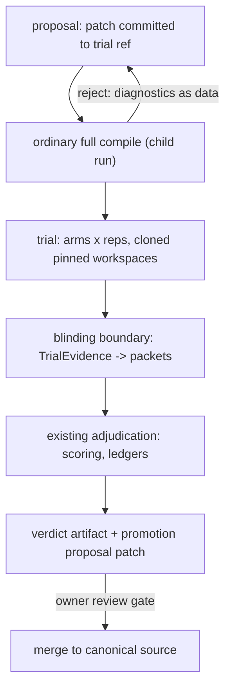

# Workflow Lisp Trial Runs: Controlled Experiments Over Pinned Repository Workspaces

Current durable use: the bounded direct-task control remains an ordinary
admitted evaluated program. Path-mode run references retain their pure-child
and typed result/delta/accounting contracts under [evaluated execution](workflow_lisp_evaluated_execution.md).
Named static workflow confinement has its separate [2.38 owner](workflow_lisp_run_ref_expression_environments.md)
and command-only/public-provider qualification boundary. Historical E1 workspace
preparation is not the confinement provisioning route.

Current availability amendment (2026-10-13): the
[selected retirement](workflow_lisp_executor_retirement.md) removes `trial`,
its SDK and ES/research execution from this package. E0's bounded evaluated
entry and admitted evaluated path-mode `run-ref` remain; bundle/trial effects
are excluded. The original E0–E2 completion, study park, protocol and scientific
results below are historical evidence, not current launch permission or a new
research selection. [CLI](../../specs/cli.md) owns the public refusal boundary.

## Metadata

- **Status:** partial current control/run-ref contract; E0–E2 completion below
  is historical evidence for the retired route. E3's external evolution
  controller is not implemented. Its separate owner-selected pending state is
  recorded in the [evolution roadmap](../plans/2026-07-22-workflow-lisp-evolution-follow-on-roadmap.md);
  that selection is not execution authority. See the [Capability Status
  Matrix](../capability_status_matrix.md) for current status and copy safety.
- **Kind:** target architecture and experiment-platform design
- **Owner:** agent-orchestration maintainers
- **Reviewers:** ordered independent `E_DESIGNS_SPEC_APPROVED`, then
  `E_DESIGNS_QUALITY_APPROVED` on 2026-07-31
- **Created:** 2026-07-27
- **Related docs:**
  - [Program-search boundary invariants](workflow_lisp_program_search_boundaries.md)
    (binding; compliance table below)
  - [Lean ORC-effectiveness pilot design](../superpowers/specs/2026-07-26-orc-effectiveness-lean-pilot-design.md)
    (accepted; this design's Layer 0 and admission gate)
  - [Parked evolution substrate and feature design](../superpowers/specs/2026-07-22-workflow-lisp-evolution-substrate-and-feature-design.md)
    (parked by owner decision `8aeb2949`; this design deliberately does not
    revive its substrate layer — see
    [Deliberately Not Selected](#deliberately-not-selected))
  - [Lean-pilot deterministic report](../reports/2026-07-26-orc-effectiveness-lean-pilot.md)
    (completed Layer-0 evidence and claim limits)
  - [Provider at-least-once loosening amendment](../plans/2026-07-26-provider-at-least-once-loosening-amendment.md)
    (landed through ML; supplies the at-least-once attempt and single-writer
    run contract this design assumes)
  - [Pure-result replay](workflow_lisp_pure_result_replay.md)
    (accepted M2 persistence-parsimony boundary; trial state and replay must
    remain subordinate to it)
  - [Workflow language design principles](workflow_language_design_principles.md)
    (Principles 28, 29, and 30 bind refusals, type density, and provider
    attention respectively)
  - [Substrate maintenance track](../plans/2026-07-26-substrate-maintenance-track.md)
    and the Q/L roadmap (MR-4 and L3 own the compiler-session/reentrancy
    substrate needed only by a later in-process compilation optimization, not
    by the E0-E3 tranche gates)
  - `specs/dsl.md`, `specs/providers.md`, `specs/state.md`, and
    `specs/versioning.md` target-2.11 `adjudicated_provider` sections (the
    historical origin of the reuse candidate, not this design's target)
- **Implementation targets:** the original unassigned-target wording below is
  historical. E1 `run-ref` is implemented at target 2.24 and E2 `trial` at
  target 2.25. The E3 design remains pending and does not itself authorize
  execution or follow-on work.

Purpose: define the smallest coherent platform on which (1) the effectiveness
of `.orc` orchestration can be measured against controls on real repository
tasks, and (2) bounded, generational program evolution can later be run —
without adding runtime `eval`, code values, or a parallel evaluation system.

Authority: normative runtime behavior remains in `specs/`. Historical E1/E2
contracts are in [the DSL spec](../../specs/dsl.md), [state
spec](../../specs/state.md), [versioning spec](../../specs/versioning.md), and
[CLI contract](../../specs/cli.md); authoring guidance is in the [drafting
guide](../lisp_workflow_drafting_guide.md#pinned-child-runs-and-trials).
This document preserves the design rationale and original pre-implementation
gates; its target-assignment language is not current admission guidance.
Where this document conflicts with
`workflow_lisp_program_search_boundaries.md`, the boundaries document wins.

Copy safety: `.orc` fragments and record shapes here are design sketches, not
copy-safe templates. Use the current specs and drafting guide for implemented
syntax. The matrix identifies
[`workflows/library/control/direct_task.orc`](../../workflows/library/control/direct_task.orc)
as copy-safe for E0's bounded direct-control shape; E1/E2 have no checked-in
production `.orc` template, and test fixtures are not authoring templates.

## Provenance And Inputs

Three inputs, reconciled here:

1. **Owner direction (2026-07-26/27, session record):** provide a trivial
   direct-to-provider control; provide a primitive that executes a `.orc`
   (sub)expression in another workspace pinned by git ref + hash; run
   experiment arms concurrently; reuse the existing adjudication machinery.
   Repository clones were requested for exact workspace pinning and disposal,
   not accepted as an execution sandbox. Language substrates (for example,
   incremental compilation) are named dependencies on existing tracks rather
   than speculative work in this design. Generated-candidate execution remains
   governed without exception by invariant 6 below.
2. **External thesis memo (2026-07-27, baseline `f29aab84`):** contributes the
   three-treatment experiment separation, the evaluation-methodology package
   (blinding, authority hierarchy, preregistration, ablations, stop rules),
   repository-identity normalization, gene-bounded mutation surfaces, and
   materialization economics. Its closure-extraction `in-workspace`, its
   revival of the parked variant substrate, and its sandbox program are not
   adopted (rationale below).
3. **Lean pilot design (accepted 2026-07-26):** already owns the first
   DIRECT/COORDINATOR/ORC experiment and explicitly gates "building a
   reusable experiment platform" on its outcome. This design is that
   platform, written to slot under the pilot's handoff rather than around it.

## Motivating Question

The doubts report established that no inspectable example demonstrates the
system's value. The lean pilot asks the question once, by hand, on one task
family. This design makes the question *repeatable*: every admitted workflow,
task corpus, and candidate variant uses the same controls, blinding, evidence
discipline, and generated-candidate environment gate. Two questions, never
collapsed:

1. Does orchestration beat one direct provider call by enough to justify its
   extra inference? (DIRECT vs ORC)
2. Does the compiled `.orc` representation beat a conventional typed
   coordinator implementing the same topology? (COORDINATOR vs ORC)

Only the second is this project's distinctive thesis. Every experiment run on
this platform must declare which question each comparison answers.

## Layered Structure

- **Layer 0 — lean pilot (separate evidence program).** External sealed
  controller, three treatments, calibration + A1 nanoBragg task. Its durable
  owner-decision handoff is an admission input; completion status is routed by
  the pilot's own plan and reports, not asserted by this design.
- **Layer 1 — experiment platform (this design's tranches E0–E2).** Canonical
  control workflow; workspace-pinned child runs; a trial form with concurrent
  arms feeding the existing adjudication machinery through a blinding
  boundary.
- **Layer 2 — evolution methodology (tranche E3).** An external search
  controller that proposes gene-bounded candidate commits, trials them via
  Layer 1, and emits promotion proposals. No new language surface.

This is the canonical tranche mapping consumed by the current E roadmap:

| Tranche | Sole meaning in this design |
| --- | --- |
| E0 | canonical one-call direct control and accounting-parity fixtures |
| E1 | pinned-workspace child execution through `run-ref` |
| E2 | concurrent trial arms, evidence freezing, blinding, and adjudication |
| E3 | external gene-bounded controller over the admitted E0–E2 contracts |

Historical E-numbering is context only and cannot select or redefine these
tranches. C1 is the review-pending companion named by the E roadmap; C2/C3
remain deferred unless separately incorporated. None is selected by this
mapping.

## E0 — Canonical Direct Control

A versioned library workflow, `workflows/library/control/direct_task.orc`
(conceptual name): typed `task: String` plus provider policy inputs, exactly
one provider invocation whose composed prompt is the task text plus only the
runtime-owned output contract, and a minimal typed completion result.

Requirements:

- **Canonical, not conventional.** All experiments use this one definition of
  "direct"; a hand-rolled minimal workflow per experiment is a confound. The
  workflow is digest-identified like any other source.
- **Provably one call.** Conformance tests assert: exactly one provider
  invocation per arm; no retries beyond the experiment's declared policy; no
  injected orchestration content beyond the standard output-contract suffix.
  (Behavioral assertions on invocation count and composition stages — not
  prompt-text assertions.)
- **Accounting parity.** The control emits the same evidence surface as any
  other arm: provider identity/policy, attempt identity, cost/token usage,
  elapsed time, terminal status, validated result, produced artifacts. A
  control that is cheaper to *account* is not a control.
- **Workspace-native output.** For agentic tasks the deliverable is the
  workspace delta, not a structured bundle; the control must not be forced to
  produce report artifacts the treatment produces, or the evaluator can
  unblind on artifact shape.

E0 is library + tests only: no runtime, loader, or spec changes. It is also
independently useful outside experiments (the cheapest possible workflow for
genuinely trivial tasks — trivial tasks should remain trivial in `.orc`).

The original E1 bundle protocol, E2 trial execution, E3 methodology and generated-candidate environment are historical. Current path children and confined static workflows use the evaluated/run-ref owners; no trial/bundle execution is admitted. See the [preserved record](../reports/documentation-history/workflow_lisp_trial_runs-history.md#e1--workspace-pinned-child-runs).

## Deliberately Not Selected

- **Closure-extraction `in-workspace` (inline subexpression arms).** Free
  variable analysis, serializable-capture checking, closure conversion, and
  synthetic child entrypoints constitute the largest avoidable line item in
  the external memo (its own estimate: 450–800 hours) and add lexical
  machinery adjacent to territory this language deliberately excludes.
  Wrapper workflows deliver the same granularity at ~5 lines each. Shelf
  trigger: recurring, documented authoring friction from wrapper workflows in
  real experiments.
- **Revival of the parked variant substrate**
  (`SubjectManifest`/`RewriteProposal`/`CertifiedVariant` registries). Git
  commits are the variant registry (content-addressed, diffable, admission =
  commit); the ordinary compiler is certification; diff-span policy checks
  enforce gene bounds. Owner decision `8aeb2949` stands; this design is a
  revival of the *direction* under the boundaries document, not of that
  substrate.
- **Isolation/security implementation.** Not selected by this design.
  Generated tool-using candidates remain excluded unless a separately
  accepted capability supplies genuine positive sandbox evidence; a clone,
  subprocess, gene bound, or permission freeze never supplies that evidence.
- **`.orc`-native search controller.** Later experiment on the same public
  contracts; external controller first (matches the lean pilot architecture).
- **Submodule/LFS normalization, cross-DSL-version children.** Fail closed in
  v1; later amendments with their own identity rules. Children compile under
  the controller installation's compiler; the pin makes version skew
  detectable at compile time.

## Design-Principle Compliance

- **Principle 28 — refusals name their rule.** Every admission denial uses a
  stable code and includes the rejected locator, identity, signature, effect,
  or policy fact. No workflow/module name grants authority, and a downstream
  compile or launch error retains the admission refusal as its cause.
- **Principle 29 — types are opt-in constraints.** Trial inputs start from the
  existing transportable structural value surface and may narrow. Nominal
  force is reserved for load-bearing identities, rooted paths, and routed
  outcome variants; trial authors do not mint taxonomies merely to use the
  platform.
- **Principle 30 — conserve provider attention.** Identity, packet exclusion,
  blinding, output validation, budget accounting, and admissible-environment
  checks are compiler/runtime/controller obligations. They never become
  instructions in an arm or evaluator prompt. Prompts retain only genuinely
  ambiguous task and judgment content.

## Feasibility Entry Proofs

This list records the original pre-implementation entry proofs; it does not
claim that E0–E2 remain gated. Their completion and exact contracts are
recorded in the [Capability Status Matrix](../capability_status_matrix.md),
the [E1 component plan](../plans/2026-07-31-workflow-lisp-e1-run-ref-component-plan.md),
and the [E2 component plan](../plans/2026-08-01-workflow-lisp-e2-trial-component-plan.md).
E3 remains unimplemented; its historical owner selection is not current
execution authority. See the [evolution roadmap](../plans/2026-07-22-workflow-lisp-evolution-follow-on-roadmap.md).

1. **E0 accounting parity:** one deterministic-provider fixture proves that
   the direct control and an ordinary arm emit the same accounting fields
   without requiring matching artifact shapes.
2. **E1 full-compile and source identity:** the hermeticity fixture above
   proves source/dependency content addressing and ordinary full-pipeline
   compilation from the pinned child root, including stable structured
   rejection from the actual compiler rather than a parallel validator.
3. **E1 run topology:** a minimal parent/child fixture proves separate
   single-writer roots, typed result return, committed-result reuse, and fresh
   discard/rerun for an incomplete visit without relying on quarantine. The
   same fixture proves deterministic, bounded `WorkspaceDelta` bytes for an
   identical pinned tree and child result.
4. **E1 admissible environment:** both-direction fixtures admit an effect-free
   candidate and reject an unknown/tool-using generated candidate absent
   genuine sandbox evidence with the stable refusal code.
5. **E2 adjudication reuse:** a deterministic two-arm fixture proves the
   existing evaluator/ledger contracts can consume whole child-run evidence;
   until then the reuse map above is a target, not a capability claim.
6. **E2 M2 fit:** clean/resume parity proves durable trial state contains only
   the validated effect/public-boundary facts listed above, while derived pure
   values follow accepted M2 replay and no effect-identity memo key appears.

Failure of a proof narrows or stops its tranche; it does not authorize a
parallel runtime, a weaker identity, or a prompt-carried substitute.

## Spec Amendment Inventory (At Admission, Per Tranche)

This table preserves the intended landing order. The current target-2.24 and
target-2.25 contracts are already in the linked normative specs above; the
old post-2.23 target assignment is not an open question.

- **E0:** none (library + tests only).
- **E1:** `specs/dsl.md` (`run-ref` form, structural refusals, version
  gating at a post-2.23 target); `specs/state.md` (parent-side trial ledger
  entries; clone-local child state statement; M2-compatible persistence);
  `specs/versioning.md` (new, as-yet-unassigned post-2.23 target row). No
  security spec or boundaries amendment is selected.
- **E2:** `specs/dsl.md` (`trial` form); `specs/providers.md` (evaluator
  packet `WorkspaceDelta` member; blinding exclusions as packet policy);
  `specs/state.md` (trial ledgers keyed `(arm, rep)`; partition membership);
  `specs/observability.md` (trial snapshots as sidecars, mirroring the
  target-2.11-origin pattern).
- **E3:** no spec changes (external controller over public surfaces); the
  landed at-least-once and single-writer contracts continue unchanged.

The E0–E2 rollout and selection record is historical; it cannot activate E3 or later research. See the [preserved record](../reports/documentation-history/workflow_lisp_trial_runs-history.md#tranche-sequence-and-gates).

## What This Approach Makes Harder

- Inline arm authoring is clunkier than closure extraction: arms live as
  named wrapper workflows, and evolution arms require commits to trial refs —
  deliberate friction that doubles as the admission ledger.
- Mode 2 children are pinned to the controller installation's compiler:
  trialing a candidate *together with* a DSL/compiler change requires
  releasing the compiler change first (or a future nested-version amendment).
- Setup nondeterminism is recorded, not eliminated, in v1; environment-driven
  noise between arms is bounded only by setup-identity matching.
- Refusing submodules/LFS excludes some real target repositories from trials
  until later amendments.

## Stop Rules (Program Level)

Stop, simplify, or narrow if: the lean pilot shows no plausible target-domain
value; the direct control is competitive enough that orchestration cost is
unjustified for the chosen family; a conventional typed coordinator matches
ORC reliability with materially less complexity; prompt search fails to beat
random search under equal budget; topology search adds nothing over
prompt-only; adaptive gains vanish on validation; evaluator disagreement
prevents stable claims; materialization cannot be made exact enough for
comparable trials; or holdout improvement stays below the preregistered
threshold. A negative result is a successful experiment and must be recorded
as such, not reframed as motivation for the next, more general layer.

## Verification Strategy

Behavioral, per house rules (no prompt-text assertions): identity-separation
property tests (revision/setup/program identities change only under their own
inputs); materialization tests (pinned bytes, refusal families, mirror
reuse); crash injection at materialize/setup/launch/finalize/evidence
boundaries with discard-and-rerun assertions; concurrency tests with
randomized completion order proving authored-order evaluator input;
blinding-boundary tests (packet exclusion list; a treatment-labeling probe
must perform at chance); ledger/resume reconciliation tests reusing the
existing adjudication test patterns; end-to-end: one two-arm trial on a fixture repository
through scoring to a verdict artifact. Design-doc routing changes rerun
`tests/test_workflow_lisp_drain_roadmap_routing.py`.

## Open Questions (Dispositioned)

1. Transportable `run-ref` input types — start with the existing closed
   transportable value set + relpath artifact references; widen by amendment.
2. May a mode-1 child call other bundle entrypoints? — v1: yes, anything in
   its own certified bundle; the child is an ordinary run of that bundle.
3. Cancellation when one arm exhausts a shared provider budget — v1: siblings
   run to their own budgets; trial-level budget exhaustion cancels *pending*
   arms only and records `budget_exhausted` outcomes; mid-flight arms finish.
4. Best first benchmark family — owned by the lean pilot (A1 nanoBragg) and
   its successors; this platform does not choose corpora.
5. Evaluator reuse boundary — packets and ledgers are the reuse surface;
   selection/promotion of source is not (verdict artifacts only).
