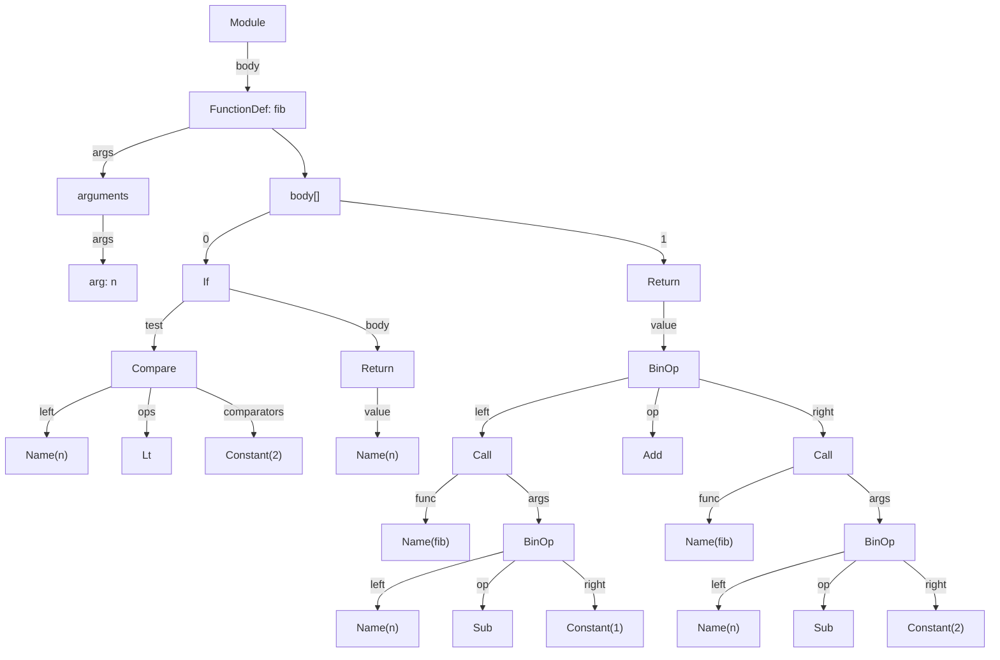
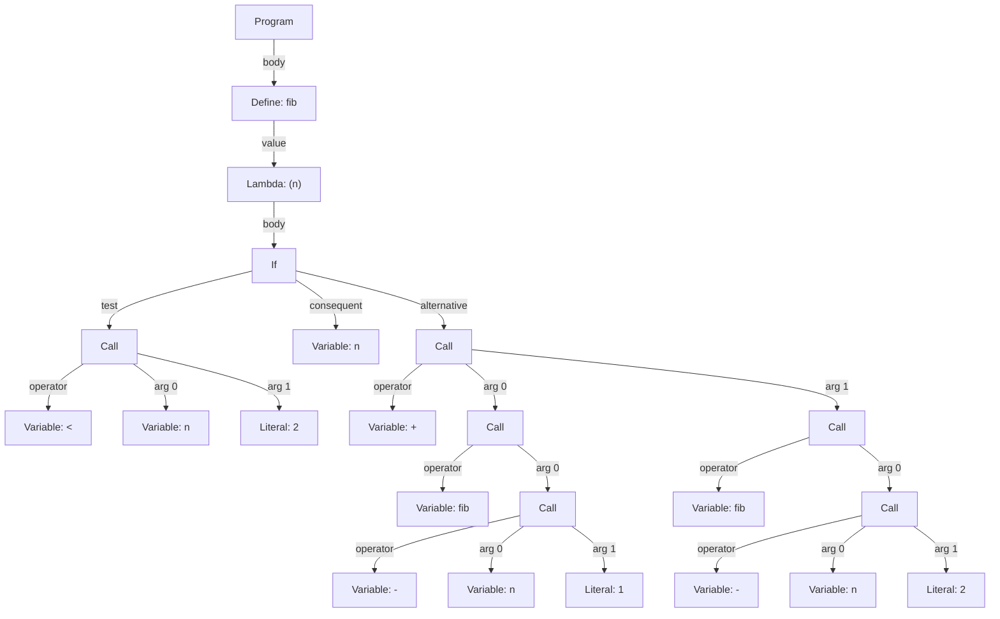

# Fibonacci ASTs in Python and Scheme

Historical discussion summary, captured on 2026-10-16. This note records the
examples and clarifications from a conversation about abstract syntax trees
(ASTs), including top-down ASCII and Mermaid diagrams of both examples.

The examples illustrate Python and Scheme, not the repository's Workflow Lisp
AST contract. Use the [documentation hub](../index.md) and
[frontend specification](../design/workflow_lisp_frontend_specification.md)
for current project behavior. The Python example can be parsed as shown below;
the Scheme AST node names are illustrative, not an executable API or a dump
from a particular Scheme compiler.

## The shared Fibonacci example

For nonnegative integer inputs, the example uses `fib(0) = 0`, `fib(1) = 1`,
and `fib(n) = fib(n - 1) + fib(n - 2)` for larger inputs.

```python
def fib(n):
    if n < 2:
        return n
    return fib(n - 1) + fib(n - 2)
```

## Python: an actual AST dump

With the source above stored in the string `source`, the expression
`ast.dump(ast.parse(source), indent=2)` produced the following output in
Python 3.13.9 during the discussion. Import `ast` from the standard library
before running that expression. This dump omits source-location attributes
and empty optional lists under the default formatting in that version.

```text
Module(
  body=[
    FunctionDef(
      name='fib',
      args=arguments(
        args=[
          arg(arg='n')]),
      body=[
        If(
          test=Compare(
            left=Name(id='n', ctx=Load()),
            ops=[
              Lt()],
            comparators=[
              Constant(value=2)]),
          body=[
            Return(
              value=Name(id='n', ctx=Load()))]),
        Return(
          value=BinOp(
            left=Call(
              func=Name(id='fib', ctx=Load()),
              args=[
                BinOp(
                  left=Name(id='n', ctx=Load()),
                  op=Sub(),
                  right=Constant(value=1))]),
            op=Add(),
            right=Call(
              func=Name(id='fib', ctx=Load()),
              args=[
                BinOp(
                  left=Name(id='n', ctx=Load()),
                  op=Sub(),
                  right=Constant(value=2))])))])])
```

`FunctionDef` binds the function name and parameters. Its body contains an
`If` statement with a conditional return, followed by another `Return`.
Arithmetic uses `BinOp` nodes, comparison uses `Compare`, and recursive
applications use `Call`. A `Name` with `ctx=Load()` reads a name's value.

### Python AST drawn vertically in ASCII

```text
                           Module
                              |
                      FunctionDef: fib
      +-----------------------+-------------------+
      |                                           |
  arguments                                    body[]
      |                     +---------------------+---------------------+
   arg: n                   |                                           |
                           If                                        Return
                +-----------+-------------+                             |
                |                         |                           BinOp
             Compare                   Return       +-------------------+-------------------+
      +---------+---------+               |         |                   |                   |
   Name(n)     Lt    Constant(2)       Name(n)    Call                 Add                Call
                                            +-------+-------+                       +-------+-------+
                                            |               |                       |               |
                                        Name(fib)         BinOp                 Name(fib)         BinOp
                                                  +---------+---------+                   +---------+---------+
                                                  |         |         |                   |         |         |
                                               Name(n)     Sub   Constant(1)           Name(n)     Sub   Constant(2)
```

`body[]` labels the function's statement-list field; it is not an additional
AST node. Its children are the `If` statement and the final `Return`, in that
order. The other `Return` belongs to the `If` body; the `If` has no `else`.
Each `BinOp` shows its left operand, operator, and right operand. Each `Call`
shows its function reference followed by its argument. For readability,
`Name(n)` abbreviates `Name(id='n', ctx=Load())`, and the drawing omits empty
fields and separate `Load` leaves.

### Python AST in Mermaid

This diagram uses the same abbreviations as the ASCII tree. Edge labels name
AST fields; `body[]` remains a display grouping for the function's statements.



## Scheme: source syntax and explicit AST nodes

The initial Scheme answer gave this source expression:

```scheme
(define fib
  (lambda (n)
    (if (< n 2)
        n
        (+ (fib (- n 1))
           (fib (- n 2))))))
```

The user correctly pointed out that this did not provide the explicit AST
requested. S-expressions make nesting visible, but showing source syntax
does not identify a particular compiler's AST nodes or its expansion and
binding decisions. Scheme does not prescribe a universal AST object format.

The corrected answer used the following illustrative node model. `Program`,
`Define`, `Lambda`, `If`, `Call`, `Variable`, and `Literal` are explanatory
names, not classes supplied by a Scheme implementation.

```text
Program(
  body=[
    Define(
      name="fib",
      value=Lambda(
        params=["n"],
        body=If(
          test=Call(
            operator=Variable("<"),
            arguments=[Variable("n"), Literal(2)]),
          consequent=Variable("n"),
          alternative=Call(
            operator=Variable("+"),
            arguments=[
              Call(
                operator=Variable("fib"),
                arguments=[
                  Call(
                    operator=Variable("-"),
                    arguments=[Variable("n"), Literal(1)])]),
              Call(
                operator=Variable("fib"),
                arguments=[
                  Call(
                    operator=Variable("-"),
                    arguments=[Variable("n"), Literal(2)])])
            ]
          )
        )
      )
    )
  ]
)
```

Here `If` is an expression with a test, a consequent, and an alternative.
Its selected branch supplies the lambda's result, so there are no explicit
`Return` nodes. Operators such as `+`, `-`, and `<` appear as variable
references in procedure calls in this illustrative representation.

### Scheme AST drawn vertically in ASCII

The user asked to rotate the presentation so the tree structure was visible,
then requested ASCII instead of Mermaid. The root is at the top:

```text
                           Program
                              |
                         Define: fib
                              |
                         Lambda: (n)
                              |
                              If
          +-------------------+-------------------+
          |                   |                   |
         Call                 n                  Call
    +-----+-----+             +-------------------+-----------------------+
    |     |     |             |                   |                       |
    <     n     2             +                  Call                    Call
                                            +-----+-----+           +-----+-----+
                                            |           |           |           |
                                           fib         Call        fib         Call
                                                  +-----+-----+           +-----+-----+
                                                  |     |     |           |     |     |
                                                  -     n     1           -     n     2
```

Read the drawing as follows:

- The three children of `If`, from left to right, are its test, consequent,
  and alternative.
- Each `Call` has its operator first, followed by its arguments. This is a
  structural ordering, not a claim about Scheme's operand evaluation order.
- Bare names and operator symbols represent `Variable` nodes; numbers
  represent `Literal` nodes. A leaf `+` is the addition operator, while a
  `+` joining horizontal and vertical lines is an ASCII connector.
- `fib` in `Define: fib` and `n` in `Lambda: (n)` are binding attributes.
  Their occurrences below calls are variable references.
- The two recursive branches are separate subtrees for `fib(n - 1)` and
  `fib(n - 2)`; the drawing does not expand recursive calls into more trees.

### Scheme AST in Mermaid

The same illustrative Scheme tree is shown below with explicit leaf types.
Argument indices describe tree structure, not evaluation order.



## Verification scope

The Python AST was generated with the standard-library parser. The Scheme
AST and its diagrams were illustrative; none came from a Scheme compiler.
The discussion did not execute either Fibonacci function, benchmark them,
or change the repository's compiler implementation.
