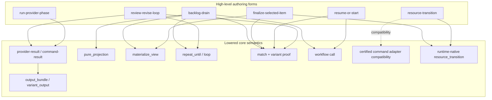
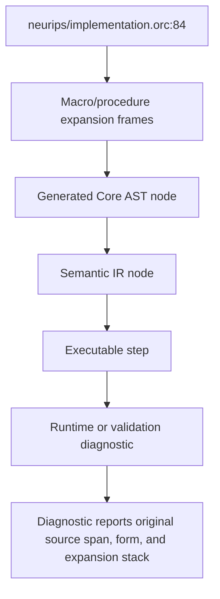

# Workflow Lisp Frontend Specification: Historical Sections

Status: **Historical.** Extracted original sections; original tense, review
labels, measurements and acceptance language are evidence, not current
authority or permission to execute/select work. Current owner: [workflow_lisp_frontend_specification.md](../../design/workflow_lisp_frontend_specification.md).

## 45. Core Workflow AST

Historical syntax-neutral flat structure; YAML authoring and flat execution
are retired. Retained typed/shared readers do not restore that backend.

Suggested shape:

```python
CoreWorkflow(
    name: QualifiedName,
    version: DslVersion,
    inputs: list[CoreInput],
    outputs: list[CoreOutput],
    statements: list[CoreStmt],
    source_map: SourceMap,
)
```

Core statements:

- `CoreMaterializeArtifacts`
- `CoreProviderStep`
- `CoreCommandStep`
- `CoreCallStep`
- `CorePureProjectionStep`
- `CoreMaterializeViewStep`
- `CoreOutputBundle`
- `CoreVariantOutput`
- `CorePreSnapshot`
- `CoreSelectVariantOutput`
- `CoreMatch`
- `CoreRepeatUntil`
- `CorePublish`
- `CoreAssert`
- `CoreResourceTransitionStep`
- `CoreProviderSupervisionStep`

Generated pure projections, materialized views, and resource transitions are
first-class Core statement families on the WCC/schema-2 route. Certified
command-adapter lowering remains available only when an explicit compatibility
contract declares the adapter backend for the same typed effect.

## 46. Validated Core Workflow AST

After shared validation.

Adds:

- `ReferenceCatalog`
- `ContractCatalog`
- `ProofContext` graph
- `WorkflowCallGraph`
- snapshot declarations
- artifact availability table
- effect graph
- pointer authority checks

This is where existing v2.14 validation should run.

## 47. Semantic IR

Semantic IR is validated and type-rich.

Suggested shape:

```python
SemanticWorkflowIR(
    workflows: dict[QualifiedName, SemanticWorkflow],
    types: TypeCatalog,
    contracts: ContractCatalog,
    refs: ReferenceCatalog,
    effects: EffectGraph,
    proofs: ProofGraph,
    state_layout: StateLayout,
    source_map: SourceMap,
)
```

`state_layout` records projections derived from `StateLayout` /
`PathAllocator` allocation metadata. The allocator returns neutral allocation
records; runtime binding, workflow-boundary projection, source maps, and
Semantic IR each consume those records rather than synthesizing generated paths
independently.

Semantic step examples:

```python
SemanticProviderResult(
    id,
    provider_ref,
    prompt_contract,
    return_type,
    variant_contract,
    artifact_contracts,
    effects,
)

SemanticVariantSelection(
    id,
    snapshot_ref,
    candidates,
    return_union,
    atomic_commit,
)

SemanticWorkflowCall(
    id,
    callee,
    args,
    return_type,
    version_policy,
)

SemanticProviderSupervision(
    id,
    worker_member,
    supervisor_member,
    observation_edge,
    directive_type,
    settlement_type,
    effects,
)
```

Semantic IR is the authoritative compiler output.

For a provider result with typed prompt dependencies,
`SemanticPromptSurface` carries the validated
`CompilerPromptDependencyContract`. The adjacent source map carries lineage for
the clause and each required/optional operand. Semantic IR describes the
compiled prompt contract; it does not own runtime file bytes or evidence
acceptance.

## 48. Executable IR

Runtime-ready form.

Contains:

- ordered executable steps
- resolved provider invocations
- resolved command invocations
- materialization actions
- snapshot capture actions
- atomic write actions
- runtime guards
- state projections
- observability hooks

Provider executable configuration carries the optional typed
`CompilerPromptDependencyContract` beside ordinary `depends_on` configuration.
Executable validation requires the side table and provider-step set to
reconcile exactly. The public `runtime_plan` deliberately omits dependency
operands, injection policy, compiler-contract data, content digests, and
evidence metadata; it remains topology/checkpoint planning only.

`ExecutableNodeKind.PROVIDER_SUPERVISION` carries a
`provider_supervision.v1` node-local schema. Its validated config contains the
two immutable member provider configs, the supervisor-to-worker observation
edge, worker and directive result contracts, pure settlement payload and
result contract, bounded member/step deadlines, `max_steers: 1`, and
visit/member/turn-qualified provisional paths. Runtime-plan and Semantic-IR
projections expose one composite node and one atomic result boundary, not two
independent workflow steps.

Executable IR no longer contains macros, procedures, or unresolved type forms.

Dedicated stdlib proving fixtures may also compile under a named
runtime-proof validation profile. That lane still has to assemble ordinary
`LoadedWorkflowBundle` values, derive Semantic IR / runtime-plan projections,
and pass executable IR validation, but it does not by itself certify that the
same workflow is promotion-ready as a public or parent-callable boundary.

## 49. Runtime Plan

Final runtime plan includes:

- step order
- dependencies
- state paths
- artifact publication plan
- snapshot storage plan
- error handling plan
- observability spans
- resume checkpoints

It does not include provider prompt-dependency paths, injection policy,
compiler-contract metadata, snapshot bytes/digests, or evidence locations.
Those belong to validated executable/semantic ownership and per-attempt state
or evidence, not topology.

## Part IX. Elaboration And WCC Projection Rules

This part describes how surface forms enter the WCC route and what flat Core
AST projection they may produce after WCC elaboration, ANF normalization,
scope/effect/proof analysis, and defunctionalization.

The Core AST sketches below are projection shapes, not permission for
surface-specific direct flat-step lowerers. For promoted routes, construct
classes covered by WCC must elaborate to WCC first. Direct schema-1/per-form
lowerers are legacy compatibility or characterization paths only.

## 50. `defworkflow` Elaboration

Source:

```lisp
(defworkflow implementation/run
  ((ctx PhaseCtx)
   (inputs ImplementationInputs)
   (providers ImplementationProviders))
  -> ImplementationResult
  body)
```

WCC and Core projection:

```text
defworkflow boundary
  -> WCC module/function boundary
  -> defunctionalized CoreWorkflow
  inputs:
    ctx fields as structured inputs or flattened inputs
    inputs fields
    providers fields
  outputs:
    union discriminant
    union fields by variant
  statements:
    lowered body
```

Semantic IR:

```text
SemanticWorkflow
  typed input signature
  typed output union
  workflow call entrypoint
  effect summary
```

## 51. `defproc` Elaboration

A `defproc` elaborates to a WCC function after import expansion,
specialization, and typechecking. The compiler may project it as inline WCC or
as a private workflow boundary before Core AST generation.

Inline projection:

- required for workflow-to-procedure migrations;
- use when the caller owns runtime state, checkpoint, resume, and debug
  identity; and
- preserve procedure-definition, specialization/ProcRef, and call-site source
  provenance on generated nodes.

Private subworkflow projection:

- use only when migration contract/evidence identifies a private state
  namespace or independently useful private resume/debug boundary;
- keep the boundary internal and deterministic; and
- do not replace a public workflow invocation or publication boundary.

The current slice records that namespace need as reviewed evidence, not a new
source annotation. `auto` may choose either projection only when that choice is identity-free. It
does not promise stable persisted routing. Reuse count and body size may inform
compiler cost decisions but do not by themselves justify a private identity.

Generated private names are deterministic:

```text
%neurips.implementation.ensure-approved-plan.v1
```

Source maps point back to the original `defproc`.
Imported private-subworkflow projections elaborate against the defining
module's type environment. Specialized procedures use the defining module's
environment for free-name resolution and extend it with specializing-unit
concrete bindings for type arguments, ProcRefs, and values.

After those bindings resolve, the accepted effect-validation route must
recompute the specialized helper's caller-visible transitive effects before
either projection is chosen. The chosen projection must preserve public-wrapper
outputs, artifacts, publication ownership, state layout, checkpoint identity,
and resume behavior.

## 52. `call` Elaboration

Source:

```lisp
(call implementation/run
  :ctx implementation-ctx
  :inputs implementation-inputs
  :providers providers.implementation)
```

WCC and Core projection:

```text
perform workflow call
  -> CoreCallStep
  callee: implementation/run
  args:
    ctx: ...
    inputs: ...
    providers: ...
  expected_return: ImplementationResult
```

Validation:

- same target DSL version
- argument contract compatibility
- provider ref compatibility
- workflow ref known
- return type bound

## 53. `match` Elaboration

Source:

```lisp
(match result
  ((COMPLETED c) ...)
  ((BLOCKED b) ...))
```

WCC and Core projection:

```text
case result.variant
  join branch exits
  -> CoreMatch or defunctionalized routing equivalent
  discriminant_ref: result.variant
  arms:
    COMPLETED:
      proof_context: result == COMPLETED
      statements: ...
    BLOCKED:
      proof_context: result == BLOCKED
      statements: ...
```

Semantic IR:

- `ProofContext` entered for branch
- `VariantArtifactEntry` availability narrowed
- runtime `requires_variant` guard retained

## 54. `provider-result` Elaboration

Source:

```lisp
(provider-result providers.execute
  :ctx ctx
  :prompt prompts.implementation.execute
  :inputs (inputs.design inputs.plan)
  :model inputs.model
  :effort inputs.effort
  :timeout-sec 7200
  :prompt-dependencies
    (:required (inputs.design inputs.plan)
     :optional (inputs.prior-review)
     :position prepend)
  :returns ImplementationAttempt)
```

WCC and Core projection:

```text
perform provider call :effect provider_call
  -> CoreProviderStep
  provider: providers.execute
  prompt: prompts.implementation.execute
  provider_call_policy: {model: inputs.model, effort: inputs.effort}
  timeout_sec: 7200
  depends_on: required/optional content injection from typed bindings
  compiler_prompt_dependency_contract: typed side-table entry
  prompt_contract: generated from ImplementationAttempt
  output_bundle: generated canonical bundle
  variant_output: generated if return type is union
```

Semantic IR:

```text
SemanticProviderResult
  VariantContract(ImplementationAttempt)
  PromptContract(...)
  CompilerPromptDependencyContract(...)
  AtomicBundleValidation(...)
```

For a target-2.20 fragment application, the same provider step additionally
carries the validated `CompilerPromptFragmentContract` and exact
`compiled_prompt_fragment_identity`. Document fills lower through the
`workflow_lisp_prompt_fragment` dependency origin; rendered fills remain in the
compiler fragment contract. Classic and WCC/schema-2 lowering must produce the
same normalized contract, result contract, and identity.

## 54.1 `with-live-providers` Elaboration (Target 2.16)

Source:

```lisp
(with-live-providers
  ((worker (run-worker request))
   (supervisor (run-supervisor policy)
     :observes worker))
  worker)
```

The form has exactly two bindings and one sibling `:observes` edge. The
observed member is the worker; its peer is the supervisor. The worker returns
any transportable type `T`, the supervisor returns the compiler-owned
non-shadowable `ProviderSteeringDirective`, and the settlement body is a pure
expression over both values whose type is the form's result type.

A member is eligible only when post-specialization recursive expansion of
direct `:lowering inline` procedure calls yields one straight-line region with
exactly one unconditional provider perform and a pure result projection.
Residual calls, workflow boundaries, branches, loops, a second perform, or
other effects reject with source-mapped diagnostics.

WCC elaboration produces one closed `WccProviderSupervision` term and records
the member provider effects plus
`LiveSupervisionEffect(supervisor, worker)`. Defunctionalization emits one
generated Core provider-supervision statement. Shared validation requires the
worker provider template's structural `turn_boundary_resume` capability; the
supervisor needs no session capability.

Semantic and executable projection preserve the two members, observation edge,
directive contract, pure settlement contract, source ownership, and one
atomic workflow-state/result boundary. Member provisional bundles, panes, and
transcripts are invocation evidence. Only the selected validated worker value
and directive enter settlement, and only the validated settlement value is the
node result.

## 54.2 `with-live-provider-peers` Elaboration (Target 2.17)

Source:

```lisp
(with-live-provider-peers
  ((planner
     (provider-result providers.planner
       :prompt prompts.planner
       :inputs ()
       :timeout-sec 300
       :returns String))
   (reviewer
     (provider-result providers.reviewer
       :prompt prompts.reviewer
       :inputs ()
       :timeout-sec 300
       :returns Bool))
   (builder
     (provider-result providers.builder
       :prompt prompts.builder
       :inputs ()
       :timeout-sec 300
       :returns String)))
  (record TeamResult
    :plan planner
    :approved reviewer
    :notes builder))
```

The literal binding list contains two through eight unique members in authored
order. Each binding has only a name and provider-producing expression: there
is no `:observes`, role, access-control, or dynamic-membership spelling.
Every member may address every other member by binding name, while self-send
is rejected. A member expression cannot capture a sibling result.

After recursive specialization of direct `:lowering inline` procedures, each
member must close to exactly one unconditional provider perform followed only
by a pure result projection. Residual calls, workflow boundaries, branches,
loops, extra effects, or a second provider perform reject with source-mapped
diagnostics.

Member results and the settlement result may use any declared transportable
type. The form imposes no peer-specific nominal wrapper: an author may use
ordinary scalar, collection, record, or union contracts and narrow them only
when the workflow needs stronger guarantees. The settlement body is a pure
expression over exactly the authored member bindings, and its type is the
form's result type.

WCC elaboration produces one closed `WccProviderPeerGroup`, preserving authored
member order, each member's provider effects, and
`LivePeerMessagingEffect(members=<authored-order ids>)`. It does not produce
`LiveSupervisionEffect`. Defunctionalization emits one compiler-generated Core
peer-group statement and one `provider_peer_group.v1` executable node. The
closed config preserves the member provider/result contracts, pure settlement
payload and contract, `all_other_members` policy, required
`interactive_terminal_turn_queue.v1` capability, generated paths, source
ownership, positive timeouts, and `max_steers: 0`.

At runtime every member has one attempt-bound opaque endpoint credential.
`peer-ready` forms an all-member barrier; accepted `peer-send` requests are
fsynced into the exact receiver attempt's ledger before input is offered;
`peer-ack` records the receiver's exact message-id acknowledgement; and
`peer-finish` freezes the validated member bundle before the declared natural
close is offered. Only after every member proves natural termination does the
coordinator evaluate and atomically publish the pure settlement.

The endpoint and client handles are ephemeral runtime values. Message content,
pane text, transcripts, member provisional bundles, and message ledgers do not
become workflow values or alternate result authorities. An interrupted
nonterminal visit is at-least-once: after exact-visit integrity validation,
ordinary resume preserves partial ledgers as audit-only evidence, discards the
partial result authority, emits exactly one
`provider_attempt_interrupted_rerun`, and enters a fresh group visit through
ordinary dispatch. Messages are never retargeted, and member sessions,
attempts, endpoints, panes, bundles, and settlements from the interrupted
visit are never reused. Missing, malformed, conflicting, or ambiguous
authoritative recovery state fails closed before provider launch; compatible
completed-group reuse remains invocation-free.

Targets below `2.17` reject `with-live-provider-peers`. Target `2.17` continues
to accept the target-`2.16` `with-live-providers` form without changing its
`provider_supervision.v1` lowering.

## 55. `produce-one-of` Elaboration

Source:

```lisp
(produce-one-of ImplementationAttempt
  :ctx ctx
  :producer ...
  :candidates ...)
```

WCC and Core projection:

```text
perform snapshot
perform producer
perform select-variant-output
  -> CorePreSnapshot
  -> CoreProducerStep
  -> CoreSelectVariantOutput
```

Semantic IR:

- `SnapshotEntry`
- `SnapshotDiffEvidence`
- `VariantSelection`
- `AtomicBundleWriter`

This aligns with the v2.14 selection model: snapshot evidence, exactly-one
changed candidate, validation before commit, and artifacts exposed only after
successful commit.

## 56. `resource-transition` Elaboration

Compatibility lowering A: certified command adapter.

```text
perform certified adapter transition
  -> CoreCommandStep
  -> CoreOutputBundle
  -> CorePublish
```

Declared-transition lowering B: generated runtime-native transition.

```text
perform runtime-native resource transition
  -> compiler-generated resource_transition step
  -> CoreResourceTransitionStep
  -> ExecutableNodeKind.RESOURCE_TRANSITION
```

Rule:

If the form promises atomic move + ledger update, the selected backend must
actually provide that property.

If only a command adapter exists, the language must say:

```text
atomicity is adapter-certified and fixture-tested
```

not pretend it is a core runtime transaction.

For the declared runtime-native route, the runtime must own transition schema
validation, version checks, idempotency, audit append, and replay semantics.

## 57. `review-revise-loop` Elaboration Contract

Source:

```lisp
(review-revise-loop implementation-review ...)
```

The stdlib definition must compile through ordinary imported/std `.orc` into
WCC. After specialization and WCC analysis, defunctionalization may project a
Core AST shape equivalent to:

```text
loop/recur or bounded rec-join
  -> CoreRepeatUntil or equivalent defunctionalized routing
  iteration state
  call specialized review ProcRef
  match decision
  optional call specialized fix ProcRef
  final projection to stdlib-owned terminal result
```

Semantic IR must expose:

- `BoundedLoop`
- stdlib-owned `ReviewDecision`
- stdlib-owned `ReviewLoopResult`
- effects of the selected review/fix procedures
- artifact refs by branch

The generated monomorphic helper uses ordinary loop state. A conceptual
loop-frame contains the current completed value, latest review report, latest
findings, optional blocker class, optional reason, iteration count, and a scalar
decision marker. After specialization all fields are concrete; no type
parameter or ProcRef may remain in lowered state.

Review decisions elaborate through ordinary proof-gated `match` / WCC `case`:

- `APPROVE` materializes the current completed value, review report, findings,
  and terminal decision marker.
- `REVISE` calls the specialized fix ProcRef, materializes its returned
  completed value plus the review report/findings, and continues.
- `BLOCKED` materializes the current completed value, review report, findings,
  blocker class, and terminal decision marker.
- max-iteration exhaustion uses the authored loop exhaustion projection to set
  an `EXHAUSTED` marker and then constructs `ReviewLoopResult.EXHAUSTED` from
  the final loop-frame outputs.

The final projection must read loop-frame outputs. It must not read only the
first review step or a body-local step that was not materialized onto the loop
frame.

Promoted elaboration must not depend on `ReviewReviseLoopExpr`, a lowerer branch
keyed to literal `review-revise-loop`, or review-loop-specific Python
construction of terminal variants. Legacy bridge fixtures, if any remain, must
be explicitly marked legacy.

## 58. `backlog-drain` Elaboration

Source:

```lisp
(backlog-drain neurips
  :selector selector/run
  :run-item selected-item/run
  :gap-drafter gap/draft
  :ctx ctx
  :max-iterations max)
```

WCC and Core projection:

```text
loop/recur or bounded rec-join
  -> CoreRepeatUntil or defunctionalized routing equivalent
  call selector
  match SelectionResult
    EMPTY -> done
    GAP -> call gap_drafter, continue
    SELECTED -> call run_item, match SelectedItemResult
```

Semantic IR:

- loop state type
- `WorkflowRef` signatures
- `DrainResult` union
- effect summary

## Part XV. Example End-To-End Design

## 88. Types

```lisp
(defmodule neurips/types
  (:language workflow-lisp "0.1")
  (:target-dsl "2.14")

  (import std/paths :as path)
  (import std/phase :as phase)

  (defenum BlockerClass
    missing_resource
    unavailable_hardware
    roadmap_conflict
    external_dependency_outside_authority
    user_decision_required
    unrecoverable_after_fix_attempt)

  (defrecord Blocker
    (class BlockerClass)
    (reason String)
    (retryable Bool)
    (owner Optional[String]))

  (defrecord ImplementationInputs
    (design path/design)
    (plan path/plan)
    (check-commands path/check-commands)
    (execution-report-target path/work-report-target)
    (checks-report-target path/checks-report-target)
    (review-report-target path/review-report-target))

  (defrecord ImplementationProviders
    (execute Provider)
    (review Provider)
    (fix Provider))

  (defunion ImplementationAttempt
    (COMPLETED
      (execution-report path/work-report))

    (BLOCKED
      (progress-report path/work-report)
      (blocker Blocker)))

  (defunion ImplementationResult
    (APPROVED
      (execution-report path/work-report)
      (review_report path/review-report)
      (findings phase/ReviewFindings))

    (EXECUTION_BLOCKED
      (progress-report path/work-report)
      (blocker Blocker))

    (REVIEW_BLOCKED
      (execution-report path/work-report)
      (review_report path/review-report)
      (blocker_class BlockerClass)
      (findings phase/ReviewFindings))

    (EXHAUSTED
      (execution-report path/work-report)
      (last_review_report path/review-report)
      (findings phase/ReviewFindings)
      (reason String))))
```

## 89. Implementation Phase

```lisp
(defmodule neurips/implementation
  (:language workflow-lisp "0.1")
  (:target-dsl "2.14")

  (import std/context :as ctx)
  (import std/phase :as phase)
  (import std/provider :as provider)
  (import neurips/types :as nt)

  (export run)

  (defworkflow run
    ((phase-ctx ctx/PhaseCtx)
     (inputs nt/ImplementationInputs)
     (providers nt/ImplementationProviders))
    -> nt/ImplementationResult

    :effects
      ((reads inputs.design inputs.plan inputs.check-commands)
       (uses-provider providers.execute providers.review providers.fix)
       (writes inputs.execution-report-target
               inputs.checks-report-target
               inputs.review-report-target)
       (updates-state phase-ctx))

    (phase/with-phase phase-ctx implementation
      (let* ((attempt
               (provider/provider-result providers.execute
                 :ctx phase-ctx
                 :prompt prompts.implementation.execute
                 :inputs
                   (inputs.design
                    inputs.plan
                    inputs.execution-report-target)
                 :returns nt/ImplementationAttempt
                 :artifacts
                   ((COMPLETED
                      (execution-report
                        :target inputs.execution-report-target
                        :format markdown))

                    (BLOCKED
                      (progress-report
                        :target (phase/target phase-ctx 'progress-report)
                        :format markdown)))))

             (result
               (match attempt
                 ((COMPLETED completed)
                  (match
                    (phase/review-revise-loop implementation-review
                      :ctx phase-ctx
                      :completed completed
                      :inputs inputs
                      :review (proc-ref implementation-review)
                      :fix (proc-ref implementation-fix)
                      :max 40)

                    ((APPROVED approved)
                     (nt/ImplementationResult.APPROVED
                       :execution-report completed.execution-report
                       :review_report approved.review_report
                       :findings approved.findings))

                    ((BLOCKED blocked)
                     (nt/ImplementationResult.REVIEW_BLOCKED
                       :execution-report completed.execution-report
                       :review_report blocked.review_report
                       :blocker_class blocked.blocker_class
                       :findings blocked.findings))

                    ((EXHAUSTED exhausted)
                     (nt/ImplementationResult.EXHAUSTED
                       :execution-report completed.execution-report
                       :last_review_report exhausted.last_review_report
                       :findings exhausted.findings
                       :reason exhausted.reason))))

                 ((BLOCKED blocked)
                  (nt/ImplementationResult.EXECUTION_BLOCKED
                    :progress-report blocked.progress-report
                    :blocker blocked.blocker)))))

        result))))
```

Notes:

- the stdlib loop returns `phase/ReviewLoopResult`; workflow-specific terminal
  unions are projected by caller code with an ordinary `match` using
  refined match binders
- no manual state path
- no markdown extraction
- no explicit snapshot name
- no candidate-path bookkeeping
- no manual `requires_variant`
- no pointer file authority

## 90. Selected Item Workflow

```lisp
(defworkflow run-selected-item
  ((item-ctx ItemCtx)
   (selection SelectionInput)
   (providers NeuripsProviders))
  -> SelectedItemResult

  (let* ((selected
           (resolve-selected-item item-ctx selection))

         (queue-transition
           (resource-transition backlog-item
             :ctx item-ctx
             :when selected.active?
             :resource selected.item
             :from Queue.active
             :to Queue.in-progress
             :ledger item-ctx.ledger
             :event SELECTED))

         (roadmap
           (call roadmap/sync
             :ctx (phase-ctx item-ctx 'roadmap-sync)
             :selected selected
             :providers providers.roadmap))

         (plan
           (resume-or-start plan-gate
             :ctx (phase-ctx item-ctx 'plan)
             :resume-from selected.final-plan-gate-state
             :valid-when APPROVED
             :start
               (call plan/run
                 :ctx (phase-ctx item-ctx 'plan)
                 :selected selected
                 :roadmap roadmap
                 :providers providers.plan)
             :returns PlanGateResult))

         (implementation
           (call implementation/run
             :ctx (phase-ctx item-ctx 'implementation)
             :inputs (make-implementation-inputs item-ctx selected plan)
             :providers providers.implementation)))

    (finalize-selected-item
      :ctx item-ctx
      :selected selected
      :queue-transition queue-transition
      :roadmap roadmap
      :plan plan
      :implementation implementation)))
```

## 91. Top-Level Drain

```lisp
(defworkflow drain
  ((ctx DrainCtx)
   (providers NeuripsProviders)
   (max-iterations Int))
  -> DrainResult

  (backlog-drain neurips
    :ctx ctx
    :selector selector/run
    :run-item selected-item/run
    :gap-drafter gap/draft
    :providers providers
    :max-iterations max-iterations))
```

This is the kind of compression that could genuinely improve composability and
size.

## Part XVIII. Implementation Staging

These stages are retained as provenance for the frontend rollout. They are not
the current compiler-lane roadmap where they conflict with WCC. The current
compiler substrate is WCC/schema 2 for the migrated M0-M5 route subset;
legacy schema 1 is a predecessor compiler identity, and the flat executor and
historical-run resume are retired (§44.1, §78).

WCC compiler-lane work is governed by this baseline plus the component
contracts it routes to: private executable context, typed projection,
certified adapters/resource transitions, parent-callable family parity,
promotion evidence, and post-promotion simplification.

## 99. Stage 1: Frontend Core Without Workflow Execution

Implement:

- parser
- syntax objects
- modules
- imports/exports
- `defenum`
- `defpath`
- `defrecord`
- `defunion`
- `defun`
- basic type checking

No effects yet.

## 100. Stage 2: Procedural Substrate

Implement:

- `defworkflow`
- `defproc`
- `call`
- `let*`
- `match`
- effect signatures
- source maps
- WCC elaboration and Core AST projection

A trivial workflow should compile to core AST and semantic IR.

## 101. Stage 3: Macro System

Implement:

- `defmacro`
- hygiene
- macro expansion frames
- macro determinism checks
- macro error mapping

Keep macros small initially.

## 102. Stage 4: Provider/Command Structured Results

Implement:

- `provider-result`
- `command-result`
- structured bundles
- union return types
- prompt contract generation
- variant output lowering

No markdown extraction.

## 103. Stage 5: Phase And Context Library

Implement:

- `PhaseCtx`
- `with-phase`
- `phase-target`
- `run-provider-phase`
- `produce-one-of`
- `review-revise-loop`
- `resume-or-start`

Review/revise route:

- promoted `review-revise-loop` is implemented as a stdlib-owned macro/generic
  procedure route that lowers through ordinary typed forms;
- the promoted route uses exact stdlib-owned `ReviewDecision`,
  `ReviewFindings`, and `ReviewLoopResult`;
- review/fix hooks are compile-time ProcRefs;
- old compiler-special review-loop expression and stdlib-specialization bridge
  types are not part of the promoted expression table;
- any residual review-loop-specific helpers are compatibility/quarantine
  surfaces, not the semantic route.

## 104. Stage 6: Resource And Drain Library

Implement:

- `resource-transition`
- `finalize-selected-item`
- `backlog-drain`
- workflow refs
- `loop/recur`

Semantically critical `resource-transition` behavior lowers to the
runtime-native declared transition backend. Certified adapters remain explicit
compatibility backends when they implement the same typed transition contract.

## 105. Stage 7: NeurIPS Migration Experiment

Translate:

- implementation phase
- plan phase
- selected item
- top-level drain

Measure:

- LOC reduction
- gate-pattern reduction
- manual-state reduction
- manual-pointer reduction
- semantic equivalence

Reject the frontend design if translations remain YAML-shaped.

Baseline note: the WCC M0-M5 route supersedes the direct Core-AST
compiler-substrate interpretation of these stages. Migrated-route evidence
identifies the lowering route and schema version; promoted work uses
`wcc_default`/schema 2 as the current compiler guidance.

Promotion of YAML primaries was separate from implementation of frontend
capability: a `.orc` candidate needed machine-computed non-regressive parity
evidence before replacing a YAML primary, even if the candidate compiled,
validated, and dry-ran. The YAML frontend and that gate are retired (§78.1).

## 105.1 Runtime Migration Foundation Contract

Promotion-grade Workflow Lisp composition relies on these runtime-foundation
contracts:

- command structured-output conformance;
- frontend-lowered typed value transport;
- provider structured-output target binding;
- strict migration promotion gates;
- `StateLayout` / `PathAllocator` ownership for generated private paths;
- prompt extern source semantics;
- canonical `resume-or-start` proof alignment for compatibility paths that
  traverse reusable-state recovery.

Generic provider-heavy `.orc` workflows are valid promotion evidence only when
these contracts are satisfied by the exercised runtime path.

## 105.2 Post-Foundation Composition And Stdlib Migration

Composition and stdlib migration requires:

1. inventory the implemented composition and stdlib route;
2. harden generic effectful composition;
3. harden imported/std `.orc` reuse;
4. prove `review-revise-loop` through the ordinary stdlib route with no
   promoted compiler-name special case;
5. add entrypoint bootstrap/defaults so wrappers match YAML public boundaries;
6. keep canonical `resume-or-start` validation typed and parity-testable;
7. inventory adapter lint debt before strict enforcement;
8. use `--require-non-regressive` for evidence and `--require-promotable` for
   any primary-surface decision (retired gate flags, §78.1).

## 105.3 Native Transportable Returns And Typed Result Guidance

Wave 1 (native transportable returns) is landed: `defworkflow`, effectful
`defproc`, `provider-result`, `command-result`, and workflow calls share one
`is_transportable_result_type` decision instead of separate record/union
allowlists. Every currently transportable type (`String`, `Int`, `Float`,
`Bool`, enums, declared path refinements, `Optional[T]`, `List[T]`,
`Map[String, T]`, records, and unions) is valid in every return position.

A non-record/non-union ("root") result lowers to one generated
`output_bundle` field named `__result__` with `json_pointer: ""`; the
provider or command writes the direct JSON value, not an object wrapper.
Authored Workflow Lisp never names or projects `__result__`; the compiler
binds the validated artifact directly as the declared type. A reusable
workflow boundary declares exactly one generated output named `__result__`
for a root-valued return, and `call` carries it through the outer call-step
artifacts unchanged.

DSL v2.15 is the public wire version for this widened contract. Ordinary
loader entrypoints and Workflow Lisp shared validation accept it uniformly.
v2.14 authored YAML and existing record/union `.orc` programs are unaffected
and remain non-regressive.

Full contract, wire schema, and verification strategy:
[Workflow Lisp Native Transportable Returns And Typed Result Guidance](../../design/workflow_lisp_native_transportable_returns.md).
Typed result guidance is implemented. Plain returns remain canonical; an
annotated occurrence uses `(result T :description ... :format-hint ...
:example <pure-constant>)`, and record/union payload fields accept the same
three optional keys. Examples are typed pure constants; path examples enforce
path safety but not target existence. Composition preserves metadata without
including it in type or specialization identity.

Effect boundaries lower guidance into v2.15 bundle `guidance`, direct field
keys, ordered ancestor `guidance_context`, and discriminant-ordered
`guidance_by_variant`. Overall callable/workflow return guidance lowers once
to top-level `result_guidance` and survives Surface, Core, Semantic, and
Executable IR. It is not injected into provider prompts and does not change
outputs, runtime plans, value validation, fingerprints, checkpoints, or
resume.

Target 2.19 additionally implements exact opaque `Value` on the same shared
transport path. It does not widen or alias `Json`, records, unions, or any
other concrete type. Direct results retain the sole `__result__` / empty
JSON-pointer carriage with `type: value`; public boundaries use
`kind: value`. Classic and WCC lowering, state/report projection, checkpoint
identity, and resume preserve the declared type and recursively validated
strict-JSON payload. `Value` guidance permits description and format hint but
not an example. DSL 2.18 and earlier reject the source type and `value`
contract descriptor, while all v2.15 narrower-return and guidance behavior is
unchanged.

## 105.4 Procedure-First Reuse And Migration

Workflows are durable public run/resume/invocation/publication boundaries.
Typed procedures are the normal internal reuse unit. A workflow-to-procedure
migration keeps a public `defworkflow` wrapper and passes all of these tests:

The resolved-effect substrate is implemented:
`TypedProcedureDef.direct_effect_summary` retains the body-local view,
`transitive_effect_summary` is recomputed after generic/ProcRef
specialization, and lowering/Semantic IR consume the resolved caller-visible
view. Stage 3 owns resolved procedure lowering modes and generated names. A
pilot still must pass the family-specific effect, identity, runtime, parity,
and review gates below, and it may not depend on the classic schema-1
iteration-scope lowering override.

1. the callee owns no independently required external invocation, run/resume,
   publication, public output, or operator-visible identity;
2. its typed signature and every direct/transitive effect are supported on the
   procedure route;
3. migrated definitions and calls select `:lowering inline` explicitly;
4. specialization resolves type parameters and ProcRefs and recomputes the
   caller-visible transitive effect summary before lowering;
5. production WCC lowering and shared validation pass without a consumer-name
   special case; and
6. computed before/after evidence preserves public inputs/outputs, terminal
   outcomes, artifacts/publications, source maps, state/write roots,
   checkpoint identities, and resume/reuse behavior.

Persisted identity is strict-compatible by default. A mismatch stops the
migration unless a separately reviewed general atomic upgrader applies or the
accepted reviewed internal identity-retirement class applies; that evidence-
only exception is unavailable to public/exported callees, promoted/live routes,
or supported old-identity consumers. All other comparison axes above remain
unconditional, and no retirement record remaps old state. See
[Procedure-Migration Identity Compatibility](../../design/workflow_lisp_procedure_migration_identity_compatibility.md).

Compilation or dry-run alone is not promotion evidence. Keep a workflow when
it is externally run or resumed, is an independently addressable child
workflow, owns public publication/output lifecycle, requires a stable
independent checkpoint namespace without an accepted remap, or uses an
unproven procedure effect boundary. `:lowering private-workflow` is available
only when migration contract/evidence identifies a private
state/resume/debug namespace and does not turn a public boundary into an
internal one. That need is review evidence in the current slice, not a new
source annotation.

Detailed rationale, feasibility cases, and verification requirements:
[Workflow Lisp Procedure-First Reuse Contract](../../design/workflow_lisp_procedure_first_reuse_contract.md).

## 105.5 Provider Live Binding

The target-2.16 v1 surface is implemented as the bounded
`with-live-providers` form described in Section 54.1. Its shipped boundary is:

- exactly one worker and one supervisor;
- exactly one supervisor-to-worker observation edge;
- provider members that normalize to one unconditional provider effect plus a
  pure projection;
- the reserved `ProviderSteeringDirective` with `CONTINUE` and one bounded
  `STEER` correction;
- structural worker `turn_boundary_resume` eligibility;
- a pure settlement expression; and
- one `provider_supervision.v1` executable node and atomic result commit.

Observation panes are process-local views. Provider transport and validated
member bundles remain authoritative; pane bytes, transcripts, live targets,
and unselected provisional bundles never become workflow values or result
channels. Compatible completed groups remain invocation-free. After
exact-visit integrity validation, ordinary resume discards an interrupted
group's partial result authority, emits exactly one
`provider_attempt_interrupted_rerun`, and enters a fresh group through
ordinary dispatch. It never resumes interrupted member sessions or retargets
messages, and missing, malformed, conflicting, or ambiguous authoritative
recovery state fails closed before provider launch.

Target `2.17` implements the separate
`with-live-provider-peers` surface described in Section 54.2 and
`workflow_lisp_provider_peer_messaging.md`:

- a literal authored-order group of two through eight members;
- one eligible provider region and any transportable result type per member;
- the structural `interactive_terminal_turn_queue.v1` provider capability;
- exact-attempt ready/send/ack/finish through a runtime-owned endpoint;
- receiver-ledger record-before-offer ordering;
- cooperative natural close; and
- one pure atomic settlement through `provider_peer_group.v1`.

The v1.1 group has no observation or forcing edge and cannot use `STEER`,
cancel, resume, replace, or separately settle a member. Same-turn or
unrecorded raw-pane steering, dynamic membership, mixed peer-plus-STEER, and
cross-run messaging remain outside the language contract. Target `2.16` and
its `provider_supervision.v1` artifacts and behavior are unchanged.

## 105.6 Prompt Core

Target 2.20 implements the bounded Q1 prompt core described in Sections 8.7.1,
22.6, and 54. It includes import/export resolution for `defprompt`, fully
applied named fills, closed kind/refinement checking, deterministic renderer
selection, prompt-owned returns, classic/WCC parity, exact compiled-fragment
identity carriage, runtime rendering through the existing prompt composer,
schema-2.1 fragment snapshots, and compatible completed-boundary resume.

The migrated `review-design-docs` review call is the current real consumer.
Its fix call remains extern-backed. Q2 output positions and Q3
prompt-attempt identity/diagnostics are implemented. Q3 adds no authored
syntax beyond selecting target 2.22 for the direct fragment-backed call. Q4
judgment views remain a separate successor tranche.

## 105.7 Implemented Prompt Output Positions

Q2's independently reviewed design-amendment and implementation-plan gates are
closed. Its minimum target is 2.21 and target-2.20 Q1 output remains
byte-for-byte unchanged. The bounded `:path :out` syntax is available for
authoring and is reflected in the capability/routing docs.

Implementation evidence includes parser/type/diagnostic negatives; classic
and WCC parity through Semantic and Executable IR; exact Q1 v1 and Q2 v2
identity tests; exact Q1 v1 carrier serialization plus v2
carrier/`expected_outputs` pair tests; generic paired-contract admission,
ordering, name-disjointness, and atomic failure tests; exact binding-ref/literal
path derivation and rendered/resolved equality; pre-launch pairwise and
structured-bundle destination-alias rejection; both-direction runtime checks
for missing file versus invalid bundle; checkpoint/resume reuse and drift
checks; and a real `review-design-docs` E2E. The E2E must show one authored
target fill drives both prompt rendering and the required-file postcondition
without weakening the prompt-owned `ReviewDecision`.

## 105.8 Implemented Prompt-Attempt Identity And Diagnostics

Q3 is implemented at target 2.22 through the exact carrier/binding-plan
carriage, one-render fragment and typed-evidence reuse, pure closed roles and
comparison, functional-v2/preparation-failure evidence, prelaunch publication,
and allocator-derived JSON/Markdown reporting described in Sections 8.7.3 and
22.8. Deterministic retry evidence proves independent input, dependency,
runtime-contribution, and provider-policy drift in fixed order; target-2.20 and
2.21 controls preserve their execution bytes and project validated v1 evidence
as `legacy_snapshot`. The surface remains direct-fragment-only and
non-authoritative.

## 105.9 Implemented Phased Contract Delivery

Q5 is implemented at target 2.23 through the exact call-policy carriage,
single-render `T1 || T2 == C` cut, deadline-aware interactive adapter,
attempt-bound submit endpoint, bounded materialization-only correction,
joint Q2 validation, immutable candidate freezing, natural shutdown, and
atomic publication described in Sections 8.7.4 and 22.9.

Attempt identity v2 and functional evidence v3 distinguish canonical
composition from exact actual deliveries. The canonical phase ledger,
candidate manifests, total diagnostics, and report-v2 projection are
content-free and non-authoritative. Omitted/explicit composed calls retain
their ordinary path and Q3 v1/v2 evidence; target-2.17 peer behavior is
unchanged. The migrated `review-design-docs` consumer and its real-provider
invalid-then-valid run prove one-client correction without pane-text
authority, cancellation, or a provider-session resume command.

## 105.10 Implemented Durable Host Input

Historical (target 2.32): the syntax/type contract below is retained;
`request-input` execution and `input answer`/`cancel` settlement are retired
(see the header note and [CLI](../../../specs/cli.md)).

Target 2.32 reserves `(request-input question)`, one exact-`String` operand,
and the closed builtin `HumanReply` union. The operation has one inferred
`host-input` effect; procedures declaring effects write `:effects
((host-input))`. A question may be literal, a typed reference, or a supported
computed expression whose ordinary prefixes have completed before the atomic
request leaf. The compiled leaf carries exactly one `request_input.question`
literal/ref source, while the fixed result contract supplies only `ANSWERED`
with `text: String` or `CANCELLED`. It has no provider options, prompt
interpolation, output bundle, per-call descriptor, or second result carrier.

At dispatch, the runtime creates at most one root-owned request, preserves the
reached call/loop cursor and visit, and marks only the aggregate root
`suspended`. Child frames remain ordinary incomplete frames. The host records
an exact answer or cancellation through the single durable API; that operation
does not execute the workflow. An unanswered resume stays suspended. An
answered resume checks the original scope, runtime node, visit, loop placement,
and complete reply before atomically publishing the ordinary result/dataflow
and marking the request consumed. Existing completed-effect replay may reuse
only the exact validated `HumanReply` boundary.

This is deliberately one durable host interaction, not native provider-session
resume, arbitrary continuation serialization, a second request store, or a
polling/event framework. Source targets through 2.31 reject the form. The
closed graph carries reachable request-input nodes in v6; unaffected graphs and
state retain their earlier version and bytes.

## Final Design Center

The Lisp frontend should be a typed procedural workflow language over the
existing deterministic runtime.

The minimal acceptable architecture is:

- `defmodule`
- `defenum` / `defpath` / `defrecord` / `defunion`
- `defun`
- `defmacro`
- `defproc`
- `defworkflow`
- `call`
- `let*`
- `match`
- `with-live-providers`
- `with-live-provider-peers`
- effect signatures
- source maps
- WCC elaboration and Core AST projection
- shared validation
- semantic IR

The minimal acceptable standard library is:

- `provider-result`
- `command-result`
- `run-provider-phase`
- `review-revise-loop`
- `resume-or-start`
- `resource-transition`
- `finalize-selected-item`
- `backlog-drain`

The non-negotiable semantic rules are:

- structured bundles are authority
- reports are views
- artifact values are authority
- pointer files are representations
- freshness uses snapshot evidence, not mtime
- variant refs require proof
- macros cannot hide effects
- the frontend targets core AST / semantic IR, not YAML

That is the difference between a cosmetic Lisp frontend and a language that can
actually improve composability, size, reusability, and modularity.

## Removed Forms (Moved 2026-11-13)

The bodies below were moved out of the specification by task T5 of the [design corpus consolidation plan](../../plans/2026-11-13-workflow-lisp-design-corpus-consolidation-plan.md). Each form they describe was removed on 2026-11-12 (git tag `archive/pre-one-target-2026-11-12`) and refuses with `form_retired`; the two library modules fail to import with `module_not_found`. The specification keeps each heading with a one-line notice.

## 24. Produced Outcome

Some producers create candidate files rather than a canonical structured bundle.
For those, use a higher-level form:

```lisp
(produce-one-of ImplementationAttempt
  :ctx ctx
  :producer
    (provider providers.execute
      :prompt prompts.implementation.execute
      :inputs (inputs.design inputs.plan))
  :candidates
    ((COMPLETED
       (execution-report
         :target inputs.execution-report-target
         :schema Path.execution-report))

     (BLOCKED
       (progress-report
         :target (phase-target ctx 'progress-report)
         :schema Path.progress-report)
       (blocker Blocker
         :source structured-sidecar))))
```

But the preferred provider protocol should be structured `provider-result`.

`produce-one-of` lowers to:

- `pre_snapshot`
- producer step
- snapshot_diff evidence
- `select_variant_output`
- atomic bundle commit
- variant-aware artifact registration

This preserves the v2.14 rule that fresh selection uses content-hash evidence,
not mtime-only checks.

## Part VI. Standard Procedural Library



## 26. `run-provider-phase`

High-level phase execution.

```lisp
(run-provider-phase implementation
  :ctx ctx
  :inputs inputs
  :provider providers.execute
  :prompt prompts.implementation.execute
  :returns ImplementationAttempt)
```

Expected lowering:

- derive phase state path
- derive canonical bundle path
- inject provider output contract
- run provider
- validate typed union
- atomic commit
- register typed artifact refs

It should not require manual state paths.

## 28. `resume-or-start`

```lisp
(resume-or-start plan-gate
  :ctx ctx
  :resume-from selected.final-plan-gate-state
  :valid-when APPROVED

  :start
    (call plan/run
      :ctx (phase-ctx ctx 'plan)
      :selected selected
      :roadmap roadmap
      :providers providers.plan)

  :returns PlanGateResult)
```

Meaning:

- validate prior canonical state
- if reusable, return typed resumed value
- otherwise run fresh workflow/procedure
- normalize both branches to same return type

This replaces brittle recovery gates.

## 29. `resource-transition`

```lisp
(resource-transition
  :transition write-drain-status
  :resource drain-run-state
  :expect-version current-version
  :request (record DrainStatusRequest
    :status "BLOCKED"
    :reason "runtime_native_fixture"
    :summary_path summary-path))
```

Return type:

```lisp
(defrecord DrainStatusResult
  (status String)
  (summary_path WorkReportTarget))
```

The generalized authored surface is a declared `Transition<TRequest, TResult>`
reference plus one concrete resource binding. The selected `deftransition`
declaration owns:

- request/result types;
- preconditions;
- update ops and write set;
- idempotency fields;
- result projection; and
- audit projection.

The runtime owns:

- version checks;
- precondition evaluation;
- idempotent replay;
- result validation;
- append-only transition-audit rows; and
- resume replay keyed on idempotency evidence.

The legacy queue-move/resource-routing shape remains available as a
compatibility/library route. It keeps the old `:from` / `:to` / `:ledger` /
`:event` shape and lowers through the certified `apply_resource_transition`
adapter only when an explicit compatibility contract selects that backend.

### 29.1 Lowering Options

`resource-transition` must not pretend to be more atomic than the substrate
supports.

Valid backends:

- legacy certified command adapter + typed `output_bundle`
- compiler-generated runtime-native `resource_transition` statement family
- transaction-capable state operation

If it lowers to a command adapter, the adapter must be:

- registered
- fixture-tested
- contract-validated
- source-mapped
- effect-declared

Repeated semantically critical transitions target the runtime-native backend on
the WCC/schema-2 route. Certified adapters are migration backends, not the
long-term target, for those transitions.

If a transition needs stronger atomic file move, ledger, or multi-resource
transactionality than the runtime-native backend provides, the authored surface
must select a backend that actually provides those guarantees. It must not
overclaim atomicity.

## 30. `finalize-selected-item`

```lisp
(finalize-selected-item
  :ctx ctx
  :selected selected
  :plan plan
  :implementation implementation)
```

Meaning:

- match typed phase results
- record completed or blocked item result through a declared transition
- update workflow-managed resources if needed
- write structured selected-item outcome
- materialize summary views from typed terminal state
- return `SelectedItemResult`

This replaces fan-in through multiple handwritten blocked/completed scripts.

The authoring route is the imported `std/resource` definition. The semantic
route is typed `match` plus runtime-native declared transition plus
`materialize-view` summary rendering. Bare-form lowerers and command adapters
for the same behavior are compatibility surfaces and are not part of the
current stdlib contract.

## 31. `backlog-drain`

```lisp
(backlog-drain neurips
  :ctx ctx
  :selector selector/run
  :run-item selected-item/run
  :gap-drafter gap/draft
  :max-iterations max-iterations)
```

Return type:

```lisp
(defunion DrainResult
  (EMPTY)

  (BLOCKED
    (stage FailedStage)
    (reason String)
    (summary MaterializedView[DrainSummary]))

  (COMPLETED
    (items-processed Int)
    (summary MaterializedView[DrainSummary])))
```

Lowering:

- `loop/recur` or `repeat_until`
- selector workflow call
- selected item workflow call
- gap drafter workflow call
- typed loop state accumulator
- pure projections for routing and terminal values
- runtime-native resource transitions for durable state changes
- materialized views for reports and compatibility outputs
- terminal typed result

This is the high-level construct that should materially shrink top-level
backlog-drain authoring.

The authoring route is the imported `std/drain` definition. Lowering must expose
the generated calls, transitions, projections, views, source maps, and Semantic
IR effects; it must not hide selection, terminal routing, or resource mutation
inside command scripts.

## 86. `std/resource`

- `resource-transition`
- `resource-location`
- `queue`
- `ledger-event`
- imported stdlib module for declared transitions and selected-item finalization
- owns `finalize-selected-item` as typed match/projection plus transition/view
  composition

## 87. `std/drain`

- `backlog-drain`
- `SelectionResult`
- `DrainResult`
- `GapResult`
- imported stdlib module for drain/backlog orchestration
- owns `backlog-drain` as ordinary imported `.orc` composition over typed
  selector results, loop state, workflow calls, transitions, projections, and
  materialized views

## 107. Resource Transition Backend

The historical WCC/schema-2 route used a runtime-native declared transition
backend with certified adapters as explicit compatibility implementations. Neither
that history nor the library import admits a resource-transition effect to the
current evaluated route. Any later admission must preserve declared inputs,
outputs, effects, fixtures, path safety and source provenance.

A transition must not claim stronger atomicity than its backend provides. The
runtime-native file-backed backend may provide single-resource atomic commit and
fail-closed multi-resource sequencing with audit evidence; stronger
transactionality requires a backend that actually supports it.

## Sections Moved Off The Reading Path (2026-11-13)

Parts VIII, XII, XIII, XIV, XVII and XX of the specification, less their part headings, moved here in task T5b of the [design corpus consolidation plan](../../plans/2026-11-13-workflow-lisp-design-corpus-consolidation-plan.md). Their live rules went to the owners the specification now names under each part heading; the [rule ledger](../2026-11-13-design-corpus-rule-ledger.md#t5b-parts-viii-xii-xiii-xiv-xvii-and-xx) lists each one.

## 38. Intermediate Overview

```text
Source text -> SExpr -> resolved/expanded frontend AST -> typed frontend AST
  -> typed elaboration, specialization and scope/effect/proof analysis
  -> checked closed program -> evaluated runtime and effect memo
  -> derived report/dashboard views
```

The typed frontend also supplies read-only catalogs and exact source provenance
to LSP and historical readers. The checked artifact, input document and memo own
executable identity and persistence; see [evaluated execution](../../design/workflow_lisp_evaluated_execution.md).
Flat Core AST projection, Executable IR, debug YAML and positional replay are
historical and cannot be emitted or executed by importing an old source header.

## 39. Source Text

Input file:

```text
*.orc
```

Properties:

- human-authored
- module-scoped
- source-mapped
- not trusted until compiled

## 40. S-Expression Parse Tree

Low-level parse result.

Contains:

- lists
- atoms
- strings
- numbers
- source positions

No semantic meaning yet.

## 41. Syntax AST

Adds:

- module context
- hygiene marks
- macro expansion metadata

Used by macro system.

## 42. Resolved Frontend AST

After imports and name resolution.

Contains:

- fully qualified names
- resolved module references
- unexpanded macro calls marked
- definition table

## 43. Expanded Frontend AST

After macros.

Contains no unresolved macro calls.

Still contains:

- `defworkflow`
- `defproc`
- `defun`
- typed expressions
- high-level standard procedures

## 44. Typed Frontend AST

After typechecking.

Contains:

- type of every expression
- effect signature of every effectful form
- proof context annotations
- resolved workflow references
- record/union layouts
- path contract descriptors

Example:

```text
attempt : ImplementationAttempt
inside COMPLETED branch:
  completed : ImplementationAttempt.COMPLETED
  completed.execution-report : Path.execution-report
```

## 44.1 Workflow Core Calculus

WCC and typed elaboration retain compiler-internal effect/proof and ownership
rules used by checked closed-program construction. Historical schemas 1/2
identify predecessor compiler contracts, not a current flat executor. ANF and
scope analysis remain where needed; defunctionalization to flat steps and
positional/checkpoint replay are removed by the selected retirement. Current
nested control/loop/stdlib work must preserve admitted typed and evaluated
contracts, without restoring a compatibility backend.

The [retained WCC closure contract](../../design/workflow_lisp_core_calculus_middle_end.md#132-retained-executable-wcc-closure)
requires source checking and specialization to carry resolved child types,
nominal/proof ownership and capture-creation facts forward into structured WCC.
Preparation synthesizes types for its own generated values. Closed translation
consumes those prepared operands without rebuilding frontend expressions or
re-inferring source children; the independent artifact checker still verifies
every claimed type. Semantic closure and exact request inventory are checked
before emission. This construction contract preserves source admission,
historical import rules and execution-mode defaults.

Detailed contract:
[Workflow Lisp Core Calculus And Compiler Middle-End](../../design/workflow_lisp_core_calculus_middle_end.md).

## 74. Source Map Requirements

Every generated core AST node must map to:

- source file
- source line/column
- source form path
- macro expansion stack
- procedure/workflow origin
- generated name origin

Imported stdlib and generic-specialization routes must also map:

- caller call site;
- imported stdlib definition;
- specialization arguments;
- generated monomorphic helper or private workflow;
- generated loop frame;
- generated match arms;
- generated materialization/projection steps;
- generated paths and bundle roots;
- selected ProcRef definitions.

Missing source-map origin for any generated helper, step, boundary field, path,
or projection is a compile-time failure in promoted routes.

Generated structured-result contracts must preserve authored union-field
identity through runtime validation. Each authored variant field has a stable
source-map subject whose origin resolves to that field's exact source span and
form path. Shared field names retain one origin per variant, and runtime
validation selects the origin for the active contract rule. Runtime violations
carry only the stable subject reference; the canonical source-map sidecar owns
the authored span, expansion, and form metadata.

Runtime source attribution must not recompile source, infer identity from a
field name, or make the generated contract a second source-map authority. A
build produced before field-level lineage was available may fall back to its
enclosing generated step, but a newly promoted route must fail source-map
validation if its emitted field subject is dangling or ambiguous. Both the
canonical source-map validator and the Semantic IR source-map bridge must
recognize the field origin section and its validation subjects. The detailed
component contract is
[Workflow Lisp Source Map](../../design/workflow_lisp_source_map.md).

Example diagnostic:

```text
variant_ref_unproved

Generated step:
  %implementation.review.publish_execution_report

Origin:
  neurips/implementation.orc:84
  form: (match implementation ...)
  macro stack:
    review-revise-loop
    publish-result
```



## 75. Runtime Observability

Runtime logs should display both:

- generated executable step name
- high-level source form

Example:

```text
Running step %implementation_attempt.provider_execute
  source: neurips/implementation.orc:42
  form: (provider-result providers.execute ...)
```

## 76. Build Artifacts

Current `compile` persists `.orchestrate/build/<build_key>/closed_program.json`
and `manifest.json` (§77). The historical flat recommendation was:

```text
.orchestrate/build/<hash>/frontend_ast.json
.orchestrate/build/<hash>/expanded_frontend_ast.json
.orchestrate/build/<hash>/typed_frontend_ast.json
.orchestrate/build/<hash>/core_workflow_ast.json
.orchestrate/build/<hash>/semantic_ir.json
.orchestrate/build/<hash>/executable_ir.json
.orchestrate/build/<hash>/source_map.json
.orchestrate/build/<hash>/expanded.debug.yaml   # optional
```

## 76.1 Editor And Lint Tooling Compatibility

The compiler should expose diagnostics and source metadata in a
machine-readable form suitable for future CLI linting and Language Server
Protocol integration.

This is a compatibility requirement on compiler artifacts, not a requirement
to build editor tooling in the first frontend tranche.

Compiler outputs should support:

- stable diagnostic codes;
- source spans for parse, syntax, type, effect, proof, and lowering failures;
- symbol locations for definitions, fields, variants, workflow names, and
  module exports;
- type, contract, availability, and effect metadata for hover-style
  explanations;
- source-map links from frontend forms to generated Core AST, Semantic IR, and
  executable steps;
- lint classifications for brittle authoring patterns such as hidden command
  effects, report parsing, pointer-as-authority, manual state paths, unproved
  variant references, and command adapters without typed contracts.

The implemented Workflow Lisp language-server v1 plus L0, L1, L2, L3, L4,
and L5 consumes those shared surfaces for:

- compiler diagnostics on clean disk-equal open/save through one serialized
  full Stage-3 compile;
- go-to-definition for exact compiler-provenanced direct procedure/workflow
  call heads, authored prompt-application heads, and only final unexpanded
  direct-retained `proc-ref` name tokens in authored non-generated,
  non-specialized owners;
- document symbols for authored modules, procedures, workflows, enums, paths,
  records, unions, schemas, resources, and transitions; and
- namespace-preserving procedure/workflow completion with compiler-rendered
  signatures plus completion from the form registry.

L3 accepts one immutable `entry_workflows` source-path-to-export-name object
at initialization. Each compile request performs exact canonical source-path
lookup: a listed application receives its configured exported-workflow name,
while an unlisted library receives `entry_workflow=None` and keeps the
production compiler's unchanged zero/one/many-export selection semantics. The
removed process-wide scalar is rejected. Map validation and real-stdio
refusals use the closed structured initialization-error contract owned by the
language-server design. No editor focus, source content, basename, ancestor,
or default selection is inferred.

It owns exactly one canonical workspace root, treats the compiler-owned builtin
stdlib root as its sole additional source allowance, binds results to exact
source/configuration content, requires restart after configuration or root
drift, returns null navigation for dirty/pending/failed/invalidated/stale
documents, and writes no workspace files. It uses the fixed production compile
policy and does not infer a nominal type taxonomy. See
`docs/workflow_lisp_language_server_setup.md`.

L4 keeps diagnostic ownership and presentation separate. Retained
contribution tuples continue to own invalidation, replacement, and target
clearing, while only clean, current, terminal, generation-matched owners enter
the published aggregate. Dirty, pending, invalidated, unavailable,
server-failed, configuration-stale, closed, and unassociated owners are hidden
without deleting their tuples; current success or language-error completion
reveals one atomic replacement.

When the initialized client advertises `window.workDoneProgress=true`, one
transport-local, indeterminate, non-cancellable lifecycle covers one logical
serialized compile-pump busy interval. Coalesced entries and superseding
generations share its token. Capability absence, create/begin/end transport
failure, late acknowledgment, and presentation-only client cancellation never
delay, validate, cancel, or otherwise change compilation. This adds no
percentage, telemetry, persistence, runtime reporting, compiler callback, or
public compile-cancellation surface.

L5 is a read-only consumer of already-retained original syntax, typed prompt
or proc-ref occurrences, and compiler prompt/procedure catalogs. Each admitted
edge joins one exact authored token to one canonical compiler target and one
authored definition span, and every edge uses the existing current-success
definition preflight. A missing, duplicate, kind-, identity-, or
span-mismatched join fails the whole navigation index. Macro heads remain null
shape-wide, as do macro-consumed, erased, expanded, generated-owner, and
specialized-owner proc-refs. Existing direct-call behavior remains unchanged,
and WCC-reconstructed/generated calls remain excluded. These navigation rules
do not define a second syntax, resolution, catalog, or compiler contract.

Still-deferred tooling may include:

- `orchestrate lint workflow.orc`;
- hover information for types, contracts, effects, and proof contexts;
- richer completion for variants, fields, and type-directed contexts;
- formatting and simple code actions.

These tools must consume the same compiler diagnostics, source maps, catalogs,
and validation results used by normal compilation. They must not implement a
parallel parser, type checker, linter, or workflow validator.
The language-server implementation does not authorize the separately deferred
P1–P5 frontend prerequisites: diagnostic accumulation, reader recovery,
hover-type sidecars, unsaved source overlays, or compile caching.

The implemented L0 reliability amendment tightens that consumer without
changing compiler authority:

- one `didSave` disk snapshot selects either the existing reverse-revision
  observer for a changed revision (including sentinel transitions) or the
  existing local save transition for an equal revision (including equal
  sentinels), never both;
- structured `LispFrontendCompileError` failures during production
  initialization loading become intentional invalid-params responses carrying
  an ordered closed array of stable diagnostic code/path rows, while
  unstructured failures retain their existing server-failure classification;
- the LSP presentation appends ordered compiler notes and renders structured
  macro/helper, call/definition, name, and nullable expansion-ID provenance
  without changing raw diagnostic contributions or parity identity; and
- the untraced pure-projection export-info cache keys canonical source identity
  by exact content as well as path, while compiler-traced reads continue to
  bypass it.

This amendment remains save-driven full compilation. It does not select source
overlays, diagnostic recovery, type sidecars, general compile caching, or
incremental compilation. L1 authored symbols and callable signatures are now
implemented without changing the L0 boundary. L2 recovery-safe static
completion is also implemented without changing definition/document-symbol
freshness or any P1–P5 boundary.

Evaluated-entry availability is narrower than the legacy LSP surface. For
the demonstrated W3 sources, CLI and LSP select the same source graph and
builtin helper, but the LSP still terminates with
`evaluated_execution_unavailable` after graph
compilation. Selection/root/hash/read-trace parity does not establish a
successful evaluated snapshot, semantic navigation or terminal diagnostic
parity. Evaluated F2 remains **OPEN_NOT_WAIVED**; the existing F2 acceptance
contract remains unchanged; migrated current-target controls retain its
semantic obligations. L2 may supply its existing frozen
static-form recovery response, never stale callables.

### Accepted L1 Authored Symbol And Completion Compatibility

This L1 contract is implemented after `L1_DESIGN_SPEC_APPROVED` then
`L1_DESIGN_QUALITY_APPROVED`, the reviewed L1 implementation plan, and its
repository-real stdio/status closure. It does not change the implemented v1 or
L0 freshness and compiler-authority bounds.

The compiler, not the language server, must derive one closed original-syntax
symbol projection from each `ResolvedModuleSource.syntax_module`. Each row is:

```text
(kind, name, definition_span, selection_span, source_ordinal)
```

The admitted kinds are `module`, `procedure`, `workflow`, `enum`, `path`,
`record`, `union`, `schema`, `resource`, and `transition`. Every directly
authored row must match exactly one same-kind definition in the successful
compiled module; missing, duplicate, kind/name-mismatched, or span-ambiguous
rows fail index construction. Expanded/generated definitions without a direct
original-syntax row, specialized procedures/workflows, and generated local
procedures are excluded rather than treated as missing authored rows. The LSP
must not read or parse source text, classify syntax independently, strip names
from canonical identities, or fall back to a whole-form span.

For all ten kinds, the document-symbol `range` is the complete authored
definition span and `selectionRange` is the exact authored name-token span.
Symbols remain in source order. Protocol presentation is exactly:

| Internal kind | LSP `SymbolKind` |
| --- | --- |
| `module` | `Module` |
| `procedure` | `Function` |
| `workflow` | `Function` |
| `enum` | `Enum` |
| `path` | `Class` |
| `record` | `Struct` |
| `union` | `Enum` |
| `schema` | `Interface` |
| `resource` | `Object` |
| `transition` | `Event` |

Completion retains distinct `procedure`, `workflow`, and `form` internal kinds.
Same-label cross-namespace rows coexist. Local labels come from direct authored
definitions; imported labels are the exact
`ModuleImportScope.procedure_bindings` and `.workflow_bindings` keys, preserving
compiler-admitted `alias.member`, `module/member`, and `:only` unqualified
spellings. Rows sort by `(label, kind_rank, canonical_target)`, where kind rank
is procedure, workflow, form and a form head is its own canonical target.

Details use only existing resolved signatures and renderers:

```text
procedure (<name>: <render_type_ref>, ...) -> <render_type_ref> effects <render_effect_set>
workflow (<name>: <render_type_ref>, ...) -> <render_type_ref>
form
```

Zero parameters render as `()`. Procedure effects are exactly
`ProcedureSignature.declared_effects`; inferred direct/transitive summaries do
not enter completion. Workflow effects are not inferred. Procedure and workflow
protocol kinds remain `CompletionItemKind.Function`, and form remains
`CompletionItemKind.Keyword`.

L1 changes only the complete index of a current successful snapshot. Current
success remains `isIncomplete=false`; dirty, pending, invalidated, failed,
superseded, closed, configuration-stale, source/configuration-stale, and
unassociated documents use the L2 behavior below for completion while
definition and document-symbol requests retain the implemented null behavior.
P1-P5,
nominal/type-directed filtering, hover, type-token definition, references,
rename, signature inference, snippets, and insertion rewriting remain
unchanged or deferred.

Acceptance requires both-direction compiler-projection, exact-range,
generated/specialized exclusion, mismatch, alias/namespace, signature/effect,
ordering, freshness/null, and repository-real stdio LSP evidence before an
implementation status change.

### Implemented L2 Recovery-Safe Static Completion Compatibility

L2 is an implemented editor-consumer amendment, not a compiler-language feature.
After successful production initialization, the server captures one
**process-frozen form registry** from
`registered_form_heads(target_dsl_version=None)`. The tuple must be unique and
lexicographically ordered, is immutable for that server lifetime, and supplies
the identical form rows used by full and recovery completion. The request path
must not re-read the registry, parse source, derive a target version, consult a
stale navigation index, or invent additional labels.

After the existing configuration-currentness preflight, completion selects one
closed result:

- a clean current successful snapshot whose navigation index builds returns
  the complete L1 callable-plus-form union with `isIncomplete=false`;
- an associated open entry in a valid dirty-idle, current-pending,
  current-language-error, or current-server-error state returns exactly the
  frozen form rows with `isIncomplete=true`; and
- configuration-stale, unavailable, closed, unassociated, clean-idle,
  malformed or contradictory state, non-current pending state, and
  navigation-index failure return `items=()` with `isIncomplete=false`.

The recovery response uses `CompletionItemKind.Keyword`, `detail="form"`, and
`sortText=head` for every lexicographically ordered row. It contains **no stale
callable**, signature, import label, source-derived target filter, generated
symbol, snippet, or last-good index value. A prior accepted snapshot does not
authorize any recovery callable. Unknown or contradictory state fails closed
to the empty branch.

Definition and document-symbol freshness remain unchanged. L2 adds no parser,
partial AST, overlay compilation, compile trigger, target inference,
cursor/type filtering, general cache, diagnostic recovery, hover, rename,
formatting, or P1–P5 prerequisite. Compile scheduling, single-writer generation
acceptance, diagnostic ownership, restart-on-configuration-drift, and the
single canonical workspace root remain unchanged.

The reviewed implementation supplies both-direction
state/driver/navigation/server evidence for
all three branches, frozen-snapshot stability, no stale callable leakage,
malformed-state and index-failure closure, plus one repository-real stdio
transition from recovery-static completion to current full completion.
Implementation landed through `70b83f32`, `b399c041`, `ee213a43`, and
`10e3ccc3`, followed by ordered `L2_FINAL_SPEC_APPROVED` then
`L2_FINAL_QUALITY_APPROVED`.

## 77. Compile

Use the public evaluated [compile contract](../../../specs/cli.md) and the
[complete recipe](../../lisp_workflow_drafting_guide.md#a-complete-235-recipe-compile-run-resume-report-invalidate):

```bash
python -m orchestrator compile workflows/examples/plan_review_execute.orc \
  --entry-workflow plan_review_execute::run \
  --provider-externs-file workflows/examples/inputs/plan_review_execute/providers.json
```

Compilation checks the closed program and persists `closed_program.json` and
its manifest. Flat Core-AST, Semantic/Executable IR and source-map emissions
are retired. The read-only typed core remains available for analysis/LSP.

## 78. Run

Public `run`, `--dry-run`, `resume` and `invalidate` use the evaluated profile.
Supply the entry's declared input and binding manifests as shown in the linked
recipe; executable entries through 2.34 refuse before publication or effects.
`report` and the dashboard refuse historical runs with `workflow_execution_profile_retired`; there is no conversion or replay.

### 78.1 Historical Migration Promotion Gates

Replacing a historical YAML primary with a `.orc` candidate required
machine-readable migration evidence, not compile/dry-run success alone. The
retired manifest-driven gate had two strict modes:

- `--require-non-regressive`: selected targets must have schema-valid, fresh,
  complete evidence and tooling-computed `non_regressive=true`;
- `--require-promotable`: selected targets must also be eligible for primary
  surface selection.

`primary_surface` is a gate-derived view or gate-evaluation output, not an
authored manifest field and not a per-target report authority field. A
non-regressive but ineligible candidate may pass evidence checks and still must
not replace the YAML primary.

The generator and manifest are retired. Current route claims use
`docs/workflow_lisp_route_readiness_registry.json` plus the direct owner tests
cited there; preserved reports remain frozen history.

## 79. Explain Expansion

The flat `explain` command is retired; the `explain` subcommand refuses with
`workflow_explain_retired` and `compile --diagnostics-json` is the current
check. No evaluated replacement is selected.
Retained editor diagnostics and REPL introspection use their own public contracts.

## 80. Emit Debug YAML

Flat debug-YAML emission is retired. Its renderer/layout descriptions are
historical design evidence, not an execution or persistence authority.

## 81. `std/types`

```text
String
Int
Bool
Json
Optional[T]
List[T]
Map[K,V]
Resource[TState]
Transition[TRequest,TResult]
MaterializedView[T]
```

## 82. `std/paths`

```lisp
(defpath Path.state-root ...)
(defpath Path.state-file ...)
(defpath Path.state-existing ...)
(defpath Path.artifact-root ...)
(defpath Path.work-report ...)
(defpath Path.work-report-target ...)
(defpath Path.review-report ...)
(defpath Path.checks-report ...)
```

## 83. `std/context`

`orchestrator/workflow_lisp/stdlib_modules/std/context.orc` is an ordinary
stdlib type module exporting these records:

- `RunCtx`
- `PhaseCtx`
- `ItemCtx`
- `DrainCtx`
- `SelectionCtx`
- `RecoveryCtx`

These are Workflow Lisp library records, not runtime-owned domain nouns.
Private executable-context recognition is structural and `RunCtx`-anchored.
Hidden promoted-entry bindings record schema-versioned per-input role metadata
in
`PrivateExecContextBinding.projection_hints`:

- `context_binding_schema_version = 1`
- `context_input_roles[input_name] in {run_anchor:run-id, run_anchor:state-root, run_anchor:artifact-root, compile_time_default}`

The runtime bootstrap lane derives only `RunCtx` anchor values directly at
execution time. Any additional generated context input must already carry a
compile-time default or the compile fails closed. Author-facing workflow
boundaries expose only public authored inputs. Generated
private executable-context bindings, managed write roots, and compatibility
bridge values are runtime-owned boundary classes and must stay off the public
input surface even when they appear as generated internal inputs in lowered
artifacts.

## 84. `std/provider`

- `provider-result`
- `command-result`
- `produce-one-of`

## 85. `std/phase`

- `run-provider-phase`
- `review-revise-loop`
- `ReviewFindingsJsonPath`
- `ReviewFindings`
- `ReviewDecision`
- `ReviewLoopResult`
- `resume-or-start`
- `with-phase`
- `phase-target`
- `phase-state`

## 87.1 `std/improve`

- `Decision[F B]`
- `Improvement[S F B]`
- `improve`
- introduced at target 2.33; both packaged `std/improve` module variants now
  declare 2.35 to meet the source floor. Source-graph selection chooses the
  context-explicit or W3 four-argument API; the maintained 2.39 caller retains
  imported 2.35 definition contracts (§106). The helper provides a bounded
  review/revise loop that returns the candidate together with its outcome
- owns `improve` as ordinary `.orc` composition over generic unions, `ProcRef`
  hooks, and loop state; its contract and limits are in
  [Composition-First Procedures](../../design/workflow_lisp_composition_first.md)
- `std/phase` `review-revise-loop` remains available

## 94. Unit Tests

- parser tests
- module resolver tests
- macro expansion tests
- hygiene tests
- type checker tests
- effect checker tests
- source map tests

## 95. Lowering Tests

For each standard procedure:

- source `.orc`
- expected core AST
- expected semantic IR facts
- expected validation errors for misuse

Each implementation tranche that changes authoring behavior must also name an
end-to-end usage scenario. For Workflow Lisp, that usually means writing or
updating a small `.orc` workflow, compiling it, and running at least a dry-run
when runtime support exists. Focused parser, type, and lowering tests are still
required, but they are not enough by themselves for a composability claim.

## 96. Behavioral Equivalence Tests

For migrated workflows:

- legacy/current behavior
- v2.14 YAML behavior
- Lisp frontend behavior

Compare:

- published artifacts
- typed outcomes
- run state
- error codes
- snapshot evidence
- variant selection

## 97. Negative Tests

Required negative fixtures:

- semantic field parsed from markdown
- variant field accessed outside match
- pointer path published as artifact value
- resource transition without capability
- macro emits hidden provider call
- imported stdlib expansion hides provider or command effects
- type parameter leaks into runtime-visible loop state or contracts
- loop-state carrier includes runtime-forbidden values such as ProcRefs,
  provider refs, prompt refs, or workflow refs
- review output attempts to replace carried evidence identity
- promoted `review-revise-loop` attempts to use legacy provider/prompt operands
  or compiler-special review-loop lowering
- `defun` performs effect
- workflow ref signature mismatch
- line-prefix legacy adapter without fixture

## 98. Metrics Tests

Track:

- authored LOC
- semantic LOC
- gate-pattern count
- manual pointer count
- manual state-path count
- manual candidate-path count
- helper script count
- variant-proof boilerplate count

Success should be based on reductions in brittle correctness surfaces, not only
LOC.

## 109. Debug YAML

Resolved by the executor retirement: flat debug-YAML emission is retired (§80)
and no renderer is maintained. The original question and recommendation:

The retired renderer is retained only in its [historical contract](../../design/workflow_lisp_debug_yaml_renderer.md). Reports and inspection remain derived views of their structured authority.

## 110. Type Flattening

Current evaluated input documents preserve typed structured values under the
[checked-program input contract](../../design/workflow_lisp_evaluated_execution.md). Older
flattened private boundaries retain their versioned import/type restrictions,
including ambiguous-path refusal. They do not select an old executor or create
an unresolved choice for the current runtime.

## Part VII. Macro System (Former Text)

The text below was replaced in the specification by task T4c of the [design corpus consolidation plan](../../plans/2026-11-13-workflow-lisp-design-corpus-consolidation-plan.md), which rewrote Part VII, §8.7 and §68 from the implemented macro contract. Its phase list names removed intermediates, and seven of its codes (`macro_unknown`, `macro_keyword_unknown`, `macro_keyword_missing`, `macro_hygiene_violation`, `macro_non_deterministic`, `macro_emits_untyped_hole`, `macro_weakens_contract`) were never emitted by the code.

### 8.7 `defmacro` (Former Text)

```lisp
(defmacro with-phase ((ctx phase-name) &body body)
  ...)
```

Macros operate on syntax objects, not raw strings.

Macros may:

- construct AST
- introduce hygienic bindings
- expand shorthand into typed forms
- emit source-map frames
- emit helper-composed `let*` bindings whose imported `defproc` calls remain
  ordinary effect-visible workflow expressions

Macros may not:

- perform filesystem I/O
- perform network I/O
- depend on wall-clock time
- call providers
- run commands
- weaken contracts
- emit executable IR directly

A macro expands to frontend AST, which must still pass validation. Imported
helper-result locals introduced by that AST are typed and lowered as ordinary
lexical bindings after hygiene rewriting; direct macro-owned variant proof
remains deferred to ordinary helper bodies and `match`.

## 32. Macro Phases

Compiler phases:

```text
P0 read source
P1 parse S-expressions into syntax objects
P2 resolve module imports and macro bindings
P3 expand macros hygienically
P4 elaborate definitions and type signatures
P5 type-check expressions/procedures/workflows
P6 lower procedures to core workflow AST
P7 shared workflow validation
P8 semantic IR construction
P9 executable IR construction
```

Macro expansion occurs before full typechecking, but macro outputs are
typechecked.

Typed macros may optionally declare expected shapes.

## 33. Syntax Objects

Every syntax object carries:

- datum
- source span
- module context
- hygiene marks
- expansion stack

Example internal shape:

```python
Syntax(
    datum=List([...]),
    span=Span(file="foo.orc", line=12, col=3),
    module="neurips.implementation",
    marks=[MacroMark("with-phase", id="...")],
    expansion_stack=[...],
)
```

## 34. Hygiene

Macros introduce generated names with hygiene marks.

Example:

```lisp
(with-phase ctx implementation
  body)
```

may introduce:

```text
%phase_ctx_17
%phase_state_17
```

but these names cannot capture or be captured by user names.

Authors can request intentional capture only through explicit forms:

```lisp
(bind-as phase-ctx ...)
```

Initial version should avoid intentional capture.

## 35. Macro Determinism

Macros must be deterministic.

Forbidden:

- random
- current time
- filesystem reads
- environment variables
- network
- provider calls
- command execution

Allowed:

- syntax inspection
- static module metadata
- type descriptors
- declared compile-time constants

## 36. Macro Outputs

Macros emit frontend AST only.

Forbidden:

- emitting semantic IR directly
- emitting executable IR directly
- bypassing source-map creation
- bypassing validation

## 37. Macro Error Model

Macro expansion errors:

- `macro_unknown`
- `macro_arity_error`
- `macro_keyword_unknown`
- `macro_keyword_missing`
- `macro_expansion_cycle`
- `macro_hygiene_violation`
- `macro_non_deterministic`
- `macro_emits_invalid_ast`
- `macro_emits_untyped_hole`
- `macro_weakens_contract`
- `macro_hidden_effect`

### 68. Macro Errors (Former Text)

- `macro_unknown`
- `macro_arity_error`
- `macro_keyword_unknown`
- `macro_keyword_missing`
- `macro_expansion_cycle`
- `macro_hygiene_violation`
- `macro_non_deterministic`
- `macro_hidden_effect`
- `macro_emits_invalid_ast`
- `macro_weakens_contract`
