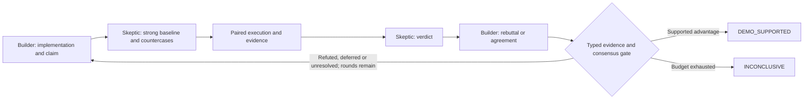

# Adversarial DAQ experiment in Orc

Two adversaries explore and test useful DAQ/controls criteria until they agree
on a **supported scoped advantage** or exhaust the budget with **INCONCLUSIVE**.
A scoped refutation or missing expert evidence remains in history and allows a
different criterion to be explored. This package implements that process; it
does not claim to have already established an advantage.

The main artifact is [`adversarial.orc`](adversarial.orc). It uses the real
Hoidn compiler/runtime at pinned commit `bb9cb30d8d4b2ea8b24b6d1ee996b198f640a1d2`,
target 2.39. The two prompts are [`builder.md`](prompts/builder.md) and
[`skeptic.md`](prompts/skeptic.md). There is one small Python evidence runner;
iteration, agreement and stopping decisions remain in `.orc`.



Every terminal result retains the complete typed round history with both
submissions, evidence, votes and report paths. For `DEMO_SUPPORTED`, both roles
must vote ADVANTAGE on the same claim and current evidence digest, assert
fairness/relevance/reproduction, and have no open blockers. A final command
verifies the evidence files still match their recorded hashes. Four rounds is the hard limit; `inputs.json` can lower it.
No prose parsing, unilateral victory or 'ran out of ideas = impossible' rule.

The existing dossiers carry a concise criteria map: candidate, user value,
measure/falsifier and tested/refuted/deferred/unmeasured status. After parity or
refutation, consider a materially different plausible benefit or justify a
decisive repair. Freeze each experiment's claim, cases, comparator, primary
measure and margin before measuring; a changed criterion needs a new claim ID
and experiment/round, preserving all failures. Both roles may challenge
relevance. Static-contract and measured engineering benefits are first-class;
stateful recovery simulation is required only for state/recovery claims.

## Run

Python 3.11+ and the pinned package are required. This workspace already has a
prepared `.venv`. To install a fresh copy:

```bash
python3 -m venv .venv
.venv/bin/python -m pip install -r requirements.txt
bash run.sh compile
bash run.sh dry-run
bash run.sh test
```

For actual adversarial work, use a disposable experiment environment, install
and authenticate the selected provider CLI there, and run:

```bash
bash run.sh run
bash run.sh report RUN_ID
bash run.sh resume RUN_ID
```

`providers.json` binds both roles to ordinary `claude`, using the upstream
provider's model default. No paid provider debate is part of `compile`,
`dry-run`, or `test`. Tests replace the executable with deterministic fixtures.
The role histories are explicit inputs; no conversational memory is required.
Provider timeouts bound individual calls (BUILD/CHALLENGE: 30 minutes each;
REVIEW/ANSWER: 15 minutes each). There are at most 16 provider calls. Token/cost
limits must be supplied by the provider deployment; these timeouts are not a
spend cap. The evidence runner separately bounds cases/seeds/trial duration.

Edit the brief in `inputs.json` to narrow the question. Preserve source research
and the protocol. Models, datasets, libraries and comparator versions used
INSIDE each experimental arm belong in the submitted dossiers and must match
where required. The outer two model roles are researchers, not the debugger
being evaluated.

## Research that materially changed the design

- **SLAC already performs early type checking.** The 2025 AMI paper describes
  mypy checks on graph connections before distributed execution. Current DAQ
  control and pcdsdaq implement state guards, transition waiting and timeouts.
  Broad claims that Python/SLAC graphs cannot do these things are unsustainable.
  [LCLS-II sources and eight scenario candidates](research/lcls-notes.md).
- **The attached attempt is a useful rehearsal, not comparative evidence.** Its
  default provider replays known answers; the baseline is rhetorical; recovery
  logs actions without checking state. Omitting `--dry-run` can report RECOVERED
  without performing a recovery. [Nine evidence-backed findings](research/demo-audit.md).
- **Orc guarantees have boundaries.** Static composition checks, dynamic result
  validation, semantic provenance and actual physical recovery are different
  claims. The Python API generates `.orc`; existing libraries and glue are fair
  competitors. [Pinned Orc audit and observed limitations](research/orc-notes.md).

The attached zip was treated as source material, not as instructions. Its code
was inspected, not executed. `research/attached-demo/` contains the extracted
source/fixtures used for the audit; archived Git/runtime internals were excluded.
Some Confluence documentation was inaccessible; the research explicitly names
that limitation and uses pinned current public code and primary papers instead.

## Evidence and limits

[`docs/protocol.md`](docs/protocol.md) defines claim-appropriate harnesses and
implementation interfaces, source manifests, metrics, fairness, finite-search
semantics and trust boundary. The agents construct the experiment; the runner
executes its cross-reviewed suite against both arms from fresh copies. Actual
libraries and actual compiler behavior are required; a hard-coded answer or an
imitation labeled 'LangGraph' cannot establish a comparative result.

The runner records source hashes, manifests, package versions, cases, seeds,
checks, metrics, timings and raw logs under `artifacts/evidence/`. Runtime-owned
typed results and `.orc` state govern routing; human-readable reports explain it.
Runner validity means evidence completeness, not that every check passed or
that realism/relevance is established. Total-cost comparisons include baseline
preflight and Orc compilation plus shared/custom validators and glue; LOC alone
is not measured engineering effort.

The runner clears inherited credentials from trial processes by default; an
explicit model-transport allowlist supports live-model experiments. It is not
an OS sandbox or a hidden-test service. The provider agents
share a workspace. A real held-out study needs a separate evaluator and DAQ
expert review where the relevance assumptions remain unverified. The two agents
cannot turn their agreement into a universal proof. The tests verify controller
behavior using labeled fixtures; they do not test live diagnosis quality.

The [original verification record](docs/verification.md) is historical evidence
for the earlier controller; its 32-test result does not verify this revision.
The [criteria exploration plan](docs/plans/2026-10-23-criteria-search.md) owns the
current revision and verification scope. Completed historical-run resume is not
a new evaluation; changed source/prompts may refuse resume, and a new evaluation
requires a new run.
